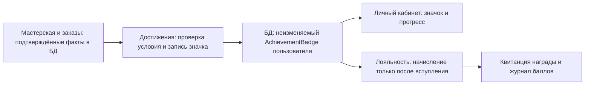

# Независимые достижения

Достижения доступны всем активным зарегистрированным пользователям. Участие в
клубе, состояние его истории и кошелька не являются условиями выдачи значка.
`GET /achievements/me` читает значки и прогресс текущего пользователя, не запускает
обработчики и не создаёт членство. Клиент использует отдельный user-scoped cache.

Как читать: значок и бонусы — два отдельных результата. Лояльность читает уже
сохранённый значок; не вызывает обработчик достижений и не перепроверяет его
условие через сервисы заказов или мастерской.

## Выдача и сохранение

- `AchievementBadgeService` и worker обрабатывают пользователей независимо от клуба.
- `achievement_qualification` проверяет активную ревизию условия по опубликованным
  фактам. Для работ нужна одобренная публичная публикация, не просто загрузка.
- `AchievementBadge` уникален по `(userId, definitionId)`. Сохраняются версия,
  доказательство выполнения, дата и сумма будущей клубной награды.
- Повторы защищены ограничениями БД, транзакцией и advisory claim. Ошибки
  повторяются автоматически с backoff; ручное присвоение не требуется.
- Полученный значок сохраняется после скрытия работы, возврата заказа,
  изменения правил или архивирования определения. Будущие достижения за покупки
  проверяются по актуальной пригодности завершённых заказов.

## Бонусы — ответственность лояльности

До вступления нет награды в кошельке. После вступления лояльность обрабатывает в
том числе прежние значки и начисляет их замороженную сумму один раз. Изменение
суммы в админке не доплачивает старые значки. Нулевая награда создаёт квитанцию
обработки без фиктивной операции кошелька.

`LoyaltyAchievementAward.badgeId` обязательно ссылается на значок и уникально;
квитанция и положительный CREDIT атомарны. Финализатор истории ждёт недостающие
значки по достигнутым условиям и квитанции всех полученных значков, включая
архивированные определения. UI «Награда в клубе» обозначает условие награды,
а не подтверждение, что баллы уже зачислены.

## Миграция

`20260922100000_independent_achievements` переносит существующие награды в значки
с сохранением владельца, ревизии, доказательства и даты. Старые квитанции
связываются со значками без новых операций и изменения балансов. Миграция
транзакционная; при rollout старые writers должны быть остановлены до её применения.
Существующая админская конфигурация `/loyalty/admin/achievements` пока остаётся
общим реестром; её путь не определяет право пользователя на получение значка.
