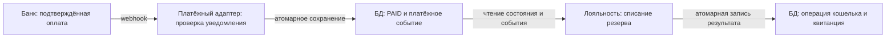
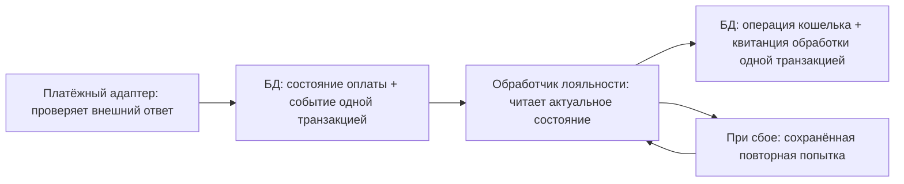
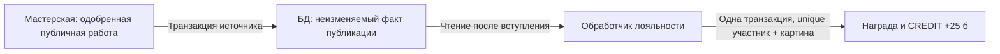

# Основа программы лояльности

Модуль реализует участие, кошелёк, журнал, покупательские начисления, награды за публичные одобренные картины и уже полученные достижения, автоматическое восстановление истории. Сами значки принадлежат независимому [домену достижений](../achievements/README.md) и доступны без клуба. Backend checkout поддерживает расчёт и резервирование существующих бонусов. Списание и освобождение резерва выполняет отдельный потребитель подтверждённых платёжных состояний из БД, без зависимости от банка. Кабинет `/account/club` показывает участие, баланс, ставку и операции; значки находятся отдельно в `/account/achievements`. В checkout подключён пользовательский выбор списания: серверные лимит/цена, points и pricingRevision подтверждённого расчёта в create payload; frontend не рассчитывает распределение скидок и не списывает баланс самостоятельно. Preview ожидаемого начисления передаётся сервером в `loyalty.expectedEarnedPoints` и показывается как `+N б` только в актуальном расчёте без списания. Новые участники остаются PENDING до завершения общего восстановления; готовность интерфейсов не означает готовность всей программы к production.

### Ожидаемое начисление в checkout

`OrdersLoyaltyService.preview` читает опубликованную сумму завершённых оплаченных покупок с учётом возвратов через `readPublishedPurchaseSpend`. Общие чистые правила `purchaseRateForSpend` и `purchasePointsForAmount` рассчитывают целые баллы с округлением вверх от стоимости товаров после промокода, без доставки. Текущая корзина не повышает собственную ставку. Для гостя, неучастника, неготового/заблокированного участника или ненулевого списания возвращается 0; нулевой баланс сам по себе не препятствует начислению.

Это read-only прогноз, не операция кошелька и не фиксация ставки. При создании заказа ставка фиксируется существующим механизмом по актуальным данным; фактическое начисление остаётся за обработчиком оплаченного завершённого заказа. Изменение истории между preview и созданием может изменить ставку. Frontend не копирует формулу и скрывает награду во время пересчёта/ошибки или при списании, без текста об отсутствии начисления.

## Источник оплаты и направление данных

Источник истины о факте оплаты — банк/эквайер. Webhook является штатным способом доставки этого факта; подлинность и соответствие заказу проверяет только платёжный адаптер. После сохранения подтверждённой оплаты дальнейшие сервисы берут сведения из БД, не обращаются к банку и не требуют ручного подтверждения.



Как читать: движение факта оплаты однонаправленное. Лояльность проверяет сохранённые данные заказа и собственный резерв, затем записывает только свой результат. Сбой лояльности не отменяет PAID; повтор события не списывает баллы второй раз. Автоматическая сверка потерянного уведомления выполняется платёжным адаптером и сохраняет факт тем же путём — не вызывает лояльность напрямую.

Неоплаченный заказ не создаёт окончательного списания. До результата оплаты существует только резерв; он освобождается по подтверждённому окончательному закрытию без оплаты. Начисление **новых** бонусов за покупку — отдельный механизм после оплаты и завершения заказа, не действие банковского webhook.

## API участия

- `GET /loyalty/me` — состояние участия и баланс; ничего не создаёт.
- `GET /loyalty/me/dashboard` — read-only ставка из согласованного снимка `RepeatableRead`. До вступления: `{ tier: null }`. Значки и прогресс читает отдельный `GET /achievements/me`, без зависимости от членства. Чтение не вызывает начисления и обработчики истории.
- `POST /loyalty/enroll` — явное вступление: `acceptedTerms: true`, актуальная `termsVersion` из overview. Версия `loyalty-v1` обозначает контракт согласия; перед выпуском нужен утверждённый текст условий и его отображение в интерфейсе.
- `GET /loyalty/me/operations?cursor=...&limit=20` — собственная история по убыванию sequence. Cursor — исключающая верхняя граница, лимит 1–100. Человекочитаемый `title` определяется видом операции и структурной связью с наградой/покупкой; внутренние ключи операций не раскрываются.

Dashboard использует тот же read-only `orders/published-purchase-spend` и пороги `purchaseTiers`, что и checkout: оплаченные завершённые товары без доставки, с учётом возвратов. Черновики ачивок не публикуются: до получения показывается активная ревизия, после получения — неизменяемая награждённая ревизия, включая архивные определения. Одна карточка на определение, прогресс полученной ачивки остаётся полным. Незаработанный прогресс ограничен целью и считается по опубликованным фактам тех же четырёх условий, что обрабатывает начисление.

Все endpoints защищены AuthGuard, ответы `private, no-store`. Владелец берётся только из проверенной сессии; body не принимает userId/memberId/баллы. CSRF проверяется существующим middleware приложения.

Участник и нулевой кошелёк создаются атомарно. Повторное вступление сохраняет joinedAt, согласие и баланс. Новый участник имеет historyState=PENDING: списание недоступно до завершения первоначальной обработки истории. `LoyaltyHistoryFinalizationWorker` автоматически переводит его в READY после проверки результатов доменных обработчиков. Публичного способа выставить READY и ручного подтверждения нет.

## Транзакционные команды

`LoyaltyWalletService` принимает **транзакцию вызывающего домена**, а не открывает свою. Любая ошибка команды или deferred-проверки БД должна откатить всю транзакцию. Не перехватывать ошибку и не продолжать commit частично выполненной команды.

- credit — начисляет целые баллы.
- reverse — уменьшает баланс не ниже нуля, сохраняет запрошенную и фактически удержанную сумму, включая нулевую корректировку.
- reserve — увеличивает резерв, не уменьшает полный баланс.
- consume — уменьшает баланс и резерв.
- release — уменьшает только резерв.
- restore — восстанавливает потраченные баллы по зарегистрированному возврату, не создаёт новую награду.

Доступно `balancePoints - reservedPoints`. Числа в БД — BigInt с ограничением safe integer; HTTP DTO содержат проверенные числа, не BigInt. Срока сгорания нет.

Создание заказа резервирует прежние баллы. Подтверждённая оплата сохраняется вместе с событием `PAID`, после чего потребитель лояльности списывает резерв в собственной транзакции. До обработки события баллы остаются зарезервированными и недоступны для другого заказа. Сбой лояльности не откатывает факт оплаты. Ручная отмена доступна только администратору; сама смена CRM-статуса не освобождает резерв — требуется подтверждённое внутреннее состояние `CLOSED_UNPAID`. Неопределённый результат, ошибка запроса или таймер не являются подтверждением. Освобождение резерва не начисляет новые бонусы; покупательская награда относится к отдельному этапу после оплаты и завершения заказа без списания.

Резервирование/settlement берут блокировки `Order → LoyaltyMember`; credit/reverse — `LoyaltyMember`. Перед вызовом из Orders сохранять этот порядок. Вступление блокирует существующего User для сериализации создания membership. При наличии более ранних account/promo locks соблюдать общий порядок из Orders; не добавлять обратных зависимостей.

Каждой команде нужны стабильные operationKey, sourceKey, rulesVersion и occurredAt источника. При повторе нельзя подставлять новое `new Date()`: тот же ключ с другим содержимым вызывает конфликт. operationKey уникален глобально. Повтор исходной успешной команды возвращает прежнюю запись и не меняет текущий баланс.

Источник начисления проверяет вызывающий домен. Эти команды нельзя публиковать как пользовательские HTTP mutations. Сейчас FK заказа есть у reservation; дальнейшие order-accounting/reward модели должны добавить структурированные связи оснований начисления, а не заменить их произвольным JSON.

## Расчёт списания

`orders/pricing/apply-loyalty-points.ts` — чистый расчёт поверх общего снимка цены. `OrdersLoyaltyService` связывает его с checkout и кошельком. `getMaxLoyaltyPoints` определяет ёмкость товаров, `applyLoyaltyPoints` применяет указанное целое количество баллов: 1 б = 20 копеек, минимум 100 копеек за каждую штуку, доставка неизменна. Превышение ёмкости отклоняется, а не обрезается молча.

`POST /orders/checkout/calculate` принимает `loyaltyPointsToSpend` (целое >=0, по умолчанию 0) и возвращает итоговые суммы плюс `loyalty`: доступные баллы, лимит списания, выбранную сумму, скидку в копейках и `pricingRevision`. `POST /orders` при ненулевом списании требует тот же `loyaltyPricingRevision`. Сумма/ревизия включены в fingerprint попытки; изменение цены требует нового расчёта. Ревизия не заменяет серверную проверку цены, авторизации, ACTIVE/READY membership и доступного баланса под блокировкой. Guest email-linked user не авторизует списание.

Транзакционное создание соблюдает порядок user/account/promo → order → member. Платёжный переход больше не берёт блокировку кошелька; потребитель лояльности использует order → member. Повтор существующего checkout возвращается до повторного резерва. Чек проверяется по итоговым группам после бонусов, включая ограничения соответствующего платёжного адаптера.

### Внутренний контракт оплаты и доставка событий

Платёжный источник публикует `Order.paymentStatus`, `paidAt`, `paymentClosedUnpaidAt` и неизменяемые `OrderPaymentEvent`. `PENDING` и `FAILED` не разрешают освобождение резерва. `CLOSED_UNPAID` означает подтверждённое окончательное закрытие без оплаты; `PAID` означает подтверждённую оплату. Источник отвечает за проверку внешних данных и допустимость публикации. Потребитель не анализирует `paymentMethod`, банковские идентификаторы, raw webhook или `terminalPaymentFailedAt`.



Событие сообщает об изменении, но решение принимается по актуальному состоянию БД под блокировкой заказа. Повторная доставка не повторяет финансовый эффект. Сбой потребителя оставляет платёжный факт и событие сохранёнными.

`LoyaltyPaymentSettlementService` владеет `LoyaltyPaymentReceipt`: результатом обработки, количеством попыток и временем следующей попытки. Фоновый обработчик выбирает необработанные события из БД; доставка не зависит от callback в памяти процесса. Параллельные обработчики сериализуются по заказу, после блокировки повторно проверяют квитанцию. Операция кошелька и успешная квитанция сохраняются вместе. Ошибка откатывает только транзакцию потребителя; отдельная запись назначает повтор с задержкой. После перезапуска необработанное событие остаётся доступным.

Устаревшее событие закрытия при актуальном `PAID` не освобождает резерв: обработчик следует подтверждённой оплате и использует стабильный ключ списания. Если резерв уже был освобождён до противоречивого позднего `PAID`, факт оплаты всё равно сохраняется; ошибка списания остаётся в квитанции для повторной обработки/разбирательства. Автоматическая компенсация, повторное расходование нового баланса и долг не разрешены.

### Границы текущего среза

Интеграционная оркестрация оплаты пока находится в `OrdersService`/`OrdersStorage`. Т-Банк после проверки закрытия публикует `CLOSED_UNPAID` независимо от наличия бонусного резерва; лояльность не участвует в этой проверке. Ozon и Т-Банк публикуют одинаковое событие подтверждённой оплаты. Для Ozon автоматическая публикация закрытия **ещё не подключена**: доступный контракт не доказывает окончательное закрытие всех попыток для `STATUS_CANCELED`/`STATUS_EXPIRED`. Это ограничение адаптера, а не отдельная ветка бонусной логики. Не выводить окончательную отмену из имени внешнего статуса.

Резервирование при checkout пока остаётся синхронным координатором, а существующие промокодные и партнёрские обработчики оплаты — в транзакции Orders. Этот срез отделяет платёжный settlement лояльности; перевод остальных междоменных вызовов на команды/события БД — отдельная работа. Он не означает, что весь backend уже разделён на независимые микросервисы.

Для любого заказа запрещён повторный Init после начала первой попытки, включая сетевую ошибку и истечение локального lease: сверяется только исходная попытка. Иначе ранее запущенный повторный Init мог бы создать новую оплату уже после проверки закрытия. Политика не зависит от наличия бонусов или банка. При rollout остановить старые обработчики оплаты и дождаться завершения их запросов; не запускать старую и новую логику Init одновременно. Проверка окончательного закрытия Ozon и ручное разрешение противоречивых платёжных фактов остаются ограничениями до публичного запуска. CRM-отмена сама по себе не отменяет эквайринг.

## Восстановление неопределённой оплаты

`OrderPaymentRecovery` создаётся атомарно с захватом единственного Init, **до** внешнего запроса. Ошибка сети или остановка процесса не теряет задание. Первая проверка назначается через 60 секунд по времени БД. `PaymentRecoveryWorker` выбирает задания пакетами до пяти, без HTTP под транзакционной блокировкой. Одно задание на заказ, lease 120 секунд, уникальный токен и проверка времени БД после блокировки защищают от параллельного завершения устаревшим обработчиком. Незавершённые проверки повторяются с ограниченным backoff, максимум 12 попыток за цикл; затем — `attention`, без освобождения резервов по таймеру.

`OrdersService.reconcilePayment` обращается только к статусу первоначальной оплаты. Для Т-Банка адаптер читает CheckOrder, однозначно устанавливает PaymentId и проверяет GetState. Для Ozon существующий getOrderStatus умеет поиск по исходному merchant extId, поэтому потерянный acquiringOrderId не требует нового createOrder. Неполные ответы, несовпадение суммы/валюты/идентификаторов и неоднозначные попытки не публикуют успешную оплату или закрытие. `STATUS_CANCELED`/`STATUS_EXPIRED` Ozon дают `attention/closure_unconfirmed`, а не `CLOSED_UNPAID`.

Проверенный результат сохраняется через отдельный `OrdersStorage.applyPaymentReconciliation`, а не поддельный webhook. Под блокировкой заказа повторно сверяются источник, сумма, способ оплаты и неизменяемые provider IDs. Оплата проходит через общий paid-переход с прежними эффектами промокодов, affiliate, корзины, истории и аналитики; платёжное событие публикуется в той же транзакции. При доказанном закрытии освобождается резерв промокода и публикуется CLOSED_UNPAID. Само списание/освобождение бонусов по-прежнему делает независимый потребитель событий из БД. Поздний pending/closed ответ не понижает уже сохранённый PAID. Необработанное противоречие PAID после RELEASED не прощается автоматически.

Восстановление оплаты полностью фоновое. Ручных HTTP-команд проверки/повтора и отдельного блока управления в админке нет. Очередь хранит внутреннюю диагностику и ограничивает число автоматических запросов; исчерпание попыток или неоднозначный ответ не меняют факт оплаты и не освобождают бонусы. Поздний валидный webhook по-прежнему обрабатывается обычным платёжным путём независимо от состояния этой очереди. Сырые ответы и секреты банка не становятся контрактом лояльности.

`20260920170000_order_payment_recovery` переносит начатые неопределённые оплаты и прежние Ozon-задания в общую очередь, затем удаляет старую таблицу. Старый Ozon worker, helpers и тесты его заменённого поведения удалены; исторические миграции не редактируются. Миграция не начинает оплату для нетронутых заказов. Rollout требует остановить старые payment/recheck workers, применить миграцию, затем запустить новые; dev/prod автоматически не обновляются.

**Ограничение выкладки:** текущий `.github/workflows/deploy.yml` запускает `api-migrate` до остановки прежнего API. Такой порядок не обеспечивает необходимую паузу записи для этой миграции: старый Init/recheck может создать задание после backfill либо обратиться к уже удалённой таблице. Перед production rollout требуется отдельное исправление порядка deploy (остановка/дренирование старых writers до миграции, затем запуск нового API). Обычный автоматический deploy этой ветки без такого шага не безопасен; в данном срезе workflow не изменялся.

Распределение пропорционально доступной ёмкости групп, остатки детерминированы по product ID и исходному индексу группы. Внутри группы разница списания между штуками — не более одного балла. Сохраняются исходные цены и промоскидки; результат проходит строгую проверку снимка. Повторное применение к снимку с бонусной скидкой запрещено.

Для ненулевого списания и вычисления лимита требуется исходная цена каждой штуки не ниже рубля. Если после промокода хотя бы одна штука дешевле рубля, дополнительное списание бонусов запрещено; сам промокод и его скидка не меняются. Нулевое списание сохраняет исторические цены. Этот расчёт сам по себе не разрешает использовать бонусы и не проверяет баланс или членство.

## Возврат потраченных баллов

`OrderRefundsService` регистрирует **уже выполненный** возврат: администратор передаёт `confirmed: true`, номер внешней операции и возвращённые товары. Этот сценарий не выполняет банковский возврат и не заменяет его проверку. Подтверждённая запись — внутренний факт для лояльности; платёжные провайдеры потребителю неизвестны.

`orders/refunds/refund-accounting.ts` рассчитывает денежную сумму и баллы по одним и тем же единицам `priceGroups`. Для каждой строки возврата сохраняются `previousQuantity`, `quantity`, `amountKopecks`, `loyaltyPoints`; родительский `OrderRefund.loyaltyPoints` равен сумме по строкам. Предыдущие количества вычисляются под блокировкой заказа. Сохранённые диапазоны делают результат независимым от порядка обработки событий.

Возврат, его строки и `OrderRefundEvent` сохраняются одной транзакцией. Повтор исходного requestId не создаёт второй возврат или событие; изменённый payload под тем же ключом отклоняется. Событие неизменяемо и ссылается на запись возврата и её исходное время. Уже опубликованный возврат нельзя дополнять новыми строками.

`LoyaltyRefundSettlementService` читает сохранённый факт и сверяет его с общим снимком цены заказа: принадлежность товаров, диапазоны количества, деньги, баллы, доставку и итоги. Затем вызывает собственный кошелёк через `restoreRefundInTransaction(tx, { refundId })`. Метод не принимает сумму от клиента: она берётся из БД. Операция `RESTORE` связана FK с возвратом и исходным `CONSUMED`-резервом; ключ `refund:<id>:restore`, дата и сумма стабильны. Сумма всех восстановлений не превышает первоначальное списание. Возврат разрешён заблокированному участнику, но не даёт ему нового разрешения на расходование.

Операция кошелька и успешная `LoyaltyRefundReceipt` атомарны. Если обработка списания по `PAID` ещё не завершена, возврат остаётся на повторе: потребитель не списывает резерв самостоятельно и не вызывает платёжный сервис. Фоновый обработчик повторяет незавершённые события с задержкой, включая события после перезапуска. Сбой потребителя не отменяет зарегистрированный возврат. При нулевых возвращаемых баллах (в том числе при возврате только доставки) событие завершается без операции кошелька.

HTTP DTO возврата по-прежнему описывает денежные суммы: они не включают бонусы. История кошелька поддерживает отдельный тип `restore`. Отмена ранее **начисленных за покупку** бонусов выполняется отдельным покупательским обработчиком ниже; RESTORE возвращает только ранее потраченные баллы.

## Начисления за покупки

Подтверждённая сетка: 3% до 3 000 ₽ полученных покупок, 5% от 3 000 ₽, 7% от 7 000 ₽, 10% от 12 000 ₽. Checkout читает опубликованные данные заказов/возвратов и фиксирует `loyaltyRatePercent` + `loyaltyRateVersion=purchase-v1` вместе с первым `pricingSnapshot`. Повтор checkout не меняет ставку. Порог считается по оплаченным завершённым заказам владельца `Order.userId`: денежная стоимость товаров после скидок, без доставки и возвратов. Денежная доплата при списании бонусов входит в прогресс; текущий заказ — нет. Возврат может снизить ставку следующих заказов, но не меняет обещанную ставку уже оформленных. История учитывается за всё время, без сопоставления владельцев по email.

`LoyaltyPurchaseSettlementService` автоматически читает БД; платёжные адаптеры и доставка не вызывают его. Первое начисление требует одновременно PAID + paidAt и COMPLETED + completedAt, активного пользователя и участника с historyState=READY. Дата основания — более поздняя из paidAt/completedAt. Любое списание бонусов в снимке заказа исключает покупательскую награду; это не правило для независимых ачивок.

Формула: `ceil(копейки за товары × сохранённый процент × 5 / 10000)`. Расчёт целочисленный, округляется итог. 799 ₽ при 5% → 200 б. Возвраты до первой обработки сразу уменьшают базу, включая полный возврат с нулевой наградой. Последующие частичные возвраты пересчитывают остаточную награду от оставшейся стоимости, а не округляют каждый возврат отдельно. Доставка не влияет на награду.

`LoyaltyPurchaseAccount` хранит исходное начисление, учтённые возвраты и запрошенные отмены. CREDIT/REVERSAL связаны с ним через `purchaseOrderId`; команды кошелька читают источник из БД. Учёт покупки и операция кошелька записываются одной транзакцией под блокировками Order → Member. Повторная и параллельная обработка не дают повторных баллов. Отмена начисления допускается и после блокировки участника или изменения CRM-статуса.

При отмене снимается только свободный остаток: `min(отмена, balancePoints - reservedPoints)`. Резерв другого заказа и его расчёт не меняются. Полная запрошенная отмена фиксируется даже при фактическом списании 0; долга и удержаний из будущих начислений нет. Автоматический worker повторяет сбои с задержкой через `LoyaltyPurchaseSync`, без ручных кнопок и без отката источника оплаты/возврата.

Миграция `20260920180000_loyalty_purchase_rewards` добавляет снимок ставки, учёт покупок и ограничения источников/журнала. Она не назначает ставки старым заказам, не создаёт участников и не переводит PENDING в READY. Первое начисление для заказа без сохранённой ставки делает исторический обработчик ниже. После этого общий consumer использует неизменяемую ставку account для последующих возвратов. Исторические денежные покупки также участвуют в определении ставки новых заказов.

## Историческое восстановление покупок

`LoyaltyHistoryPreviewService.previewMember(memberId)` — внутренний read-only расчёт покупательской истории в согласованном `RepeatableRead` снимке. Не создаёт участников, не меняет баланс, ставки заказов или historyState, не публикуется как ручная кнопка/API. `previewMemberInTransaction` позволяет историческому обработчику читать те же источники в своей транзакции, без применения устаревшего отчёта.

Для старых заказов пользователь подтвердил рост ставки 3/5/7/10% по покупкам, оплаченным и завершённым **до оформления** очередного заказа. В прогресс входит денежная стоимость товаров с учётом возвратов, зарегистрированных до этого момента. Поздние возвраты не меняют историческую ставку, но уменьшают текущую награду. События с точно той же датой не считаются предшествующими. Сохранённая checkout-ставка приоритетнее восстановленной.

Источник владельца — только текущая связь `Order.userId`, без нового сопоставления email. `completedAt` хранит первое завершение; последующие выходы/возвраты в этот CRM-статус учитываются по `OrderHistory.status_changed`. Используются сохранённые даты обработки: отдельное реальное время доставки/возврата источник может не содержать. Противоречивая или неполная цепочка статусов отмечается как проблема данных, а не исправляется догадкой.

Отчёт имеет scope=purchases. `proposedCreditPoints` — предлагаемое дополнительное начисление, не баланс пользователя. Уже учтённые purchase accounts дают 0 новых баллов. Существующие операции без структурированной purchase-связи, повреждённые цены/возвраты/даты или неоднозначная история делают complete=false и итоговую сумму null. Промежуточные строки не являются разрешением на выплату. Картины и ачивки не объявляются восстановленными этим расчётом; PENDING сохраняется.

`LoyaltyPurchaseHistoryService` и его worker находят уже вступивших активных участников в БД. За один проход история одного участника проверяется и записывается атомарно в `Serializable` транзакции. Первый запрос берёт неблокирующий transaction advisory lock участника: другой экземпляр API пропускает занятый пересчёт. Затем блокировки идут User → все связанные Orders по id → Member. Неполный отчёт или любая ошибка откатывает весь проход. Сериализационные конфликты также повторяются автоматически с новым снимком; нет частичных наград и ручных подтверждений. Отложенная запись ошибки не перезаписывает более новый успешный checkpoint. Таймаут транзакции 30 секунд, обработка по участникам последовательная. Для очень больших историй дальнейшее разбиение потребует отдельного согласованного manifest, а не частичного commit текущего цикла.

Обработчик вызывает общий `processOrderInTransaction`, который создаёт source-bound purchase account/CREDIT, а не generic credit с суммой отчёта. Ключи совпадают с live-потоком. Для старых заказов `historicalVersion=purchase-history-v1` и `historicalSpendKopecks` сохраняют основание восстановленной ставки в account; исходный checkout-снимок и NULL-ставка заказа неизменны. SQL сверяет историческую денежную базу с опубликованными источниками. Уже записанные ставки не пересчитываются при повторном запуске.

`LoyaltyPurchaseHistorySync.activeTransactionId` действует только внутри текущей транзакции восстановления и разрешает покупательский credit активному PENDING участнику. Он не включает reserve/spending и очищается перед commit. Успешный проход сохраняет completedAt **покупательской** истории, но не меняет общий historyState. Ошибка сохраняет только техническое состояние повтора, без банковских/персональных данных. Worker повторяется каждые 15 секунд; после успешного прохода повтор нужен при появлении ещё не учтённых PAID+COMPLETED покупок, в том числе поздней оплаты/доставки или поздно привязанного заказа. Возвраты по уже учтённым покупкам обрабатывает общий purchase consumer.

`20260920190000_loyalty_purchase_history` расширяет основания purchase-account и создаёт внутреннее состояние обработки. Не редактирует старые миграции, не начисляет баллы самим SQL backfill и не создаёт участия. Дев/прод автоматически не обновляются. До общего запуска по-прежнему нужны история картин/ачивок и финализация PENDING, а также исправление описанного выше порядка rollout.

## Награды за публичные работы

Подтверждённое правило: **25 б один раз на участника и цифровую картину** после одобрения и публичной публикации работы. Приватная загрузка и одно одобрение без публичности недостаточны. Новая попытка, ревизия, удаление и повторная загрузка не сбрасывают одноразовость. После скрытия/удаления уже полученная награда сохраняется. Заказы, оплата, промокоды и списание баллов на эту награду не влияют.

`WorkshopPublicationFact` — постоянный факт мастерской, а не команда кошельку. Миграция `20260920200000_loyalty_work_rewards` фиксирует только работы, публично доступные на момент её выполнения. Deferred-триггеры мастерской, работ, ревизий, владельцев и связанных цифровых картин/тематик/товаров сохраняют новые факты по окончательному состоянию транзакции. Предикат SQL соответствует `workshops/workshop-eligibility.ts`; изменение одного контракта требует синхронизации второго и тестов. Перед проверкой блокируется конкретная работа, затем читается свежий снимок; это покрывает параллельное изменение разных условий публичности. `qualifiedAt` — время транзакции, зафиксировавшей доказанную публикацию, не выдуманная дата старой загрузки.

Факт создаётся независимо от участия в программе и не исчезает при изменении видимости. `capturedTransactionId` отличает новый факт от ранее подтверждённого: даже после `SET CONSTRAINTS ALL IMMEDIATE` последующее скрытие в той же транзакции не позволяет сохранить промежуточную публикацию. Факты предыдущих транзакций при скрытии не перепроверяются и не отменяются. При последующем явном вступлении доказанные публикации учитываются тем же обработчиком. Старые скрытые работы без сохранённого факта публичности автоматически не награждаются: `APPROVED` не доказывает, что работа когда-либо была видна всем. Повторная публичная публикация создаст основание без отдельного ручного решения.



Как читать: мастерская публикует только свой факт. Потребитель лояльности читает БД и записывает свою награду вместе с операцией кошелька. Ошибка начисления не отменяет публикацию и повторяется автоматически.

`LoyaltyWorkRewardService` обрабатывает до 50 новых картин участника за проход, без курсора, который мог бы пропустить поздний commit. `Serializable`, неблокирующий advisory claim и порядок User → Member защищают одновременные проходы; UNIQUE(memberId, coloringId) и source-bound `creditWorkInTransaction` исключают повторное начисление. `LoyaltyWorkReward` и ровно один CREDIT на 25 б записываются атомарно. Ключ операции и источника — `coloring:{memberId}:{coloringId}`, версия `work-v1`, структурированная связь `workRewardId`.

Worker проверяет БД каждые 15 секунд. `LoyaltyWorkRewardSync` содержит только автоматический backoff; поздняя ошибка не перезаписывает более новый успешный проход. Участник и пользователь должны быть активны; разрешены PENDING и READY, но восстановление работ **само не переводит** общую историю в READY и не включает списание. Общую готовность проверяет отдельный финализатор ниже. Новых ручных кнопок, HTTP controls и зависимостей от банков нет.

## Реестр и автоматическая выдача ачивок

Админка `/loyalty/achievements` позволяет создавать, редактировать и архивировать определения ачивок: название, описание, изображение с компьютера, условие, целевое количество, награду в целых баллах и порядок. Активируются все четыре условия: `published_coloring_count` (разные картины с подтверждённой публичной работой), `distinct_collection_count` (разные тематики таких картин), `completed_collection_count` (полностью завершённые альбомы) и `completed_order_count` (оплаченные завершённые заказы с оставшимися товарами). Автоматических seed-сумм и пользовательского UI прогресса нет. Общий `historyState` не меняется.

API `/loyalty/admin/achievements` доступен только администратору: GET — список, POST — создание, PATCH `/:id` — полная новая конфигурация с `expectedVersion`, POST `/:id/activate` — активация текущей ревизии с `expectedVersion`, POST `/:id/archive` — архивирование с `expectedVersion`. Публичные числовые поля: `target`, `rewardPoints`, `sortOrder`; статус ответа — `draft`, `active` или `archived`, `activeVersion` — номер действующей ревизии либо null. Несовпадение версии даёт 409, а не перезаписывает чужое сохранение.

Миграция `20260920210000_loyalty_achievement_drafts` создаёт стабильное определение и неизменяемые ревизии. Создание и редактирование атомарны; блокировка определения сериализует конкурирующие изменения. Архивирование не удаляет историю, повторный запрос с текущей версией безопасен; редактирование и восстановление архивной записи не поддерживаются. Автор ревизии берётся из авторизованной сессии, не из входного DTO. Сервис не обращается к внешним источникам и не пишет в кошелёк.

`currentVersion` указывает на последнюю сохранённую конфигурацию, `activeVersion` — на явно активированные правила. Редактирование активной ачивки создаёт новую неизменяемую ревизию, но не меняет действующие правила до отдельной активации. Архивирование прекращает новые выдачи и сохраняет старые награды. Одна ачивка выдаётся участнику только один раз независимо от последующих ревизий; новая сумма не доплачивается прежним получателям.

`AchievementBadgeService` независимого домена достижений читает активные определения, подтверждённые публикации, составы альбомов и факты завершения заказов с актуальной eligibility. Он выдаёт значки всем активным пользователям, включая неучастников клуба. `LoyaltyAchievementAwardService` читает только сохранённые значки и начисляет их замороженные награды вступившим участникам, включая достижения до вступления. Для работ учитываются старые `WorkshopPublicationFact`; повторная загрузка той же раскраски не увеличивает счётчик. **Уже полученные ачивки и бонусные награды сохраняются после скрытия/удаления работы и возврата заказа**; это независимо от отмены покупательского начисления и базовых 25 б за картину.

### Разнообразие тематик

`distinct_collection_count` — дополнительный независимый счётчик. Пять разных картин одной тематики дают 125 базовых баллов, пять картин для `published_coloring_count` и одну тематику для `distinct_collection_count`. Порог и дополнительная награда определяются администратором; число тематик не заменяет число работ и не ограничивает базовые начисления.

Миграция `20260921210000_loyalty_collection_achievements` добавляет неизменяемый `WorkshopPublicationFact.collectionId` — снимок тематики в момент публикации. SQL helper `achievement_qualification(owner, kind, target)` (переименован при отделении домена) сначала выбирает первую публикацию каждой картины по `qualifiedAt, id`, затем группирует по coloringId или snapshot collectionId в зависимости от условия. Порог одинаково вычисляется при отборе пользователей, создании значка и SQL-проверке его основания. Перенос картины и новая попытка её загрузки не добавляют ещё одну тематику; для неё нужна другая картина. Скрытие публикации не уменьшает подтверждённый прогресс.

Для существующих фактов миграция заполняет тематику по сохранённым связям work/coloring под блокировками и останавливается при их несогласованности. Изменяемый только этой миграцией snapshot заполняется атомарно с временным отключением одного immutable-trigger, затем защита восстанавливается. Через API опубликованную картину переносить нельзя, поэтому используется этот инвариант. **Ограничение:** согласованный исторический перенос прямым SQL без аудита обнаружить невозможно; если такие правки выполнялись, перед production rollout нужна сверка соответствующих фактов. Автоматической догадки о прежней тематике нет. Рабочие базы сами не обновляются.

`LoyaltyAchievementAward` — неизменяемая квитанция обработки клубной награды, а не сам значок. После миграции `20260922100000_independent_achievements` обязательный уникальный `badgeId` ссылается на `AchievementBadge`. UNIQUE(memberId, definitionId) дополнительно исключает повторную награду. При `points > 0` квитанция и ровно один source-bound CREDIT записываются атомарно; при нуле — квитанция без фиктивной операции кошелька. Ключ — `achievement:{memberId}:{definitionId}`, версия правил операции — `achievement-v1`. SQL guard проверяет владельца и замороженные поля значка, а не текущую активную ревизию или eligibility исходного заказа. Поэтому архивирование после выдачи значка не мешает начислению после вступления. Исторические квитанции связываются со значками без изменения балансов и старых операций.

Два независимых worker выполняют обработку каждые 15 секунд: achievements выдаёт значки пользователям, loyalty начисляет награды активным участникам с PENDING/READY по ещё не обработанным значкам. Прямых вызовов между ними нет. `Serializable`, advisory claim и ограничения БД защищают повторы; пакетная обработка и backoff обеспечивают автоматические повторы ошибок. Модерация нужна только для самой публичной работы, не для ачивки. Нет ручной выдачи, финансовых подтверждений, обращений к банкам или перевода общей истории в READY этими обработчиками.

Изображения загружаются через POST `/loyalty/admin/achievements/images`, multipart поле `file`; ответ `{ url }` записывается в конфигурацию при сохранении формы. Разрешены JPEG, PNG, WebP до 5 МиБ. Admin guard выполняется до разбора файла; CSRF обрабатывается общим middleware. Сервис проверяет содержимое, ограничивает вход 24 мегапикселями и перекодирует в WebP до 1024×1024, сохраняя прозрачность и удаляя метаданные. SVG и анимация не принимаются. Файлы получают случайное имя и сохраняются без перезаписи в существующий volume `uploads/loyalty-achievements`; новые env не нужны. URL строится из существующего `API_PUBLIC_URL` (HTTP разрешён для локальной разработки миграцией `20260920211000_loyalty_achievement_images`). Файлы публичны: это изображения ачивок, не приватные документы. Замена/отвязка изображения не удаляет файл, на который может ссылаться прежняя ревизия; очистка несвязанных загрузок в этот срез не входит.

### Полностью завершённые альбомы

`completed_collection_count` считает альбомы, для каждой картины которых есть подтверждённая первая публичная работа владельца. Статус PUBLISHED сам по себе не означает полный альбом: каталог разрешает публиковать тематику с одной готовой картиной из заявленных 25.

Миграция `20260921220000_loyalty_completed_collections` добавляет принадлежащий каталогу неизменяемый `ColoringCollectionManifest` и его состав. Он фиксируется автоматически один раз, когда присутствуют ровно все номера `1..expectedColoringCount` и у каждой картины есть загруженная `ColoringRevision`. Пустые карточки без изображений и неполные наборы недостаточны. Сохраняются идентификаторы картин, номера и ревизии, подтверждающие загрузку. Ручного завершения или пересборки состава нет. Дальнейшие перестановки, архивирование или замены в каталоге не меняют этот зафиксированный набор; награда проверяет именно его.

Общий SQL qualification helper требует для каждого элемента состава первую `WorkshopPublicationFact` этой картины у владельца со snapshot той же тематики. Перенос картины и повторная загрузка не позволяют засчитать её в другом альбоме. Момент завершения — не раньше фиксации состава и последней необходимой публичной работы. Для порога из нескольких альбомов выбирается стабильное доказательство завершения порогового альбома. Award сохраняет ссылку на manifest и завершающий publication fact. SQL guard проверяет полное основание, а не только последний файл; кошелёк использует этот неизменяемый award, сверяя владельца, ревизию награды, состав и завершающий факт, без повторного пересчёта всего прогресса при replay.

Уже подтверждённый прогресс не уменьшается при скрытии работ или изменении текущего каталога. Значок выдаётся однократно на пользователя и определение ачивки. Клубная награда обрабатывается отдельно, только после вступления, с атомарным CREDIT при положительной сумме. При rollout полные существующие наборы фиксируются по текущим подтверждённым данным, со временем миграции, без выдуманной исторической даты состава. Миграция не восстанавливает отсутствующие файлы или недоказанные прежние публикации.

### Ачивки за завершённые покупки

`completed_order_count` считает разные оплаченные и завершённые заказы владельца. Один заказ с несколькими товарами даёт одну единицу прогресса. Промокод, списание баллов и отсутствие cashback за сам заказ не мешают получить ачивку. Прошлые доказанные покупки учитываются для значков без вступления в программу; начисление бонусной награды требует вступления.

До получения ачивки полностью возвращённый заказ не считается; частичный возврат оставляет его в зачёте, если осталась хотя бы одна единица товара. Основание — количества товаров и опубликованных возвратов, не сумма денег: возврат только доставки не меняет счётчик. Уже выданные значок и бонусная награда сохраняются после возврата; award и его CREDIT не отзываются и не выдаются заново.

Источник принадлежит Orders и хранится в БД: неизменяемые факт завершения и состав заказа плюс актуальная пригодность заказа для новых достижений. Лояльность не обращается к банкам, доставке или сервису заказов. При выдаче проверяется весь порог по актуальному состоянию источников; award сохраняет отдельное основание заказа вместо искусственного publication fact. Изменение источника при конкурентном возврате не допускает выдачу по устаревшему состоянию. Повторная обработка использует прежний стабильный ключ награды и не пересчитывает уже полученное достижение по новым возвратам.

Миграция `20260921230000_loyalty_completed_orders` создаёт `OrderCompletionFact`, immutable `OrderCompletionFactItem` и актуальную read-модель `OrderCompletionEligibility`. Автоматическая фиксация и обновление выполняются источником при изменениях заказов, состава и опубликованных `OrderRefundEvent`. `qualifiedAt = max(paidAt, completedAt)`, `capturedAt` отдельно сохраняет время фиксации. Для старых заказов нужны привязанный владелец, PAID, текущий CRM COMPLETED, реальные даты не раньше создания и положительные количества, совпадающие с `itemsCount`. При наличии `pricingSnapshot` он проходит существующий validator; без него используются сохранённые `OrderItem`. Недостаточные или некорректные исторические данные не создают доказательство и не подменяются догадками; отсутствие такого доказательства не откатывает подтверждённую оплату.

До выдачи блокировки идут User → Orders по id → Eligibility → Member → Definitions. Для User используется `FOR NO KEY UPDATE`: блокировка защищает статус/удаление пользователя, но совместима с FK `KEY SHARE` при возврате и первичной фиксации завершения заказа. То же правило применено в восстановлении покупательской истории; SQL guard обновлён отдельной миграцией `20260921231000_loyalty_achievement_user_lock`. Изменяемая eligibility защищает от устаревшего снимка при конкурентном возврате в Serializable-транзакции. Общий qualification helper дополнительно сверяет текущие опубликованные возвраты в той же транзакции. `publicationFactId` и `completionOrderId` — взаимоисключающие основания award, enforced CHECK/FK/guard; order award не может иметь `completionCollectionId`. Полный порог проверяет SQL guard, кошелёк сверяет неизменяемое основание и выдаёт один CREDIT. Выплаченная награда не зависит от последующей eligibility. Технические ошибки повторяются автоматически, без ручной выдачи или сверки оплаты администратором.

## Автоматическое завершение истории

`LoyaltyHistoryFinalizationService/Worker` отвечает только за готовность уже вступившего участника. Он читает результаты из БД и не вызывает изменяющие команды других обработчиков, не начисляет баллы, не подтверждает оплату и не создаёт участие. `LoyaltyHistoryPreviewService` используется только как общий read-only reader. Обрабатываются ACTIVE/PENDING участники с активным неудалённым пользователем; BLOCKED и FAILED автоматически не меняются.

Условия перехода в READY проверяются вместе:

- покупательский checkpoint успешно завершён, нет активной транзакции восстановления и ошибки;
- свежий preview полный, все положенные к учёту покупки имеют account, учтённые денежные возвраты совпадают с опубликованными возвратами;
- для каждой подтверждённой картины существует базовая награда, для каждого достигнутого активного условия — значок; каждый сохранённый значок имеет квитанцию награды, включая значки архивированных определений;
- опубликованные платёжные события по резервам этого участника обработаны, возвраты его баллов имеют обработанные квитанции;
- кошелёк существует, его остатки и revision согласованы с журналом и действующими резервами.

Пустая история допустима: отсутствие работ и активных ачивок не требует фиктивного checkpoint этих обработчиков. Новый заказ в ожидании оплаты не задерживает READY, если по нему ещё нет подтверждённой операции для обработки. Нерелевантные бонусам платёжные события других заказов не блокируют участника. Старые retry-записи за работы/ачивки не подменяют проверку реальных наград; покупательский reader не принимает недостоверные исторические данные и не придумывает начисления.

Финализатор использует advisory claim и порядок User (`FOR NO KEY UPDATE`) → Orders по id, включая заказы с резервами участника → eligibility → Member. `READ COMMITTED` выбран намеренно: после ожидания source locks reader получает свежие факты, в том числе возврат, завершившийся раньше проверки. Итоговый SQL в одном statement проверяет оставшиеся обязательства и обновляет PENDING → READY; источники начислений/журнал защищены существующими domain guards. `LoyaltyHistorySync.completedAt` записывается атомарно с переходом. Повторный READY ничего не меняет. Новая публикация, активация ачивки или заказ после этой проверки — live-событие для прежних обработчиков, а не причина возвращать участника в PENDING. Не используется high-water cursor, который мог бы потерять поздний commit.

Worker запускается при старте API и каждые 15 секунд. Миграция `20260921232000_loyalty_history_finalization` добавляет только техническую таблицу `loyalty_history_syncs`, без массовой смены состояний и без новых env. Нормальное ожидание оставшейся обработки планирует проверку через 15 секунд, с attempts=0 и без ошибки; реальные сбои используют ограниченный exponential backoff и обезличенный код ошибки. Дата следующей проверки обеспечивает продвижение очереди: один незавершённый участник не должен вытеснять следующих. Поздняя ошибка не перезаписывает более новый checkpoint. Ручных кнопок повторного запуска/разрешения списания нет.

## Защита базы

Миграция `20260920130000_loyalty_wallet` создаёт CHECK/UNIQUE/FK и immutable triggers. Deferred-проверки на commit сверяют баланс и revision с журналом, непрерывность sequence, промежуточные остатки и соответствие reservation его операциям. Изменение balance напрямую или удаление операции запрещены.

Для checkout обязательны также `20260920140000_loyalty_order_discount` и `20260920141000_finalize_order_discount`. Первая разрешает скидку без промокода только при соответствующем бонусном основании в canonical snapshot. Вторая отделяет immutable promo audit от общей скидки: её можно финализировать вместе с первым снимком, после чего snapshot, subtotal, discount, total, стоимость доставки и валюта неизменяемы. Старые миграции не редактировались.

`20260920150000_payment_settlement_events` добавляет окончательный внутренний статус, журнал платёжных событий и квитанции потребителя. Миграция создаёт события для уже сохранённых оплат с `paidAt`, но не превращает прежние `FAILED`/`terminalPaymentFailedAt` в подтверждённое закрытие. Начисления за покупки этим backfill не создаются. До запуска новой версии API необходимо применить миграцию; dev/prod автоматически не обновляются.

`20260920160000_refund_settlement_events` сохраняет точное распределение старых возвратов и публикует события для общей обработки. Backfill сверяет денежные суммы, количество, доставку и итоги с реальным снимком заказа. Для нескольких исторических возвратов одного товара с разными `loyaltyPointsPerUnit` порядок распределения не доказан только по `createdAt`; миграция останавливается с требованием сверки. Повреждённые/неоднозначные записи не исправляются догадками. Отключение старых immutable-триггеров для backfill ограничено этой транзакцией и откатывается вместе с миграцией при ошибке.

`20260920161000_loyalty_refund_restore` добавляет тип RESTORE и refund-связь в журнале. SQL-проверки контролируют исходный оплаченный заказ, владельца, размер возврата, CONSUMED-резерв, предел восстановлений и непрерывную историю баланса. Старые миграции не меняются. Rollout: остановить старые обработчики записи возвратов, применить обе миграции и запустить новую версию API/worker; старый writer не умеет публиковать обязательные события.

Корректировка сохраняет существующие резервы и списывает только свободные баллы; журнал различает запрошенную и фактическую отмену без будущего долга. Поздний consume после RELEASED по-прежнему отклоняется; решение по late-paid относится к order-accounting, не к отмене покупательских наград.

## Проверки

Обычные `yarn workspace api test` включают unit/PGlite проверки. Настоящие PostgreSQL-гонки запускаются отдельно:

```bash
LOYALTY_TEST_DATABASE_URL=postgresql://USER@127.0.0.1:PORT/artmate_loyalty_test yarn workspace api test:loyalty-postgres
```

Только изолированная **одноразовая** локальная БД с префиксом `artmate_loyalty_test`, заранее применёнными миграциями. Тест не читает runtime DATABASE_URL, не удаляет immutable данные и оставляет фикстуры в тестовой БД. После прогона остановить созданный для теста PostgreSQL.

Миграции этого модуля не создают участия существующим пользователям и не начисляют историю. Dev/prod не обновляются автоматически. Для первого снимка цены заказа rollout требует остановить создание заказов старым API на время миграции и смены версии; иначе появится заказ без pricingSnapshot.
