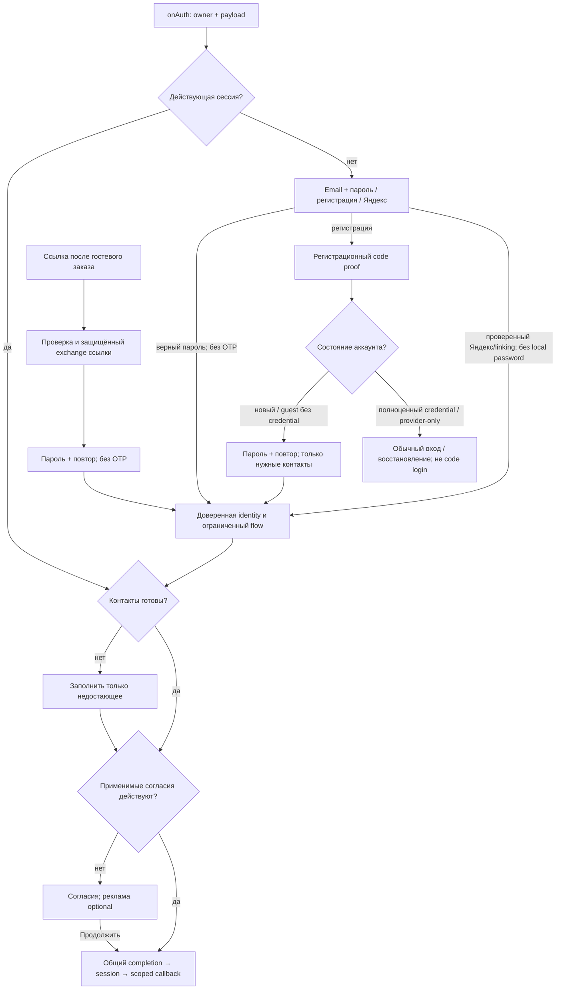
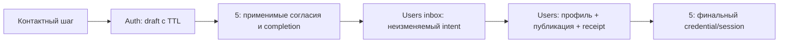
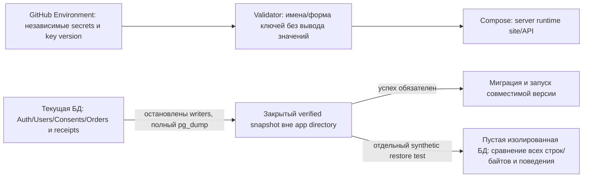
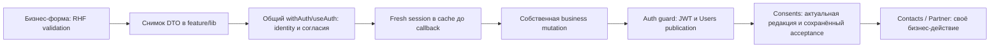

# Целевое решение: вход, контакты и согласия

Актуальные сценарии — [password-flow.md](./password-flow.md): password login без кода, email-регистрация с кодом/паролем/повтором, guest activation по ссылке без кода и с сохранением заказов, Яндекс без локального пароля. Отдельного code login нет. Статус/точка продолжения только в progress.

Редакция 20.10.2026 после интерактивных макетов. Требования — [task.md](./task.md), UI — [mockups.md](./mockups.md), API компонента — [auth-module.md](./auth-module.md), порядок — [implementation.md](./implementation.md). Открытые решения перечислены только в progress; имена новых сущностей/API ниже предлагаются для реализации.

## 1. Один pipeline для входа и завершения регистрации

Пользовательские ветки описаны в password-flow. Полноценный password account отличается от User после гостевой покупки без credential; наличие строки/email/заказа не является authentication. При valid password никаких новых кодов; регистрационный code и activation link — разные подтверждения exact email.



Как читать: link/code/password/provider устанавливают разные факты, затем сходятся в одном flow. Регистрация/активация без действующего credential требуют его draft; профиль/согласия одинаковы для всех способов. Существующий User и его заказы переиспользуются, согласия от покупки не возникают.

## 2. Состояния и граница сессии

Серверные состояния flow: `credentials_required`, `challenge_required`, `registration_required`, `activation_required`, `identity_verified`, `profile_required`, `consents_required`, `completing`, `completed`, `cancelled`, `expired`. Факты identity, контактов и согласий разделены; UI не вычисляет разрешение из местного checkbox/localStorage.

| Ситуация                                              | Следующее действие                     | Обычная сессия нового входа                  |
| ----------------------------------------------------- | -------------------------------------- | -------------------------------------------- |
| Регистрационный код отправлен, ещё не проверен        | Код                                    | Нет                                          |
| Код регистрации проверен, нет credential              | Пароль + повтор и недостающие контакты | Нет                                          |
| Контакты есть, хотя бы нужного согласия нет           | Согласия                               | Нет                                          |
| Данные и согласия уже есть                            | Автоматический server completion       | После успешного completion, без нового клика |
| Контакты только что заполнены, согласия уже действуют | Completion по «Продолжить» контактов   | После успешного completion                   |
| Показаны согласия, реклама не выбрана                 | Completion по «Продолжить», без grant  | После обязательной части                     |
| Показаны согласия, реклама выбрана                    | Completion по «Продолжить» с grant     | После подтверждённого сохранения             |
| Была сессия до вызова onAuth                          | Только недостающие gates               | Существующая сессия сохраняется при отмене   |

После valid password код не запрашивается. После activation-link proof показывается создание пароля/повтор, а не код; если контакты уже есть, шаг контактов пропускается. Для нового и guest аккаунта подготовленный credential draft не активируется до completion.

До completion pending capability не принимается AuthGuard бизнес-операций, не обновляет `UserProvider` как logged-in, не запускает redirect/onSuccess. Проверка email остаётся действительным identity fact даже при последующей отмене, но не означает принятие документа/подписку.

Если consent-state/профиль недоступны, состояние не считается готовым. Исправимые ошибки остаются в текущем flow; terminal cancel/expiry закрывает его без business callback. Изменившийся account/email/status/version перепроверяется сервером на completion.

## 3. Email challenge и защита от чужого адреса

- Site challenge используется только в email-регистрации и не раскрывает existence. После proof новый email получает регистрацию; guest без credential — активацию существующей записи; полноценному account предлагаются login/recovery, а не вход по коду или замена пароля. Нормализация совместима с текущими credentials; без догадок о точках/+suffix.
- `AuthEmailChallenge` хранит random ID, exact normalized email snapshot, HMAC кода с nonce/challenge ID, TTL, attempts/resend state и browser-flow binding. User ID может отсутствовать до создания аккаунта. Сырой код не хранится и не логируется.
- Resend/expiry/конкурентный confirm атомарны: compare-and-set по consumed/expiry/attempts и ограничению попыток. Старые коды инвалидируются; повтор не создаёт второй identity/account/grant.
- Проверенный адрес создаёт долговечный `EmailVerificationFact` с методом/временем/exact email и source ID, отдельно от чистки OTP. Существующее подтверждение из Users публикуется как RECORDED_EMAIL_VERIFICATION с исходной датой; повторное письмо не требуется.
- До нужного completion пользователь имеет только защищённый pending flow. Нового активного пользовательского входа/сессии до выполнения gates нет. Новый User создаётся/дедуплицируется владельцем Users по команде и уникальному email после подтверждения; заблокированный/удалённый account не возрождается через signup.
- Короткоживущая непрозрачная pending capability: HttpOnly/Secure/SameSite cookie в браузерной границе и доверенный server-action proxy. Не помещать secret в URL/localStorage/аналитику. CSRF, scope/purpose, expiry, одноразовость и bound browser проверяются отдельно от публичного flow ID.
- Клиент не задаёт actor/verified email/subscription recipient. Адрес другого контактного поля не становится подписчиком. Account linking по одному совпадению непроверенного OAuth email запрещён.

## 4. Контакты

`profileComplete` — серверный результат валидации реально сохранённых контактных данных; для нового/неполного профиля учитывается проверенный draft текущего flow. Наличие только `profileCompletedAt` не требуется для ранее заполненных валидных профилей; пустые строки/телефон-заглушка не считаются данными.

ФИО — одно поле с полным именем, совместимое с `User.name` (120 символов); не вводить требование ровно трёх слов или обязательного отчества. Сохранённые значения не заменять автоматически provider display name. Phone нормализуется на сервере согласованно с UI; хранится как контактный, без выдуманного `phoneVerifiedAt`, SMS-проверки или рекламного разрешения.

Missing profile появляется после доказанной identity. Существующие данные подставляются, заполненное заново не спрашивается. Draft профиля хранится с flow/TTL; постоянное обновление выполняет Users после проверки применимого основания/required acceptance. До этого нельзя объявлять draft публично сохранённым профилем. Состав цели/основания для нового ФИО/телефона входит в J1.

## 5. Consent UI и фиксация действия

Точные цвета/компоновка — в mockups. Условия показа:

```ts
shouldShowProfileStep = !contactProfileComplete;
shouldShowConsentStep =
  !requiredConsentsComplete || !emailAdvertisingConsentActive;
```

Это иллюстрация серверного решения; чтение read-model делается после identity. Отсутствующая реклама показывает шаг при каждом новом явном onAuth, в том числе в действующей сессии. После «Продолжить» с false шаг завершён только для текущего вызова; refetch/rerender не создаёт новый вызов. Постоянного suppression UI cookie/лимита повторных показов нет.

ПДн initial true выбран пользователем в макете. На сервере отсутствие прежнего acceptance всё равно означает отсутствие факта. При принятии сохраняются факт согласия и ссылка на конкретную версию формы/документа. Начальное/итоговое состояние чекбоксов и код кнопки отдельно не хранятся. Необязательный `source` обозначает место получения согласия; он не подменяет purpose и не подтверждает принятие. Юридическое действие при такой предустановке проверяется в J3; default UI не подменяет факт.

Реклама initial false; только действие по checkbox/label делает draft true. Кнопка, ввод кода, provider login, cookie banner, клик ссылки и статичные галочки преимуществ рекламу не принимают. Для true обязательны explicit submitted decision, versioned form/document, verified recipient и operation ID. False — no-op, не revoke и не фиктивный grant. При завершении без рекламы не показывается ни предупреждение, ни сообщение о неподписке.

Общие документы принимаются по серверно известному purpose, например `contact_message`; caller не может исключить обязательный документ. Уже действующие обязательные факты используются, а не создаются заново при каждом входе. Предметные оферта/клуб/фото/партнёрские условия сохраняют отдельную семантику.

## 6. Яндекс ID и продолжение исходной формы

UI — компактный официальный icon-only в ряду провайдеров; provider registry допускает будущие адаптеры без добавления фиктивных работающих кнопок сейчас. OAuth-разрешения Яндекса — не consent events Artmate.

Для подключаемого компонента: popup открывается по клику, родительская RHF форма остаётся смонтированной. Server state/nonce связывает provider callback с browser flow и owner. Same-origin callback передаёт только сигнал и публичный flow ID; host проверяет origin/source/nonce и перечитывает серверный результат. JWT/provider tokens/PII через postMessage не передаются. Popup blocked/cancel/timeout — исправление/typed error, не silent full redirect с потерей payload.

Для standalone /auth разрешён redirect adapter с safe next, но он возвращается в тот же pipeline. После возврата: identity → контакты → согласия → completion. Всё уже есть — сразу completion; дополнительных «Продолжить» нет. Статус-панель возврата — краткий pending, не обязательный ручной шаг.

Поля `default_email`/`emails` в API Яндекса описывают адрес связи; явный `email_verified` claim не документирован. 21.10.2026 пользователь явно выбрал доверять точному default_email из authenticated server exchange без дополнительного кода. Q2 закрыт этой продуктовой политикой: Auth публикует YANDEX_VERIFIED_EMAIL с provider subject/attempt provenance, не вымышленный Artmate OTP или email_verified claim. Ранее связанный аккаунт с настоящим подтверждением Users переиспользует его исходную дату. Новая связь provider subject устанавливается только после общих receipts/completion; существующий пароль, User и заказы сохраняются. Отсутствующий/неподходящий адрес или коллизия связи дают безопасный отказ; дополнительный OTP/пароль Яндексу не добавляются.

## 7. Владельцы данных и междоменные контракты

Следовать действующему AGENTS.md: каждый домен меняет только своё состояние. Междоменные команды/результаты/read-model хранятся в БД; вызов бизнес-сервиса соседа не заменяет контракт. DTO HTTP и ответ Яндекса не становятся внутренней моделью домена.

| Владелец                     | Состояние/контракт                                                                                                      |
| ---------------------------- | ----------------------------------------------------------------------------------------------------------------------- |
| Auth                         | Challenge, pending flow, verified identity facts, OAuth binding, completion operation, выдача JWT/cookie                |
| Users                        | Создание/контакты/status User, `CustomerProfileState`, исполнение `EnsureCustomerProfileCommand`                        |
| Consents / email advertising | Registry, acceptances/grants/revokes, `UserConsentState`, `ApplyConsentDecisionCommand`, eligibility/подавление рекламы |
| Notifications / delivery     | Задания/lease/SMTP attempts/receipts по опубликованному разрешению; без правил аутентификации                           |

Предложенные persisted contracts: versioned `VerifiedIdentityFact`, `CustomerProfileState`, `UserConsentState`, scoped commands с result/status и outbox/inbox. Public projection содержит только минимальные поля. Core и HTTP Nest modules отделены; зависимости без циклов Auth ↔ Users ↔ Consents.

```mermaid
sequenceDiagram
  participant H as Auth HTTP coordinator
  participant A as Auth state в БД
  participant C as Consents owner/consumer
  participant U as Users owner/consumer
  H->>A: Проверенная identity + completion operation/commands
  C->>A: Читать опубликованный identity факт и свою команду
  C->>C: Проверить версии/решение; local transaction: facts + projection + result
  U->>A: Читать свою команду и опубликованные необходимые acceptance facts
  U->>U: Local transaction: User/profile + projection + result
  H->>A: Читать подтверждённые результаты/версии
  H->>A: Завершить одноразовый Auth completion
  H-->>H: Только затем JWT/cookie и success response
```

Как читать: coordinator управляет переходом, не обновляет чужие таблицы. Источник публикует факт и outbox одной локальной транзакцией; потребитель фиксирует результат и inbox/уникальность атомарно. Если профиль уже есть, Users command не требуется; если нет новых consent decisions, не создавать лишнюю команду.

`POST /auth/flow/complete` возвращает completed либо bounded pending с operation ID. Повтор/потеря ответа читает тот же operation result. Фоновое восстановление использует БД, не React callback. Завершение UI ждёт подтверждённых нужных результатов, не enqueue. Перезапуск процесса/ошибка Users не откатывает уже принятый consent fact, а продолжает ту же операцию; новая сессия до готовности не выдаётся.

На auto-complete после password/Яндекса/проверки существующей сессии Auth читает актуальные ready projections и завершает тот же flow без лишнего UI. Перед session issuance повторно проверяет status/authVersion/exact email и применимые версии. При гонке отзыва/обновления policy flow возвращается к актуальному consent step, не выдаёт fiction ready.

## 8. Предлагаемое API сайта

Auth flow routes новые; существующий `/auth/login`, реально используемый affiliate, не удаляется как якобы ненужный alias. Заменённые site tabs/activation UI/site-only handlers удаляются после миграции consumers; сам password метод сохраняется. Временное сосуществование контрактов не должно давать site bypass общих gates; чужая рабочая авторизация не меняется молча.

| Метод/путь                                              | Назначение и guard                                                                                                            |
| ------------------------------------------------------- | ----------------------------------------------------------------------------------------------------------------------------- |
| `POST /auth/email-code/request`                         | Регистрация: email → challenge; общий публичный ответ; throttle/CSRF; не code login                                           |
| `POST /auth/email-code/confirm`                         | Регистрационный proof → регистрация/guest continuation либо login/recovery для готового аккаунта; atomic consume; без session |
| `POST /auth/email-code/resend`                          | Scoped challenge resend, лимиты, инвалидация предыдущего кода                                                                 |
| `POST /auth/flow/password`                              | Проверка действующего credential → общие gates/completion; без OTP; не ломать shared login consumers                          |
| `POST /auth/flow/registration`                          | Проверенная registration identity: контакты/password draft; guest User переиспользуется; credential не заменяется             |
| `POST /auth/flow/prepare` | Фоновая подготовка HttpOnly capability до расходования ссылки; без proof/session и без нового UI шага |
| `POST /auth/flow/order-activation/exchange`                      | Exchange действующей ссылки → browser-bound activation flow, без ordinary cookie; token consume/replay control                |
| `POST /auth/flow/order-activation/password`                 | Activation pending guard: hash draft нового пароля, без изменения готового credential                                         |
| `POST /auth/flow/recovery/request` | Общий ответ; прежний Auth recovery выбирает activation/reset и persisted email job, без session |
| `POST /auth/flow/password-reset/confirm` | Пароль+повтор и действующая reset-ссылка; прежняя смена пароля/authVersion, затем обычный вход |
| `GET /auth/flow`                                        | Pending-flow guard либо session: nextStep, missing fields, required versions, ads state; свой actor/no-store                  |
| `POST /auth/flow/profile`                               | Проверенная pending identity/session; validated draft контактов, без произвольного actor/email                                |
| `POST /auth/flow/complete`                              | Submit consent decision или завершение текущего ready flow; CSRF, versions, operation ID, one-time binding                    |
| `GET /auth/flow/operations/:operationId`                | Scoped статус своей completion; не переносимый endpoint обмена ID на session                                                  |
| `POST /auth/flow/cancel`                                | Закрыть незавершённый flow; cancel/completion CAS; existing session не logout                                                 |
| OAuth start/callback adapter                            | Existing provider integration с browser/state binding; callback не выдаёт сессию в обход общего pipeline                      |
| `GET /consents/email-advertising` | AuthGuard: actual `{email,subscribed,version}` текущего account, без клиентского recipient |
| `POST /consents/email-advertising/revoke` | AuthGuard + обычный CSRF, пустой body, server actor/email; direct revoke |
| `GET/HEAD /consents/email-advertising/unsubscribe?token=...` | Только 303 на фиксированный SITE_URL `/unsubscribe`; без записи |
| `POST /consents/email-advertising/unsubscribe?token=...` | RFC 8058 receiver: exact `List-Unsubscribe=One-Click`, urlencoded/multipart без файлов, без cookies/session/redirect |
| `POST /consents/email-advertising/unsubscribe/confirm` | Human JSON `{token}`, обычный CSRF, без session; revoke-only |

Настройки используют прямой аутентифицированный `POST /consents/email-advertising/grant` с `{ revisionId, expectedVersion, expectedStateRevision }`; actor/email/подтверждение проверяются сервером. Это рекламное решение, без Auth flow/нового ПДн. Самостоятельного анонимного grant API нет. Archive/admin export и рекламная доставка не реализуются до возвращения к отложенным этапам 10/11. Прежние проектные `/email-advertising/...` пути заменены фактическими контрактами выше, aliases не добавляются.

Не создавать старые/new параллельные site pathways, которые обходят flow. Уточнение DTO/OpenAPI — отдельный этап, названия здесь проектные. Секреты capability/OTP не включаются в openapi examples/логи. `nextStep` имеет discriminated union; fresh user появляется только в completed response. `null`, строка `"true"`, произвольный userId/recipient/version не считаются согласием.

## 9. Хранимые записи и доказательства

| Запись                                           | Назначение                                                                                                    |
| ------------------------------------------------ | ------------------------------------------------------------------------------------------------------------- |
| `AuthEmailChallenge` / `AuthPendingFlow`         | Регистрационный challenge и ограниченное продолжение; Auth-only profile/credential drafts с TTL               |
| Authentication + email-verification publication  | Свежая аутентификация отдельно от реального code/link/provider/прежнего exact-email proof; без raw code/token |
| `AuthCompletionOperation` и command results      | Одно завершение/повторы/восстановление после неопределённого результата                                       |
| `CustomerProfileState`                           | Users-owned readiness/version; без предположения, что телефон верифицирован                                   |
| `RequiredConsentAcceptance` / `UserConsentState` | Purpose/document/version/acceptance evidence и published readiness; без backfill true                         |
| `EmailAdvertisingRevision`                       | Неизменяемые документ/форма/байты/SHA-256/публикация                                                          |
| `EmailAdvertisingSubscription`                   | Exact normalized email, HMAC recipient key/version, active/revoked/revision/activeGrantId                     |
| `EmailAdvertisingConsentEvent`                   | Append-only grant/revoke, actor/email snapshot, operation, version/action/time/identity context               |
| `EmailAdvertisingDeliveryAttempt`                | Content ref, grant/revision, logical send/attempt, Message-ID/receipt                                         |
| `EmailAdvertisingAccessEvent`                    | Кто выгрузил evidence/отозвал по обращению, когда и по какому минимальному основанию                          |

Нет active grant — нет рекламного разрешения. Event + subscription projection и локальный command result фиксируются одной транзакцией владельца. Scoped operation ID с иным actor/email/решением — conflict; expectedRevision не позволяет устаревшей вкладке отменить новый revoke. Regrant не оживляет прежние queued задания. Смена email не переносит подписку.

Evidence: точный адрес/канал/отправитель; actor и identity source/time; неизменяемые PDF и snapshot текста формы, факт принятия и необязательный `source`; server timestamp, operation/request IDs, полный доступный структурированный контекст запроса без секретов доступа и с происхождением данных; grant/revoke timeline и письмо/receipt при отправке. Хеш сохраняется вместе с байтами, не вместо них. Не записывать чтение документа или checkbox click, которых сервер не доказывает.

IP/UA не удостоверяют личность. Raw OTP/JWT/cookies/provider/отписочные tokens не архивируются; текущему AuthUser не приписывается выдуманный session ID. Обновление User/очистка OTP не стирают принятую форму/identity snapshot. Runtime не получает обычный UPDATE/DELETE истории; user FK не каскадирует evidence. Retention/migration/hold выполняются отдельными правами и по J2.

### Конкретизация хранения этапа 2

- Auth: `auth-flow.prisma` — `AuthEmailChallenge`, `VerifiedIdentityFact`, `AuthPendingFlow`, `AuthCompletionOperation`. Identity и operation не имеют FK к временным challenge/flow или User: очистка временных записей и удаление аккаунта не уничтожают evidence. Source ID — снимок; секреты не архивируются.
- Users: `customer-profile.prisma` — опубликованный `CustomerProfileState`, входящий `EnsureCustomerProfileCommand` с неизменяемым intent, claim/lease и terminal result. Только текущая disposable projection имеет FK к User с Cascade. Immutable evidence User FK не имеет.
- Consents: `consents.prisma` — единый `ConsentRevision` для personal_data/email_advertising, acceptance, command/result, required-readiness и authoritative subscription/history. `UserConsentStateV1` собирается владельцем из required-readiness и subscription одним согласованным чтением; второй асинхронной копии advertisingAllowed нет.
- Notifications/Consents: `advertising-evidence.prisma` — исходящая попытка с точными MIME-байтами и терминальным SMTP outcome; append-only audit экспорта/отзыва по обращению. Самих обработчиков экспорта и отправки пока нет.
- PDF/form/MIME bytes сохраняются в `bytea` с SQL-проверкой SHA-256. Это источник точных байтов, а не ссылка на изменяемый public-файл. Экспорт/private storage adapter и backup/retention появятся в соответствующих этапах; volume не создан. Новые юридические редакции не опубликованы и не подменены текущими PDF.
- Команды — конкретные DB-каналы для Auth → Users/Consents с уникальным operationId. Уникальность + результат в той же локальной транзакции владельца — эквивалент inbox; отдельный общий command bus или дублирующая таблица outbox без своей роли не добавляются. Обработчики/fencing/recovery будут реализованы на этапах 3–5; enqueue не означает success.
- SQL защищает immutable content/intent/terminal results, связи identity/revision/purpose/email и актуальную версию подписки. Deferred constraint требует event и permission в одной транзакции; после commit revoke прежняя permission не остаётся активной. Это ещё не реализация SMTP handoff lock и не доказательство гонок двух соединений.
- Триггеры не заменяют выделенные DB-роли: владелец БД технически может отключить их. Runtime/maintenance privileges, контролируемый retention и legal hold остаются этапами 10/12. Обычный session flag для обхода истории не вводится.

### Контракты 2b: authentication, email proof и временный хеш

`VerifiedIdentityFactV1` остаётся неизменяемым подтверждением exact email. Enum `AuthEmailVerificationMethod` содержит `EMAIL_CODE`, `ORDER_ACTIVATION_LINK`, `YANDEX_VERIFIED_EMAIL`, `RECORDED_EMAIL_VERIFICATION`; provider email сам по себе не является подтверждением. Для записанной прежней проверки используются User/emailVerifiedAt из публикации Users и исходная дата, для ссылки — snapshot существующего userId.

Отдельный `AuthAuthenticationFactV1` фиксирует текущую аутентификацию: `PASSWORD`, `ENV_PASSWORD`, `EMAIL_REGISTRATION`, `ORDER_ACTIVATION`, `YANDEX`, `SESSION`. Он связан с подтверждением почты и хранит user/account snapshots при наличии, `authVersion`, `authenticatedAt` и очищенный requestContext. Password дополнительно требует `credentialUpdatedAt`. ENV_PASSWORD хранит snapshot SHA-256 binding текущей env-конфигурации; в публичную проекцию он не входит. Успешная сверка конфигурации не изменяет User/credential. Факт не содержит пароль, хеш или bearer token и сам не даёт сессии.

`sourceId` — реальный идентификатор успешной операции Auth (для password/session — новый на попытку/продолжение), token ID для activation или реальный provider exchange ID. Не выдумывать session ID для JWT. Новый onAuth без рекламного разрешения может создавать новый SESSION continuation с той же исторической проверкой email; завершённый flow не считается новым рекламным согласием.

Flow и completion обязательно хранят `authenticationFactId` и `identityFactId`; составные FK связывают их с одним подтверждением почты. Операции нельзя приписать подтверждение другого адреса. Парольная authentication и прежнее подтверждение email остаются разными фактами, связанными в одном flow. Flow дополнительно неизменно привязан к capability/browser, purpose, user и expiry. Один authentication fact создаёт не более одного flow. Completion intent неизменяем, при claim проверяются flow/authentication/purpose и intended operation key.

Только в `AuthPendingFlow` хранятся `credentialPasswordHash`, `credentialExpiresAt`, `credentialOperationKey`. Это временный hash существующего формата scrypt, только для signup/activation, с TTL не дольше flow. Повтор пароля не хранится. После записи нельзя заменить hash/TTL/key; при закрытии flow все три поля очищаются. Published contracts, Users/Consents, requestContext и export хеш не получают. До общего completion active credential не создаётся.

Для активации flow содержит уникальный `activationTokenIdSnapshot` и expiry ссылки. Deferred SQL constraint требует расходования существующего токена для того же пользователя и той же authentication; consume и публикация flow фиксируются одной локальной Auth-транзакцией. Flow не живёт дольше ссылки. Snapshot не FK к временной token row: очистка токена не стирает durable proof/operation. Формат существующих ссылок/токенов не меняется.

Runtime 3b должен заранее установить browser binding и повторяемый capability/exchange key, чтобы восстановить тот же flow при потере ответа; чужой browser не получает продолжение. Проверка bearer-секрета ссылки, CAS consume, ответ/cookies и HTTP-retry не реализуются одной схемой. Финальный completion 5 проверяет актуальные версии и отсутствие конкурирующего credential, выполняет insert/CAS под Auth lock и только затем выдаёт сессию. Нельзя upsert-заменять пароль другого signup/activation.

User/profile mutation исполняет Users по persisted command/result; Auth не перепривязывает заказы и не пишет чужое состояние. `sourceId` в proof и optional `source` в consent — разные поля; permission возникает только из подтверждённого решения Consents.

Новая миграция `20261020160000_password_activation_contracts` следует за исторической миграцией 2. Если V1 flows/operations уже существуют, она останавливается до DDL с ошибкой о необходимости явного переноса provenance: никаких выдуманных login facts и удаления истории. В реальной БД её выполнение требует предварительной проверки; существующие Users/credentials/orders/activation tokens не обновляются.


### Реализуемая граница 3a

Users публикует актуальный read-only `customer_auth_directory_v1`: userId/email/name/phone/status/authVersion/emailVerifiedAt. Существующее подтверждение email переиспользуется с исходной датой, без повторного кода. OFFSET 0 делает view недоступным для автоматических UPDATE/INSERT/DELETE. Auth читает проекцию без записи Users и без вызова его business service. Notifications читает Auth-owned `auth_registration_deliveries_v1` и свою persisted email-команду; код выводится из nonce/generation только при подготовке доставки.

Обычный сценарий: действующие почта и пароль, почта уже подтверждена → недостающие согласия → «Продолжить» → вход. Если всё уже принято, completion сразу. Для рекламной галочки используется то же подтверждение почты, без кода и дополнительного письма. Миграционная ветка и вход без email proof исключены; отдельная адаптация downstream contracts для них не нужна.

Новая миграция `20261020180000_registration_pipeline` добавляет эти проекции и ENV_PASSWORD без изменения legacy Users/credentials/orders/подписок. UTC TTL сравнивается с `clock_timestamp() AT TIME ZONE 'UTC'`. Prisma scalar FK для activeGrant дополняет прежний recipient-scoped SQL FK; ORM не вставляет NULL parent id, а защита адресата сохраняется.

HTTP capture хранит доступный API method/URL/version, повторные headers/query, серверное время, реальный socket и происхождение client IP. Подписанный site envelope хранит доступные Next headers/client metadata; исходные method/URL/version/socket через `headers()` недоступны и явно null. Не подменять их методом/URL целевого API. Подпись отдельным AUTH_FLOW_PROXY_SECRET проверяет ±60 s, method/path/body hash; неподписанным forwarded headers не доверяем. Cookies, Authorization, OTP/password/CSRF/provider tokens и прочие секреты редактируются; raw body не копируется.

Семь handlers 3a возвращают только PENDING/LOGIN_REQUIRED и server nextStep: password, registration code request/confirm/resend, draft save, read, cancel. Временные HttpOnly cookies не JWT и не принимаются обычным AuthGuard. `preparing` означает отсутствие готового downstream handler, а не завершённый вход. Новый UI будет подключён после Users/Consents/completion; production демонстрационных routes нет.

### Реализуемая граница 3b

Действующая ссылка гостевой покупки использует прежние подпись/hash и AUTH_JWT_SECRET. Перед обменом браузер в фоне получает ограниченную capability отдельным запросом prepare; это не пользовательский экран и не authentication. Затем token CAS consume, ORDER_ACTIVATION_LINK proof, ORDER_ACTIVATION authentication и pending flow фиксируются одной Auth-транзакцией. Исходная capability уже есть у браузера: потеря ответа exchange не лишает его возможности повторить тот же запрос. Чужой браузер использованную ссылку не забирает. TTL flow ограничен сроком ссылки и общим Auth TTL; retry его не продлевает.

После exchange сервер возвращает activation → password/passwordConfirm → profile только при реальной нехватке → общий downstream. Пароль использует тот же draft transaction, scrypt и operationKey, что регистрация. Contacts из формы активации не принимаются; известный профиль/заказы не переписываются. При отмене draft удаляется, подтверждение остаётся; recovery может выдать новую ссылку. Concurrent credential/provider или новая authVersion блокируют устаревшее продолжение. Final insert credential/session остаётся общим completion 5.

RecoveryFlowService переиспользует существующие Auth OrderActivationService.requestRecovery и PasswordResetService.confirmReset, включая очередь, лимиты, реальные ссылки и прежнее повышение authVersion при reset. В этом срезе новый activation core читает только опубликованный Users directory и пишет своё состояние; прежний guest provisioning/reset механизм не переносится в coordinator и не дублируется. Его действующие live endpoints остаются до переключения route adapters/callers. Старый order-activation/confirm с ранней session обязательно удалить при переключении сайта; runtime нового pipeline не вызывает его.

Frontend shared/actions содержит только HTTP proxy; последовательность prepare → exchange находится в feature mutation hook. Нет query-cache/session/callback success нового входа до completion. UI 1b, route adapters и live AuthForm этим срезом не переключаются. Новых таблиц/env/демонстрационных routes нет.

### Реализуемая граница 4

Users владеет CustomerProfileValues (нормализация/полнота имени и телефона), customer_profile_states и обработчиком EnsureCustomerProfileCommand. ФИО — одна строка без требования трёх слов; телефон нормализуется по существующей UI-политике полного номера 10–15 цифр, без SMS verification. Auth использует публичный value contract и Users directory, не дублирует правила и не вызывает Users business service.

Users-owned DB publication обновляется атомарно с любой вставкой/изменением email/name/phone/status/authVersion существующими путями Users, provisioning и reset. Revision увеличивается только при изменении опубликованных значений. Новая миграция публикует реальные профили существующих пользователей, без изменения User/verification/consents. Read-only directory дополнен profileRevision; отсутствующая projection даёт ошибку доступности, а не готовность.

POST /auth/flow/profile сохраняет только expiring draft и ожидаемую revision. Ввод и подмена actor/email не разрешены до успешной authentication/создания credential draft. Уже корректные name/phone берутся из Users; клиент не переписывает их через контактную форму. UI получает prefill/missingFields/profileRevision, известные поля доступны для чтения. Полный профиль пропускает этот шаг; сохранённый draft закрывает недостающую часть до общих consent gates.

Команда Users — доверенный внутренний intent будущего completion 5 после применимых согласий. Контактный submit её не создаёт и не меняет User. Producer 5 обязан завершить consent gates до enqueue. Handler Users проверяет immutable payload hash, опубликованные Auth operation/proof, actor/authVersion и текущую profileRevision; читает только разрешённую provenance, не Auth credentials/capabilities/drafts. Для известного User заполняет только отсутствующие/некорректные поля и сохраняет существующее подтверждение; нового создаёт только при отсутствии конфликтующей записи, с email/датой из proof и обычной ролью customer. User, projection и terminal receipt фиксируются одной Users-транзакцией.

Claim использует row lock / SKIP LOCKED и общий lock email при создании профиля. Внутри нет сетевых вызовов: продолжительной lease-фазы не требуется. Повтор команды читает прежний terminal receipt, конкурентный worker не дублирует обработку. Бизнес-конфликт даёт неизменяемый REJECTED result; инфраструктурный сбой откатывает и профиль, и receipt, worker откладывает повтор. Результат enqueue не означает success или выдачу session.



Как читать: этап 4 реализует draft, публикацию и Users consumer. Согласия, отправка intent и выдача сессии соединяются на 5; из формы нет прямой мутации User.

## 10. Документы и правовая подготовка

Подготовить конкретные редакции для email-рекламы и реальных целей ПДн, включая новые контакты; проверить J1/J3, retention J2. Product default true ПДн и отсутствие отдельного письма уже выбраны; это не юридическое заключение о достаточности доказательства. Нормы/ссылки — findings. Не обещать, что сам предустановленный checkbox доказывает добровольное согласие.

Рекламный документ: email, конкретный отправитель Artmate/оператор, характер писем, явный выбор, реальные способы отзыва; без переноса на телефон/SMS/push. Политика соответствует фактическим целям/хранению и внешним обработчикам. Новые versioned PDF в `apps/site/public/documents/legal`, registry `source-documents.ts`, `/legal/...` через `routes.legal`, общий `LegalPage`/`PdfDocumentViewer`. Проверить весь текст и все страницы. Старые принятые байты не перезаписываются.

## 11. Отзыв, отправка и архив

Реализованный этап 9: в кабинете — server state и отдельный явный revoke; включение через общий onAuth, без повторного кода для уже подтверждённой почты. Из письма — без login/пароля/причины. GET/HEAD не меняет данные, human POST защищён обычным CSRF. RFC 8058 receiver — revoke-only POST без cookies/redirect, exact body и узкое CSRF exemption по пути/методу/content type; исходящие headers/DKIM относятся к отложенной доставке этапа 11. No-store/no-referrer/noindex, без analytics, capability удаляется из URL/Next history и не помещается в mutation variables/cache. Secret URL headers редактируются и в requestContext. Token — 32 random bytes, в БД только domain-separated SHA-256, несколько ссылок на subscription без TTL/consumed. Не даёт grant/profile/session access; прежняя ссылка отзывает актуальную подписку после regrant. Повтор уже off не дублирует REVOKED event/version, но увеличивает publication revision и блокирует старый подготовленный grant. Авторитетный `REVOKED` — suppression; отдельная suppression table не нужна. Подробности — stage-9-report.

Оставшаяся часть этого раздела описывает отложенные этапы 10/11, а не реализацию этапа 9:

Владелец рекламы атомарно записывает revoke, projection/suppression и отмену ожидающих разрешений. Notifications читает опубликованные разрешения/отмены, не меняет consent table. Каждый advertising enqueue/attempt/retry проверяет конкретный grant/revision и suppression; внутренние retries SMTP не обходят gate. Lease/fencing защищает от stale/double workers.

SMTP не атомарен с БД. Предлагается per-recipient PostgreSQL advisory lock на выделенном соединении вокруг короткой проверки опубликованного разрешения и bounded SMTP handoff; revoke сериализуется тем же lock. Network I/O не держит Prisma business transaction. После подтверждённого revoke новые handoff не стартуют; уже принятый SMTP запрос может доставиться позже, что отражается в timeline.

Для этой проверки опубликованный permission contract читается из авторитетного состояния, обновляемого владельцем в той же локальной транзакции, что revoke. Асинхронная локальная копия Notifications не подходит как окончательное разрешение: задержка outbox не должна пропустить новый handoff после отзыва. Оба участника используют один recipient key/lock; потребитель только читает опубликованный контракт, без изменения чужих таблиц. Проверить crash/lease и блокировку соединения, ограничить время handoff.

Attempt до handoff, условный terminal update владельца. Receipt различает `accepted_by_smtp`, `rejected`, `not_sent/log-only`, `uncertain`; Message-ID не доказывает доставку/прочтение. Потеря ответа после возможного acceptance не приводит к слепому retry/обещанию exactly-once. Служебные письма не зависят от рекламного opt-in и не содержат подмешанной рекламы.

Private API volume архива по существующему coloring/workshop pattern, без public static uploads. Backup/restore и write restrictions обязательны. Admin export: manifest JSON, читаемый экранированный HTML, ZIP прежних PDF/формы/identity/events и конкретного письма/attempts; no-store/audit, без arbitrary fetch/public URL. Retention охватывает все копии, logs, suppression, content и backups. HMAC — не анонимизация; legal hold ограничен конкретным спором.

## 12. Конфигурация и выпуск

Текущий Auth UI постоянный после удаления заменённых путей; сбор и проверка редакций проходят действующий Consents published registry, direct revoke независим от registry и grant keys. Рекламного sender runtime нет (этап11 отложен). Проектный `EMAIL_ADVERTISING_ENABLED` и другие неподключённые UI/send flags не добавляются: отдельные реальные switches потребуют реального consumer при возвращении к delivery. Mock никогда не fallback Auth; product demo routes/panels/adapters отсутствуют, HTML-макеты остаются документацией.

Инфраструктурный срез12: независимые стабильные proxy/recipient ключи и key version доставляются через существующую GitHub env цепочку; validator отвергает short/placeholder/reused keys и неверный version без вывода значений. Полная DB копия перед миграциями через existing PostgreSQL, без новой бизнес-логики или записи чужих domain tables. Состояние и история восстанавливаются вместе, не пересобираются по boolean. Runbook — `infra/database-backup.md`.



Как читать: env preflight и резервная копия — инфраструктура, доменные владельцы сохраняются. Ошибка backup останавливает deploy до миграции. Restore здесь только тестовый, автоматического восстановления production нет.

Новые переменные — весь путь GitHub vars/secrets → workflow generated env → compose service environment → examples/required-prod-env/turbo globalEnv. Для HMAC отдельный стабильный secret с key version/rotation; не JWT key. Если появляется новый challenge key, пути доставки те же. Private volumes и restore входят в infra этап. Env проверки на dummy values, без чтения production secrets/SSH.

До выпуска: нужные legal/provider решения, protected migration, working unsubscribe/evidence (send gate относится к отложенному этапу 11), проверки и совместимый согласованный релиз новых контрактов. Старые Users/orders/photo permissions не становятся рекламными подписчиками. Rollback выключает сбор/отправку и сохраняет evidence/revoke; destructive down migration не нужен. Наличие выбранной ветки/макета не является разрешением deploy/рассылки.

## Текущий объём после этапа 12

Этапы 10 и 11 отложены по решению пользователя 21.10.2026: рекламную рассылку пока не делаем. Выполнены этапы8/9/12/13; остаётся отдельно14. Архив/экспорт/расширенная retention-инфраструктура и gate/queue/SMTP рекламных отправок не входят в текущую приёмку и выпуск. Базовое сохранение согласия, версии документов/формы, source, очищенного requestContext и истории отзыва сохраняется. Рекламная отправка остаётся выключенной; возвращение к 10/11 — отдельная будущая задача. Полное описание будущего архива и отправки ниже/выше остаётся целевой архитектурой отложенных задач, а не условием текущего выпуска.

## История редакций

- 21.10.2026 — contact/partner и checkout/cart callers подключены к общему Auth. Fixed server action → common site_auth acceptance; provenance FK вместо нового checkbox boolean. Legacy customer bypass удалены, affiliate role-bound endpoint сохранён. Гостевой checkout сохранён; этапы 10/11 отложены.

Записи ниже исторические. Целевое поведение определяется разделами выше и password-flow; ранний passwordless и альтернативный code login отменены.

- 20.10.2026 — единый email-code entry, contacts gate, Яндекс icon-only/continuation, утверждённые визуальные детали и переносимые ассеты. Убраны прежний password UI сайта и лишний клик для готового аккаунта. Предустановка ПДн зафиксирована как UX-требование; юридическая проверка отделена от него. Междоменные переходы приведены к persisted contracts AGENTS.md.
- 20.10.2026 — окончательная редакция после success UI с 3D-галочкой и мобильной поправки: сохранены оба начальных состояния preview, требования к текстовым пробелам и проверкам узких экранов. Серверные переходы/граница сессии не изменены; детали UI остаются в mockups.

- 20.10.2026 — по запросу пользователя удалена временная демонстрационная инфраструктура из приложения. Для реализации остаются только рабочие UI-компоненты/ассеты; plan больше не предусматривает preview route или mock adapter.

- 20.10.2026 — этап 2: конкретизированы SQL-ограничения, DB-каналы команд/результатов, bytea+SHA-256 и deferred consistency для рекламного permission. Runtime handlers и административные DB-роли этим срезом не заменены.

- 20.10.2026 — по уточнению пользователя requestContext расширен до versioned JSON: HTTP method/URL/version, все доступные очищенные headers/query с повторными значениями, server time, socket addresses/ports/TLS, client IP/forwarded chain и отметка доверия proxy. Применяется к identity, consent commands/acceptances/events и access audit. Подключение HTTP capture остаётся этапами 3/5/9/10. Request body не дублируется: решения/данные уже в предметных DTO, OTP/токены/пароли не архивируются. Позднее уточнение пользователя заменяет отдельные состояния чекбоксов/код действия на факт согласия, revisionId и optional source; см. запись ниже.

- 20.10.2026 — по прямому запросу удалены initial_checked/final_checked и submit_action из схемы/контрактов/неприменённой миграции, включая initial_checked редакции. RequiredConsentAcceptance — сам факт принятия; рекламная история — granted/revoked с revisionId для grant. Добавлен optional source (VARCHAR(255), NULL если не задан), например auth_form/account_notifications. RequestContext v1 сохранён полностью. source — контекст места получения, а не право или purpose; не добавлять sourceContext/обязательный enum.

- 20.10.2026 — восстановлен основной password login по явному выбору пользователя; email-код — альтернатива, новые email signup обязательно с паролем, Яндекс без локального пароля. Сохранённые версии паролей не сбрасываются. Password и email-verification evidence различаются; до реализации нужен отдельный пересмотр schema/contracts под эти ветки. См. password-flow.

- 20.10.2026 — поздние уточнения заменили отдельный code login: код только при email-регистрации, после valid password его нет. Добавлены passwordConfirm/Eye/EyeOff и гостевая активация по ссылке без повторного кода/известных контактов. Guest checkout сохраняется. Уточнены единый completion, сохранение userId/заказов, разделение authentication/email proof и план адаптации 2b; Q4 больше не открытый выбор.

- 20.10.2026 — конкретизирован 2b: отдельные факты текущей authentication и прежней проверки email, browser/operation-bound временный hash, snapshot одноразовой activation-ссылки и additive migration. Реальные HTTP handlers/CAS/session остаются в 3a/3b/5.

- 20.10.2026 — после разрешённой read-only проверки production-БД исключены усложнения для миграционных аккаунтов: таких пользователей нет. Существующее подтверждение Users переиспользуется для входа и рекламного согласия; identityFactId снова обязателен. Повторного кода/отдельной ветки подписки нет.

- 20.10.2026 — этап 3b: обмен действующей гостевой ссылки в общий browser-bound flow, временный пароль+повтор, recovery/reset transport на прежних Auth services. Добавлен фоновый prepare до consume для восстановления потерянного ответа; extra UI шага нет. Native тест выявил и закрыл гонку создания recovery throttle.

- 20.10.2026 — этап 4: Users-owned profile value contract/publication/inbox handler, Auth contact draft и missing-field UI. Добавлена новая неприменённая миграция проекции; Users данные и receipt меняются атомарно, enqueue после согласий остаётся 5.

- 20.10.2026 — этап 5: общий durable completion с Consents/Users receipts и финальным Auth credential CAS; автоматический [] readiness не создаёт согласие, отказ от рекламы не создаёт событие. Выдача JWT переиспользует AuthService. Registry lock закрывает конкурентную публикацию; JSON hash устойчив к JSONB. Сценарии site ещё не переключены.

- 21.10.2026 — этап 6: один HOC/provider/host и owner-scoped continuation; серверный SESSION flow использует действующую сессию без повторного password/OTP. Session cache обновляется до callback. Cancel/unmount подавляют позднее продолжение; неизвестное completion допускает только resume той же операции. Секретные mutation variables очищаются после success/error. Новый шаг сбрасывает прокрутку, закрытие возвращает исходный DOM focus. Route/Yandex/caller cutover остаётся этапами 7/8; новые публикации legal registry/production изменения не выполнялись.

- 21.10.2026 — этап 7: общий module подключён к standalone/recovery/activation/reset и Яндекс; trust default_email без OTP по прямому решению пользователя. OAuth callback больше не выдаёт JWT/не меняет User; provider linking — только финальный Auth commit после domain receipts. State/S256 PKCE/TTL/browser binding и persisted result. Строгая COOP сохранена: server result polling работает при потерянном opener/BroadcastChannel, сигналы только ускоряют перечитывание. Sensitive URL очищается до первого server action после transient capture: поздняя очистка проигрывала Next cookie/RSC refresh. Analytics на token surfaces отключена до scripts, no-store/no-referrer в Next/Caddy, runtime URI secrets redacted. Заменённые activation/recovery HTTP bypass удалены; живой checkout/affiliate login остаётся до своего среза.

- 21.10.2026 — по решению пользователя этапы 10/11 отложены до задачи рекламной рассылки. Текущая очередь 8/9/12/13/14; приёмка/инфраструктура/выпуск ограничены этим объёмом. Базовые факты согласия и отзыв сохраняются, рекламная отправка выключена.


## Бизнес-формы после подключения общего модуля · 21.10.2026



Как читать: авторизация возвращает управление исходной feature; отправка формы остаётся её ответственностью. Сервер отдельно читает реальные факты, независимо от вызова HOC и клиентских данных. Реклама не блокирует бизнес-действие.

Фиксированные серверные contact_message/partner_application используют общий site_auth документ форм. Source фиксирует место, не право. Новый partner record ссылается FK на существующий acceptance; historical checkbox не превращается в доказанное согласие. Гостевой checkout и его предметные согласия сохранены. Promo retry ждёт fresh identity и совпадение snapshot корзины/кода.

- 21.10.2026 — выполнен этап12: env key preflight, private full DB snapshot до миграции и isolated native restore. Текущая flag формулировка уточнена по фактическим consumers, без фиктивных переключателей; sender/archive10/11 отложены. Runbook и отчёт stage-12-report.

### Уточнение lifetime данных после приёмки13

Sensitive input отдельных Auth mutations не передаётся в TanStack variables даже вpending: локальный request ref очищается вfinally. Frozen mounted capabilities reset/OAuth/activation переживают очистку RSCprops, но не переносятся вcache/storage. Публичный router.replace завершает clean navigation перед автоматическим callback/activation exchange; это инфраструктурная подготовка, продуктовые steps/session timing неизменны. Regression/browser доказательства — stage-13-report.

-21.10.2026 — по actual pending/history/pixel probes уточнены transient lifetime и auth-onlyCTA targets/foreground; ни новых Auth способов, ни общей provider инфраструктуры не добавлено.
