# Полный план реализации авторизации и согласий

Редакция 21.10.2026, с отложенными этапами 10 и 11. Сценарии — [task.md](./task.md) и [password-flow.md](./password-flow.md); сервер — [design.md](./design.md); HOC/hook — [auth-module.md](./auth-module.md); UI — [mockups.md](./mockups.md). Статусы, следующий срез и J/Q — только [progress.md](./progress.md). Исторические этапы 1/2 не означают готовность новых password/activation веток.

Ветка codex/email-advertising-consent, worktree `/Users/denis.voropayev/.codex/worktrees/email-advertising-consent/artmate-monorepo`. Макет — [auth-password-flow.html](./mockups/auth-password-flow.html); ранние auth-flow/auth-success — история дизайна, не источник текущего password flow.

## Итоговый маршрут

| Вход                              | Обязательные действия до общих gates                                                     |
| --------------------------------- | ---------------------------------------------------------------------------------------- |
| Полноценный аккаунт               | Email + пароль; без кода                                                                 |
| Новая email-регистрация           | Email → код → ФИО/телефон, пароль и повтор                                               |
| Гостевая активация из письма      | Проверенная ссылка → пароль и повтор; без кода; контакты только недостающие              |
| Гостевая запись через регистрацию | Регистрационный код → существующий userId/заказы → пароль и повтор, недостающие контакты |
| Яндекс                            | Проверенный результат/linking; без локального пароля                                     |
| Действующая сессия                | Fresh server check; без повторной аутентификации                                         |

Далее общие контакты/согласия → completion. Если всё готово, completion сразу. Если показаны согласия — по «Продолжить», в том числе с пустой рекламой. Без действующего рекламного согласия новый onAuth снова показывает шаг. OTP, activation token и password success сами рекламу не включают.

## Очередь и правила этапа

Этапы 10 и 11 отложены по решению пользователя 21.10.2026: рекламную рассылку пока не делаем. Выполнены8/9/12/13; остаётся отдельно14. Архив/экспорт/расширенная retention-инфраструктура и gate/queue/SMTP рекламных отправок не входят в текущую приёмку и выпуск. Базовое сохранение согласия, версии документов/формы, source, очищенного requestContext и истории отзыва сохраняется. Рекламная отправка остаётся выключенной; возвращение к 10/11 — отдельная будущая задача.

```mermaid
flowchart LR
  A["0a, 1, 2: исходные срезы; статус в progress"] --> B["1b: рабочий UI паролей и активации"]
  B --> C["2b: contracts/schema с раздельными auth/email facts"]
  C --> D["3a: password login и email signup"]
  D --> E["3b: guest activation/recovery"]
  E --> F["4: Users profile"]
  F --> G["5: consent evidence и completion"]
  G --> H["6: withAuth/useAuth + один host"]
  H --> I["7: Яндекс и route adapters"]
  I --> J["8: guarded callers"]
  J --> K["9: настройки и отзыв"]
  K --> M["12: env и backup текущего объёма"]
  M --> L["13: приёмка текущего объёма → 14: выпуск"]
```



Как читать: номера прежних этапов сохранены. 1b/2b адаптируют уже подготовленные UI/схему, не запускают задачу заново. 3a/3b — отдельные проверяемые срезы внутри server auth. J1–J3 закрываются до зависимого выпуска; Q2 закрыт принятой 21.10.2026 политикой Яндекса, а не за счёт наличия макета.

Перед каждым этапом читать AGENTS.md и напоминание в progress. После этапа: адресные проверки, отдельная архитектурная сверка, отчёт «что изменилось / как проверено / ограничения / следующий срез», обновлённый progress. Не переписывать чужой diff, не добавлять продуктовые demo routes/panels. Не коммитить автоматически. Текущее разрешение, статус и следующий срез указаны в progress.

## 0. Границы, документы и карта consumers

Области: auth/users/consents/notifications, orders/checkout, contact/partner forms, общие consumers site/affiliate/admin/studio, legal registry.

- Сверить базу, применимые AGENTS и endpoint → consumer → purpose → документы. Password login сохраняется, старый отдельный email-code login не вводится.
- Различить полноценный credential account, guest provisioned account, Яндекс-only, blocked/deleted и незавершённую signup-запись. User existence не равен completed registration. Действующее подтверждение почты переиспользуется без нового кода.
- Гостевая покупка остаётся. Существующие order linkage, cart cookie recovery, оплата/банк/pricing не становятся auth-first. Связь заказа не разрешает вход. Карта изменения activation/recovery и их consumers обязательна.
- Зафиксировать J1: конкретные редакции/цели/оператор для контактов и рекламы; J2: retention/hold; J3: действие с default true ПДн. Q2 закрыт: exact default_email из server exchange принимается без OTP; linking только после completion.

Приёмка: purpose/consumer map и аккаунтные состояния сверены; UI/тестовая реализация не выдают выбранные legal/provider механизмы за завершённые проверки. Конкретные факты текущих исходников — findings.

## 1 и 1b. Рабочие UI-компоненты по актуальному макету

Области: `apps/site/src/features/auth/ui/flow/*`, `features/auth/lib/*`, public UI contract, feature-local assets. Переиспользовать существующие шаги, а не дублировать auth feature.

- Password login, email signup entry, регистрационный code, регистрация с ФИО/телефоном/password/passwordConfirm, отдельный activation step с двумя password-полями, missing profile, recovery/link states, consents/provider pending/success.
- RHF + zod/resolvers, mappers в lib. Пароль/повтор совпадают; текущая политика длины не меняется. Eye/EyeOff с доступными именами во всех password fields, paste/autocomplete разрешены.
- В UI нет кнопки «Войти по коду» и запроса кода после login. Activation не спрашивает email-код и уже известные контакты. Recovery-тексты подходят и гостю без пароля.
- Светлая тема, текущие shadcn/site tokens, Comfortaa/Nunito/логотип/CTA. Сохранить 3D-палитру/галочку, маленький «Я», круглые маркеры справа/ПДн default true, квадратную optional-рекламу слева. Ссылки через routes.legal; success без текста о подписке.
- Не добавлять demo panel/preview route/mock adapter/fixtures/timers. Чистый UI принимает props/callbacks; live auth не заменяется незавершённой версткой до готового server wiring.

Приёмка 1b: login/registration/activation/recovery UI по макету; mismatch остаётся на форме; hidden fields не блокируют другой шаг; keyboard/focus/labels; legal tab сохраняет форму. На 320/360/390/430 px и desktop нет слипания/overflow/обрезки, ПДн до submit. UI не создаёт настоящие сессии/согласия до подключения pipeline. Проверки сайта и отчёт 1b.

## 2 и 2b. Схема и persisted contracts для всех веток

Области: domain Prisma schema/неприменённая миграция, `auth/contracts`, `users/contracts`, `consents/contracts`, request-evidence, SQL tests. Не добавлять пустые modules/providers.

- Сохранить ownership: Auth — credentials/challenge/identity/activation/flow/completion; Users — User/contact profile и его публикация; Consents — revisions/acceptances/subscription/events; Notifications — delivery attempts/receipts.
- Разделить свежую authentication и подтверждение exact email. Password authentication с credential version/authVersion/временем не является новым EMAIL_CODE fact. Для регистрации есть реальный code proof, для activation — реальный link proof, для Яндекса — установленный Q2 proof. Связать их с одним user/email/flow, сохранив прежнюю действительную дату проверки.
- Расширить VerifiedIdentityFact/pending/completion contracts под password, activation-link и session continuation; конкретные версии описать в design. Через published contract не передавать credential/hash/token. Конкретные V1 facts и поля — design §9; миграция 2b отдельная, существующие V1 flows/operations требуют явного переноса provenance. Отдельный authentication fact нужен только по реальной ответственности, не ради коллекции таблиц.
- Auth-owned credential draft: только hash, flow/user binding, TTL, intended operation и защита от замены payload. Для новых/гостевых пользователей credential активируется при общем completion. PasswordConfirm не хранится в БД. Credential, возникший конкурентно, не заменяется.
- Activation token exchange: atomic consume + создание ограниченного flow, повтор своего запроса и replay чужого; не переносить hash/secret токена в evidence. Исходные ссылки продолжают проверяться до штатного истечения; активированные/expired не оживают.
- User creation/обновление профиля — через Users-owned command/result. Гостевая запись переиспользуется; email uniqueness/конкурентная покупка не создают дубль. Auth не перепривязывает заказы и не пишет состояние Orders.
- Согласие — acceptance/granted/revoked, versioned PDF/form bytes+SHA-256 один раз на редакцию, optional source и полный очищенный requestContext. Не возвращать checkbox-state/continue поля. Если миграция уже применена где-либо, делать следующую; менять исходную можно только после подтверждения, что она нигде не опубликована.

Приёмка 2b: validate, API types/lint/build и изолированная миграция; password/link/code не смешиваются в evidence, draft не даёт guard access, прежние ссылки/заказы/credential сохраняются. Нет verification/grant backfill старой базы; тесты ownership, uniqueness, evidence lifetime, replay/race constraints. Отчёт с diff к историческому этапу 2; реальную БД не мигрировать этим срезом.

## 3a. Password login и email-регистрация

Области: auth controller/credentials/email-verification, flow services/DTO/guards, Mailer и site transport/mutation contracts.

- Переиспользовать hashing/проверку существующих паролей. Успех password login передаётся в общий pending flow без письма/кода; неверный пароль не раскрывает existence. Сохранить действующих affiliate/других consumers либо мигрировать согласованно, без site bypass.
- Почта + пароль и существующее подтверждение почты → недостающие согласия → вход. Подтверждение из Users публикуется с исходной датой и привязывается к Auth flow; повторный код для рекламного согласия не требуется. Если согласия уже действуют, completion выполняется сразу. Отдельных веток для миграционных аккаунтов нет.
- Request/confirm/resend — только регистрационное подтверждение email, с непрозрачным challenge, HMAC/nonce/key version, atomic attempts/consume/resend/expiry и throttling. Нет сырого OTP в БД/логах.
- После code proof сервер классифицирует аккаунт: новый — обязательная регистрация; гостевой без credential — продолжение той же записи; полноценный — обычный login/recovery, не вход по коду и не замена пароля. Яндекс-only не получает credential молча.
- Registration draft содержит проверенные контакты и hash нового пароля, не активную сессию. Ограниченная HttpOnly/Secure/SameSite capability не принимается обычным AuthGuard, не выдаётся в URL/localStorage/аналитику.
- Backend return — server nextStep/completing/completed. Пока этапы 4/5 не подключены, отсутствующий handler/readiness не считается готовностью и не выдаёт cookie. Capture requestContext на доверенной границе без secrets. Доступные frontend headers подписываются отдельным AUTH_FLOW_PROXY_SECRET вместе с method/path/body hash; отсутствующие в Next исходные HTTP method/URL/version/socket не выдумываются. Внешний snapshot содержит полный реальный API HTTP/socket-контекст.

Приёмка: password без OTP, неправильный пароль, новый/guest/полноценный/provider-only email, TTL/resend/attempts/replay/параллельный confirm, blocked/deleted, forged actor. Нет ordinary session до gates; нет самостоятельного code-login endpoint. Служебный код без рекламы.

## 3b. Активация после гостевой покупки и recovery

Зависимости: 2b/3a, completion contract; интеграционное завершение после этапа 5. Области: `order-activation.service.ts`, token helpers/controller/DTO, password-reset/recovery, persisted activation flow, site transport. Orders/checkout — регрессионная граница, не переписывание оплаты.

- Сохранить guest checkout и его текущую привязку заказов. Успех страницы оплаты не выдаёт identity. Не создавать нового User при активации.
- Проверять/обменивать действующую ссылку по password-flow: exact email/user/purpose, срок, hash/signature, consumed, status и отсутствие credential/несовместимого linking. Ссылка подтверждает почту без второго кода.
- Перед exchange — фоновый prepare capability, подтверждённый браузеру отдельным запросом; при потерянном ответе exchange повторяется с прежними cookies без нового flow. Это технический транспорт, без дополнительного экрана.
- После exchange — pending activation, password/passwordConfirm → missing profile → consents. До final completion не активировать новый credential и не выдавать cookie. Старый `order-activation/confirm → createCookieSession` удалить при переключении site пути, не оставлять обход.
- Расход token/создание flow идемпотентны в нужной границе; final completion с concurrent activation/signup/reset/provider linking не заменяет credential и не создаёт вторую session operation. Потеря ответа восстанавливается по сохранённой операции.
- Recovery сохраняет общий ответ: guest без password → activation, credential exists → reset. Invalid/expired link → запрос новой; уже заданный пароль → login/recovery. Нейтральные тексты не раскрывают account state.
- Данные заказа могут заполнить пустой профиль после identity; не перезаписывают подтверждённые контакты существующего владельца. Orders linkage остаётся прежним, управление заказами не переносится в Auth.

Приёмка: guest create → activation → тот же userId и все заказы, покупка на existing email → обычный вход, регистрация на guest email → та же запись. Invalid/expired/replayed link, double submit, другой браузер, cancel/resume, конкурентное создание credential, две покупки на один email и recovery без enumeration. Нет кодового шага или ранней session; payment/pricing/cart recovery без регрессии.

## 4. Users-owned контактный шаг

Зависимости: 2b/3a/3b. Области: profile handler/read model/command и contact UI.

- Проверять реальные name/phone, не существование User. Известные валидные значения заполнить, запросить недостающие. Новая signup форма содержит контакты вместе с паролями, activation с полными данными их пропускает.
- ФИО одним полем без требования трёх слов; телефон нормализован, без фиктивного phoneVerifiedAt/SMS permission. Provider display name не заменяет сохранённое имя автоматически.
- Draft с TTL до применимого основания; контактный submit не создаёт Users command. Completion 5 выдаёт доверенный intent после consent gates. Users сам обрабатывает EnsureCustomerProfileCommand и публикует result/read model; Auth не пишет чужой профиль.
- Users publication атомарно обновляется на существующих путях изменения User, с revision и без изменения известных корректных значений. Отсутствующая projection не даёт ready. Consumer использует локальную транзакцию row claim/profile/receipt и повтор после инфраструктурного rollback.
- При готовых согласиях submit контактов ведёт к completion; иначе — consents. Retry/отмена не создают дубли/не стирают прежние данные.

Приёмка: новый/полный/частичный/guest профиль, валидность, draft expiry, race/потеря ответа команды, недоступная projection не считается ready. Не требовать повторного ввода известного.

## 5. Consent evidence и единый server completion


Зависимости: 2b–4; J1/J3 до реального acceptance, J2 до живого сбора. Области: Consents handlers, Auth completion, Users consumer, legal registry.

- Сервер определяет purpose/revisions/readiness. false-реклама — текущий skip, не grant/revoke; true — explicit decision на exact verified email. Default ПДн не подменяет существующий acceptance.
- Факт принятия/отзыва + revisionId формы/документа + identity/auth source/time + operation + optional source + requestContext. Секреты исключены, IP/UA не proof. PDF/form bytes не дублируются на человека.
- Auth сохраняет operation/команды, Consents/Users фиксируют свои результаты локально с outbox/inbox-equivalent uniqueness. Enqueue не success. Нет общей cross-domain SQL-транзакции; late failure не откатывает чужой подтверждённый факт.
- После подтверждённых результатов Auth в собственной финальной транзакции повторно проверяет user/email/status/authVersion, версии согласий и credential draft; одноразово завершает flow/активирует credential при signup/activation. Только затем session response/cookie.
- Ready password/provider/session continuation завершается без лишнего клика. Shown consent step требует «Продолжить». Отмена/потеря ответа/crash восстанавливаются по тому же operation, не повторным grant/credential.

Приёмка: все способы в одном completion; no early cookie/credential; false/true/снятые ПДн, stale revision, revoke race, invalid booleans, duplicate/changed operation payload, crash между доменами, cancel/commit race, expiry/account switch. Повторный новый onAuth без рекламы снова показывает шаг.

Реализованный транспорт 5: `POST /auth/flow/complete` принимает operationKey, expectedStateRevision/expectedAdvertisingVersion, decisions[{revisionId,accepted}], optional source; `GET` того же пути восстанавливает bound flow. Публичного operation-id login/дублирующего readiness route нет. Consents receipt предшествует Users command; Auth final CAS следует за Users receipt. Автоматическая готовность использует `[]` receipt без нового acceptance/grant. Consent revision registry не публикуется миграцией; реальные J-gates действуют до включения живых callers. Подробности проверки — stage-5-report.

## 6. withAuth/useAuth, общий host и cache

Зависимости: UI 1b, runtime 3–5. Области: `features/auth/index.ts`, обязательная `lib/auth-provider/*`, отдельные mutations в model, `shared/actions/auth`, `entities/session`.

- `withAuth(Component)` сохраняет props; `useAuth<Payload>({onSuccess,onError}) → {onAuth,isPending}` работает и для RHF, и для обычной кнопки. Payload и callback принадлежат owner, а не global login event.
- Один host/coordinator, без вложенных form/модалок: Dialog portal, свой RHF context. Другой инициатор получает busy; duplicate click не создаёт вторую операцию.
- Fresh completed user и обновлённый cache до onSuccess. Исправимые ошибки остаются в форме; terminal callback ровно один. Cancel/unmount/late provider result не запускают исходное действие.
- Ready session без окна; missing gates без нового login. Refetch не начинает новый flow. Ошибка бизнес-mutation после success принадлежит business feature, не повторяет auth.

Приёмка: кнопка/RHF/arbitrary payload, busy/double-click/cancel/unmount/expiry/late result, account switch, fresh cache и business failure. Проверка FSD/public API/моделей обязательна.

**Выполнено в этапе 6 (21.10.2026):** публичные withAuth/useAuth и AuthRoot, один portal host, owner/payload/callback, cancellation/drain, session cache до callback; SESSION start/checks без пароля/кода, binding migration без изменения Users; неизвестный completion — recovery-only. Секретные mutation variables очищаются после каждого запроса. 95 native HTTP/DB, 130 адресных API, 476 site tests и 11 browser cases прошли; подробности/граница подключения — [stage-6-report.md](./stage-6-report.md). Рабочие route/callers остаются этапами 7/8. Следующий этап не запущен автоматически.

## 7. Яндекс и route adapters

Зависимости: 3–6; Q2 закрыт прямым решением пользователя 21.10.2026 — доверять provider default_email без нового кода. Области: OAuth service/controller, host provider adapter, `/auth`, `/auth/activate-order`, recovery/callback routes, прежняя `features/order-activation`.

- «Я» запускает popup из component mode, caller остаётся mounted. State/S256 PKCE/flow binding, source/origin/redirect allowlist. При строгой COOP opener может исчезнуть: истина — cookie-bound server result poll. Same-origin BroadcastChannel и postMessage с проверкой origin/source передают только технический attemptId и ускоряют чтение; не JWT/PII/token.
- Яндекс без локального пароля и дополнительного кода; общие профиль/consents/completion. Exact default_email из server exchange принимается по выбранной policy с честным provider provenance. Новая связь с User по этому адресу фиксируется только после receipts; коллизии provider subject не перепривязываются. Missing email — безопасный отказ, не подставной адрес/OTP.
- Standalone `/auth` — тот же pipeline с safe next. `/auth/activate-order` только проверяет/обменивает ссылку и запускает общий activation step; не сохраняет второй password/consent flow. Старую заменённую activation UI/mutation удалить после миграции consumers.
- Popup blocked/closed/denied — понятный retry, без молчаливой потери произвольного callback при full redirect. Route mode не сериализует React functions в storage/URL.

Приёмка: ready/missing contacts/missing ads, новый Яндекс без password, replay/bad state/wrong origin/collision/missing email/popup failure; активация использует ту же UI/семантику, ссылки продолжают работать. Token query очищается до первого server action после захвата входа только в transient памяти, чтобы cookie/RSC refresh не вернул секретный URL; no-store/redacted logs, без сторонней аналитики на token surface.

**Выполнено в этапе 7 (21.10.2026):** Яндекс без OTP/локального пароля по принятой provider-email policy, S256 PKCE/browser-bound attempt/result и delayed account linking; общий standalone/activation/recovery/reset module, safe next, canonical URL cleanup, analytics/privacy headers/logredaction. Строгая COOP сохранена; server polling работает без opener и BroadcastChannel. Старые четыре HTTP bypass удалены после consumer scan; checkout/affiliate live login не удаляли. Финальные114 native,174targetedAPI,521site,13strictbrowser passed; [stage-7-report.md](./stage-7-report.md). Следующий8 не запускался автоматически.

## 8. Callers, бизнес-формы и удаление заменённого кода

Зависимости: 5–7, purpose-карта. Области: site auth page/checkout embed/partner/actions/API guards.

- Партнёрская форма использует validation → immutable DTO snapshot → onAuth → fresh success → собственная mutation. Caller сохраняет данные при отмене входа и ошибке. Backend получает actor из session и независимо проверяет prerequisite.
- Checkout promo и баллы могут вызвать общий вход. Гостевой заказ и оплата остаются без обязательного login.
- По решению пользователя от 21.10.2026 контактная форма отправляется без регистрации и без Auth modal. Чекбокс ПДн изначально выключен; RHF/zod и backend DTO требуют boolean true. API не требует session, а server action не пересылает access cookie.
- В контактной форме email служит адресом для ответа. Отправка не создаёт User, identity proof, account consent acceptance, Auth flow или рекламное согласие.
- Предметные оферта/клуб/фото/партнёрские условия сохраняются. Заменённые customer auth handlers/types/tests/aliases удалены; consumers других apps и гостевая покупка сохранены.

Purpose-карта: `partner_application` — серверный action с prerequisite `site_auth`. `SiteActionGuard` проверяет Users publication и действующий acceptanceId ПДн. Реклама не является обязательной. `source` указывает место сбора и не определяет права. Контактная форма использует собственный чекбокс ПДн и исключена из этого guard.

Приёмка: anonymous contact + true принимается, false/missing/string отклоняются; никакой подписки или подтверждения владения email не возникает. Partner anonymous/подмена actor/legacy true не обходят guard. Дополнительно проверяются guest purchase/activation/login/checkout promo и контракты affiliate/admin.

Исторический результат этапа 8 — [stage-8-report.md](./stage-8-report.md); решение о публичной контактной форме принято позднее. Affiliate использует `/auth/affiliate/login`; прежние customer endpoints удалены. Admin password login и guest checkout сохранены. Публикация юридического registry и выпуск остаются отдельными действиями.

## 9. Настройки и отписка — выполнен

Зависимости: 5, legal pages. Реальное server state в ЛК, явный revoke; новое включение через identity/decision evidence. Из письма без login/пароля/причины: GET только страница, явный POST revoke; RFC 8058 POST без cookies/redirect. Revoke-only random token/hash, узкое CSRF exemption, no-store/no-referrer/no analytics и redact token logs. Отписка работает при выключенном сборе/отправке и из старого письма.

Приёмка: scanner GET, invalid/repeated tokens, no-session POST, revoke/suppression consistency; token не даёт grant/profile access, остальные CSRF защищены. Отзыв возвращает шаг на новом onAuth.

Результат (уточнён 21.10.2026): `EmailSubscriptionSettings` использует прямой контролируемый Switch → grant mutation, без withAuth/onAuth. Подтверждённая сессия и immutable advertising evidence проверяются на backend, две ожидаемые версии/owner-fenced cache защищают от старых ответов и восстановления после OFF. Отзыв остаётся отдельным POST без нового пароля/кода/registry/profile/grant keys. Подробности и новые проверки — [direct-settings-grant-report.md](./direct-settings-grant-report.md).

Фактические API: `POST /consents/email-advertising/grant`, `GET /consents/email-advertising`, `POST /consents/email-advertising/revoke`, `GET/HEAD /consents/email-advertising/unsubscribe?token=...` (только 303 на фиксированный site URL), receiver `POST` на том же URI для RFC 8058 и `POST /consents/email-advertising/unsubscribe/confirm` для явного действия человека. Публичная site page `/unsubscribe` без входа, analytics и внешних token-bearing запросов; после захвата capability URL и Next history state очищаются, mutation variables/cache не получают token.

Миграция `20261021110000_email_advertising_unsubscribe` добавляет только hash-only capabilities с FK на подписку; несколько старых ссылок действуют после regrant. `REVOKED` в авторитетной subscription — suppression. Атомарный revoke/event и общий recipient lock; каждый валидный явный отзыв увеличивает publication revision, включая уже выключенную/отсутствующую подписку, чтобы отклонить подготовленный ранее grant. Повторы не дублируют permission event/version. Рабочая БД не затронута. Исходящие List-Unsubscribe/DKIM и доставка отложены с этапом 11; архив/экспорт — с 10.

Полные проверки, границы браузерного fixture и найденные/исправленные privacy/target дефекты — [stage-9-report.md](./stage-9-report.md). Следующий срез — 12 только по отдельному поручению.

## 10. Архив, экспорт и retention

Будущий объём, отложенный пользователем. Описание сохранено для возвращения к задаче; сейчас не реализовать и не включать в обязательную приёмку. Базовые факты согласия/редакции/контекст и отзыв уже относятся к текущему pipeline и не удаляются.

Зависимости: 2b/5/9 и J2. БД — точные immutable PDF/form/MIME bytes + SHA-256; private storage/экспорт не меняют источник принятых байтов. Admin read-only JSON manifest/escaped HTML/ZIP: документы, identity/auth evidence, timeline и конкретная отправка. Guard/no-store/audit, без public links/arbitrary fetch/raw secrets.

Runtime не переписывает историю; maintenance/retention/hold — отдельные права/операции. Удаление User/очистка challenge/draft не каскадирует evidence. Сроки покрывают logs/backups/suppression/content, без выдуманных универсальных лет; HMAC не считать анонимизацией.

Приёмка: воспроизводимость после смены пользователя/формы/редакции и backup restore, запрет unauthorized export, контролируемое удаление/hold, отсутствие паролей/hash/OTP/token в пакете.

## 11. Gate рекламных отправок

Будущий объём, отложенный пользователем: рекламных отправок сейчас нет. Не подключать рекламную queue/SMTP и не требовать эту реализацию для выпуска авторизации/сбора согласий. Служебные письма текущих сценариев сохраняются.

Зависимости: 5/9/10. Notifications typed queue: exact recipient + activeGrantId/revision/content ref/suppression на enqueue, каждой attempt и retry. Orders email/activation link не разрешение. Regrant не оживляет старые задания.

Lease/fencing и authoritative permission из локальной транзакции владельца. Revoke и короткий bounded SMTP handoff сериализуются recipient lock; stale projection не разрешает отправку после подтверждённого revoke. Network I/O не держит business transaction. Attempt сохраняется до handoff; accepted/rejected/not_sent/uncertain различаются. Не обещать exactly-once SMTP или прочтение, не повторять слепо uncertain outcome.

Приёмка: изолированный PostgreSQL + fake SMTP, гонки/retry/regrant/revoke/worker lease/delayed projection/timeout/log-only. Служебные OTP/activation/recovery/order письма без рекламных вставок и независимы от рекламного opt-in. Реальные кампании не запускаются.

## 12. Production env, storage и backup — выполнен

Текущий срез ограничен конфигурацией авторизации/согласий и резервированием их данных. Archive volume, экспорт, SMTP рекламных отправок и относящиеся к ним новые ключи/retention-инфраструктура отложены вместе с 10/11.

Три добавленных key/version переменные (`AUTH_FLOW_PROXY_SECRET`, `ADVERTISING_RECIPIENT_HMAC_SECRET`, `ADVERTISING_RECIPIENT_KEY_VERSION`) проверены по всему пути GitHub secrets/vars → workflow-generated env → compose service environment → examples/required-prod-env/turbo globalEnv. Новых переменных не требуется. Production validator проверяет длину/неplaceholder/отсутствие whitespace у двух независимых ключей, отличие от JWT/друг от друга и формат version. Обычный deploy ключи не меняет; version mapping и secrets резервируются отдельно от БД, будущая ротация не заменяется случайной регенерацией env.

Уточнение текущего объёма: общий Auth UI уже постоянный после удаления заменённых путей; новый сбор опирается на существующий published registry/Consents pipeline, direct revoke от него не зависит. Не вводить фиктивные UI/send switches и неподключённые flags: рекламного sender runtime нет, он отложен вместе с этапом 11. Отдельные реальные rollout/send controls определяются при возвращении к соответствующему функционалу; placeholders из прежней целевой схемы не являются runtime API.

`infra/backup-database.sh` создаёт полный custom pg_dump через существующий postgres service; credentials внутри контейнера, файл600/новая директория700, полный parse/decompress check, SHA-256 и exclusive hard-link publication без перезаписи, cleanup при ошибке/signal. Workflow загружает script и запускает его после остановки API до миграции; failed dump/verification прерывает релиз и оставляет writers остановленными. Snapshot хранится вне application directory (`/opt/artmate-backups`). Нет auto-restore/cleanup/срока хранения/нового scheduler/архивного volume.

Native restore проверяется в двух уникальных БД отдельного local cluster с настоящими миграциями и доменными сценариями: все строки/схема/bytes/history/receipts, пароль/User/orders и old-link revoke. Validator/compose проверены на dummy overlay; placeholders примера намеренно отвергаются. Working DB/production secrets/SSH не используются. Same-VPS snapshot не является offsite backup: внешнее шифрованное хранилище, доступ и операционный срок хранения на сервере не настраивались. Инструкция — `infra/database-backup.md`, проверки/ограничения — [stage-12-report.md](./stage-12-report.md). Отложенные архив/экспорт/рассылка10/11 не добавляются. Следующий13 — только по отдельному поручению.

## 13. Общая приёмка

Проверять текущий объём 8/9/12 и реализованные 1–7. Отложенные экспорт/архив/расширенная retention и рекламная доставка 10/11 не являются условиями прохождения этого этапа.

| Группа            | Обязательные случаи                                                                                                                       |
| ----------------- | ----------------------------------------------------------------------------------------------------------------------------------------- |
| Password          | Вход без OTP, неверный пароль, сохранённые hashes, ready auto-completion                                                                  |
| Signup            | Code TTL/retry/replay, passwordConfirm, полноценный email не превращается в code login                                                    |
| Guest             | Действующая/expired/replayed ссылка, без кода, без повторных контактов, тот же User/заказы, registration collision, concurrent credential |
| Recovery          | Без password → activation, с password → reset, общий ответ, без ранней session/grant                                                      |
| Gates             | Missing profile/consents, пустая реклама, снятые ПДн, новый onAuth, ready existing session                                                |
| Модуль            | RHF/кнопка, owner/payload, busy/cancel/unmount/late result, cache до callback                                                             |
| Сервер/домены     | Pending не guard session, forged actor/email/purpose, crash/results/retries, no credential overwrite                                      |
| Яндекс            | Без password, proof/linking, state/nonce/origin/replay, blocked/closed popup                                                              |
| Согласия          | Fact/revision/source/context, отзыв и backup/restore текущих данных                                                          |
| UI/документы      | Light theme, Eye/EyeOff, 3D assets, mobile/keyboard, legal pages/PDF всех страниц                                                         |

Команды по фактически изменённому объёму:

```bash
yarn workspace api prisma validate
yarn workspace api check-types
yarn workspace api check-types:test
yarn workspace api lint
yarn workspace api build
yarn workspace api test
yarn workspace site check-types
yarn workspace site lint
yarn workspace site test
yarn workspace site build
bash infra/validate-prod-env.sh --env-file infra/env.prod.example
docker compose --env-file infra/env.prod.example -f docker-compose.prod.yml config --quiet
```

Конкурентные PostgreSQL suites — только изолированная test DB; skip не считается проверкой. Admin/affiliate checks по изменённым consumers. Исторические результаты не переименовывать в текущий pass. Для Markdown-only изменений достаточно diff/ссылок/согласованности.

Перед analytics читать профильный AGENTS; typed transport/adapters, без email/password/code/token. После browser QA остановить поднятые процессы и проверить порты lsof. Финальная архитектурная сверка: FSD/public APIs/RHF/model-lib, Nest ownership, persisted contracts, отсутствие demo и старых обходов.

**Результат общей приёмки13 (21.10.2026):**1795API/577site/123affiliate/32infra tests,92уникальные browser checks,9standalone HTTP PASS;7PDF/102page renderings на320/1280. Types/lint/build по затронутым apps, test-types/Prisma/env/Compose/Caddy/source-diff прошли. Pending sensitive mutations теперь без cache variables; clean route navigation завершается до автоматического callback/activation exchange; reset сохраняет mounted capability; auth-only targets/contrast исправлены. Старые2API test adapters обновлены, historical baseline failure закрыт. Точные skips/границы и текущие release gates — [stage-13-report.md](./stage-13-report.md); карта — [stage-13-acceptance.md](./stage-13-acceptance.md). Production17/Docker/real SSO/SMTP и отдельные opt-in DB suites этим не проверены. Пример env содержит намеренно отклоняемые placeholder keys; validator/Compose запускались с синтетическим overlay без секретов. Никаких commit/deploy/рабочей БД;14 не запускался.

## 14. Выпуск и rollback

Закрыть зависимые J/Q текущего сбора/отзыва, readiness всех routes/consumers, сохранение фактов согласия/отзыв и тестовый restore. Экспорт/архив и send gate этапов 10/11 не требуются для этого выпуска; рекламная отправка остаётся выключенной. Согласованный выпуск schema/API/UI/guards/activation adapters с проверкой старых действующих ссылок; затем отдельно включение сбора. Реальные рекламные отправки сейчас исключены из объёма; возвращение к ним — отдельная задача с этапами 10/11. Отчёт/макет не разрешают production-действий.

Rollback выключает новый сбор/отправку, сохраняет evidence/отписку/заказы и действующие пароли. Не делать destructive down migration, не восстанавливать bypass и не автоподписывать базу. Неизвестный исход операции восстанавливается по её ID, не повторной активацией/отправкой.
