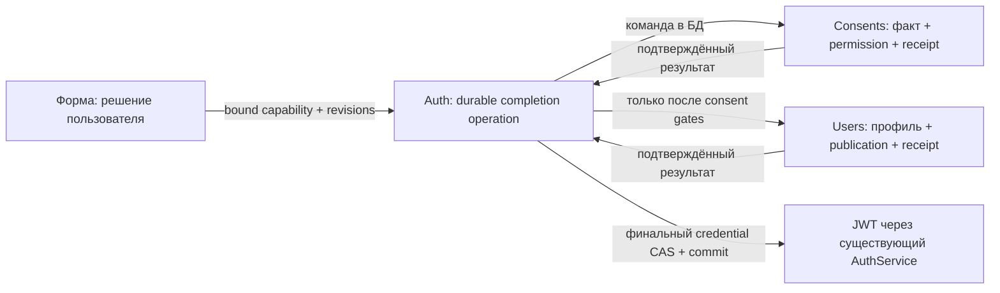

# Этап 5 — доказательства согласия и общее завершение входа

Реализован технический срез в ветке `codex/email-advertising-consent`. Авторизация по паролю, регистрация по подтверждённой почте и активация гостевой покупки используют один completion. Рабочие страницы ещё не переключены на новый host; это этапы 6–8. Коммита и выпуска нет.

## Поведение

- После подтверждения почты/пароля и необходимых контактов сервер возвращает `consents` с точными revisionId документов, версиями формы/документа, публичными legal URL и ожидаемыми версиями состояния. При отсутствии опубликованной согласованной registry готовность не выдумывается.
- Снятое рекламное согласие — пропуск подписки: не создаются subscription/grant/revoke. Прежний grant, если он есть, не отзывается. При следующем самостоятельном входе без рекламы шаг показывается снова. Обязательное согласие `false` не позволяет продолжить; строки/числа вместо boolean отвергаются.
- При уже принятых актуальных обязательных согласиях и рекламе completion запускается автоматически. Пустой список решений `[]` означает проверку имеющейся готовности, не принятие документов заново. Нового письма для подписки и нового кода после входа по паролю нет.
- Нажатие «Продолжить» сохраняет намерение и команду Consents. После подтверждённого результата Auth отправляет команду Users; после её результата в своей транзакции повторно проверяет состояние и устанавливает пароль только для регистрации/активации. Пароль и terminal completion фиксируются вместе. Только после commit существующий `AuthService` выдаёт JWT.
- Потеря ответа восстанавливается по тем же двум HttpOnly browser capabilities. Один operationKey с другим решением — конфликт. Чужой браузер/истёкший flow/сменившийся пароль/аккаунт не дают сессию. Отмена очищает временный draft и отклоняет незавершённую операцию; существующую session-cookie не удаляет.
- Гостевая покупка активируется на прежнем User, заказы сохраняются. Исходные identity/auth snapshots не переписываются после создания нового профиля.

## Что остаётся в доказательствах

Факт обязательного согласия и рекламный grant ссылаются на одну сохранённую редакцию документа и формы, exact-email proof, текущую authentication через completion operation, серверное время, requestId и необязательный `source`. Сохраняется доступный очищенный HTTP/request context, включая подписанную метаинформацию site proxy. Пароли, коды, cookie и токены в него не попадают. IP/UA не объявляются удостоверением личности.

PDF и снимок формы сохраняются один раз на редакцию, а не в каждой записи пользователя. Полей initial_checked/final_checked/continue и строк о движении чекбокса нет. Отказ от рекламы не превращается в запись принятия или отзыва. Рекламная история granted/revoked остаётся append-only; интерфейс отписки — этап 9.

## Архитектура

Как читать: каждый владелец изменяет своё состояние и receipt атомарно. Auth координирует сохранённые результаты; enqueue не равен завершению. Сбой следующего домена не отменяет уже подтверждённый факт предыдущего.

Consents имеет собственные handler/worker и опубликованные read/hash contracts. Auth использует их и Users directory, не вызывает соседние business services и не пишет User/permission напрямую. Команды обрабатываются с row claim, terminal receipt и повтором после rollback. Auth worker восстанавливает pipeline после остановки процесса и очищает истёкший COMPLETING draft независимо от готовности receipt.

В финальной проверке блокируется смена registry, проверяются версии permission/профиля/authentication, статус и exact email. Users publication дополнена настоящими roles/image для JWT; дополнительное зеркало пользователя не создаётся. Account CAS вынесен в Auth-owned adapter.

Frontend: отдельные mutations в feature/model; чистый mapper решений в feature/lib; server actions — только transport. Получение session-cookie разрешено только ответу `COMPLETED` от completion transport. Pending запросы не передают и не принимают access token. UI, demo routes/panels, host/providers, аналитика и business callers в этом этапе не добавлялись.

HTTP: `POST /auth/flow/complete` — решение; `GET /auth/flow/complete` — чтение/восстановление/автоматическое завершение готового flow. Публичного входа по ID операции нет.

## Миграция и конфигурация

Новая `20261020220000_auth_completion_pipeline` разрешает `[]` как typed readiness command и дополняет Users read-only directory ролями/изображением. Она не создаёт согласий/подписок и не меняет существующих пользователей. Предыдущие миграции и Prisma schema не переписаны. Проверено на полной истории миграций в отдельной временной схеме.

Для псевдонимного recipientKey добавлены `ADVERTISING_RECIPIENT_HMAC_SECRET` и `ADVERTISING_RECIPIENT_KEY_VERSION`: GitHub workflow → генерируемый env → api Compose, examples/required-prod-env/turbo. Секрет и версия должны быть установлены перед выпуском, как и прежний AUTH_FLOW_PROXY_SECRET. Значения секретов в репозитории отсутствуют; GitHub/production не менялись.

## Проверки

- **80/80 native PostgreSQL + HTTP:** 58 прежних и 22 новых. Полная история миграций в случайной временной схеме, настоящий Nest/PrismaPg/validation/CSRF; без DATABASE_URL рабочей БД.
- Новые проверки: строгие boolean/обязательное false, реклама false/true/существующий grant, exact proof/версии/source/full sanitized context, отсутствие ранних команд/credential/JWT, stale revisions/state/profile/account, смена документа/отзыв до финала, чужой browser и изменённый payload, потерянный ответ, регистрация/гостевая активация с сохранением заказов, автоматический [] completion, два workers/replay, atomic rollback, expiry, concurrent recovery и cancel/commit race. Публикация registry проверяется через настоящую блокировку PostgreSQL, без произвольной задержки.
- **130/130 адресных API tests**, 9 suites, включая 32 SQL migration tests и два новых теста канонического hash. Полный API suite не объявляется green: прежний unrelated welcome-promocodes mock issue описан в отчёте 2.
- **439/439 site tests**, включая три проверки session-cookie transport; эти три повторно пройдены после удаления дублирующего route.
- API `check-types`, `check-types:test`, `lint`, `build`; site `check-types`, `lint`, `build`; Prisma validate, production env validation (57 required values), Compose config и diff check — прошли.
- Собственный PostgreSQL остановлен, порт 62311 свободен. Рабочая БД, production/SSH, SMTP и GitHub settings не использовались. Миграция подготовлена, не применена к рабочей базе.

Логи: [verification/stage-5](./verification/stage-5/).

Обнаруженная native-проверкой ошибка сравнения JSONB исправлена: hash решений каноничен независимо от порядка ключей, который PostgreSQL меняет при сохранении. Независимые проверки transport защищают от ранней выдачи session-cookie.

## Граница готовности

Реальные редакции legal registry автоматически не публиковались; fixture документы существуют только в тестах. Прежние вопросы J1/J2/J3 о применимых редакциях/хранении/механике обязательного согласия остаются условиями включения живого сбора. Новая логика ещё не подключена к рабочим формам сайта; старые endpoints удаляются при переключении их реальных consumers, а не до этого. Яндекс/session producers, host/callback ownership и route cutover — следующие разрешаемые срезы.

Следующий этап — 6: `withAuth/useAuth`, один host и актуализация session cache до вызова callback. Автоматически не начинался.
