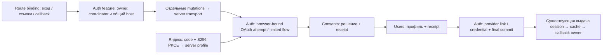

# Этап 7 — Яндекс и страницы авторизации

Реализован в ветке `codex/email-advertising-consent`, worktree `/Users/denis.voropayev/.codex/worktrees/email-advertising-consent/artmate-monorepo`. Страницы входа, восстановления, активации покупки и callback Яндекса подключены к общему модулю этапа 6. Коммита, выпуска и применения миграций к рабочей базе нет.

## Поведение

- **Яндекс:** подтверждённый серверный результат → недостающие контакты/согласия → общий completion. Ни кода Artmate, ни локального пароля. Если всё уже готово, дополнительного шага нет. Реклама остаётся необязательной; самостоятельный следующий вход без рекламного разрешения снова показывает согласия.
- **Принятая политика email:** по прямому решению пользователя используем exact `default_email` из authenticated server exchange Яндекс ID. Запись с источником Яндекс не называется подтверждением кодом Artmate. Официальный API не документирует `email_verified`; доверие этому адресу — выбранная политика продукта. Для ранее связанного аккаунта с настоящей Users verification сохраняем исходную дату подтверждения.
- **Новый Яндекс:** User создаёт Users через общий command/receipt; AuthAccount связывается только в финальном Auth commit после необходимых результатов. Существующий email может продолжить прежний User с его паролем/заказами. Занятый другим subject provider link не перепривязывается. Нет второго User или молчаливой замены пароля.
- **`/auth`:** один общий host. Прежний redirect по одному наличию session удалён: имеющаяся сессия проходит недостающие согласия, готовая завершается без окна. Вход по паролю не запрашивает код.
- **Активация гостевой покупки:** ссылка → пароль и повтор → только недостающие контакты → согласия → вход. Сохраняются прежние User и заказы, до completion сессия не выдаётся.
- **Восстановление:** общий нейтральный ответ; действующие серверные операции выбирают activation/reset письмо. Reset использует пароль и повтор, после успешного сброса предлагает обычный вход. Сам reset не авторизует и не подписывает на рекламу.
- **Popup:** открывается по клику «Я», исходная форма/payload остаются в памяти своего owner. «Другой способ входа» отменяет ожидание и возвращает login с тем же продолжением. Заблокированное окно показывает понятную ошибку; полного redirect с потерей callback нет.
- **Safe next:** внутренний нормализованный путь. Внешние/protocol-relative/backslash/control/encoded auth-loop варианты отклоняются.

## Архитектура

Как читать: route не реализует сценарий, provider adapter не меняет пользователя. Каждый серверный домен сохраняет своё состояние и результат; Auth выдаёт сессию после подтверждённых результатов и собственного финального commit.

Frontend сохраняет FSD-границы: `app` связывает route/metadata, `_pages` собирает, `features/auth/lib` владеет UI-state/provider/coordinator/route orchestration, `model` — отдельные mutations, `shared/actions` — только HTTP/proxy transport. Общая owner-логика выделена во внутренний `useAuthRequest`, а публичный `useAuth` продолжает тот же контракт. UI использует RHF/zod и существующие компоненты/ассеты.

Backend остаётся набором NestJS providers/controllers. `YandexOAuthService` знает API провайдера и возвращает нормализованную identity; он больше не создаёт/меняет User, не связывает аккаунты и не выдаёт JWT. `YandexFlowService` владеет своей попыткой/фактом/ограниченным flow. Users/Consents выполняют прежние persisted commands/receipts. Orders и отправка служебных писем не переписаны.

## OAuth и секретные ссылки

- State, S256 PKCE, десятиминутный TTL и browser/pending capability binding. В БД — hashes, технический outcome и immutable provider subject snapshot; raw verifier/code/token не архивируются.
- `POST /auth/flow/yandex/start` возвращает authorization URL и технический attemptId, устанавливает только ограниченные HttpOnly cookies. Callback не выдаёт access token.
- Повтор того же callback читает сохранённый результат без второго exchange. Изменённый state/code/browser, replay другой попытки и отменённый flow отклоняются. `GET /auth/flow/yandex/result` требует bound cookies; одного attemptId недостаточно.
- Зарегистрированный API callback остаётся фиксированным relay на site callback. Сохраняется действующий redirect URI; произвольного next нет. Передаются только bounded code/state/error, без user/JWT.
- **Строгая COOP сохранена.** При переходе на внешний Яндекс браузер может потерять opener. Авторитетный результат читается серверным polling; BroadcastChannel и допустимый postMessage передают только технический сигнал для ускорения чтения. PostMessage проверяет origin/source/attemptId; ни одно сообщение не считается входом.
- Автоматическая проверка отклонила смену общей COOP на allow-popups как широкое ослабление защиты. Этот вариант не применён; выполнена безопасная альтернатива с прежней политикой. Дополнительного согласования для обхода отказа не использовалось.
- Activation и callback захватывают вход только в transient памяти и очищают query **до первого server action**. `replaceState(null, ...)` обновляет и canonical URL Next; передача внутреннего `history.state` обходила его restore и возвращала секретный query при RSC refresh. Initial activation entry сохраняется при таком refresh, новая загрузка очищенной страницы использует bound resume.
- Reload до exchange никого не авторизует; исходная ссылка остаётся действующей до её атомарного обмена. Токены не помещаются в query/mutation cache или persistent browser storage. Raw callback/password/token variables сбрасываются после завершения mutation.
- На activation/reset/OAuth поверхностях GA и Метрика не подключаются до scripts. Proxy перезаписывает внутренний marker, known sensitive links открывают новый документ, pageviews дополнительно фильтруются. Next/Caddy: no-store/no-referrer; Caddy runtime log filter редактирует token/code/state и исключает Referer. Чувствительные ответы ошибок защищены теми же заголовками.

## Удалённый код

Полностью удалены отдельные `features/order-activation`, `features/account-recovery`, старый reset UI/mutation и заменённые site actions/DTO. После инвентаризации всех non-test consumers удалены четыре старых HTTP-пути, способные обойти общий flow:

- `/auth/order-activation/validate`;
- `/auth/order-activation/confirm`;
- `/auth/password-reset/confirm`;
- `/auth/recovery/request`.

Удалены неиспользуемые service entry methods/DTO и тесты ранней выдачи сессии. Новые HTTP-тесты проверяют отсутствие старых путей и работу текущего recovery.

Старый checkout `AuthForm` ещё имеет реального consumer; его login/register/email-confirm зависимости сохраняются до этапа 8. Affiliate/admin входы не переводились. Новый email `sign_up` отправляется только после completed registration origin; пароль, Яндекс, активация и reset не создают это событие.

## Схема и конфигурация

Новая миграция `20261021090000_yandex_continuation` добавляет попытке OAuth binding/PKCE/input hash/outcome/cancellation и immutable `providerUserIdSnapshot` факту authentication. Trigger разрешает честное переиспользование recorded email proof для Яндекса. Нет User/credential/consent backfill; рабочая БД не менялась.

Новых зависимостей и env-переменных нет. Проверен существующий путь `SITE_URL`, API public URL и Yandex client/secret/redirect URI через workflow → Compose → examples/turbo. Сам registered redirect URI не меняли. Caddyfile подготовлен в ветке, на production не применялся.

## Проверки

| Проверка | Итог |
| --- | --- |
| Native PostgreSQL + HTTP после удаления старых handlers | **114/114**, 95 прежних + 19 OAuth |
| Адресные API на финальном коде | **174/174**, включая HTTP404 удалённых путей и текущий recovery |
| Полный frontend suite | **521/521**, без failed/skipped |
| Реальные Next routes/server actions в браузере с локальным test API | **13/13** |
| API/site types, backend test-types, lint, build, Prisma validate | Passed |
| Caddy full configuration validation | Passed, официальный temporary Caddy 2.11.7, checksum сверена |
| Local Caddy runtime probe | HTTP200/502 no-store/no-referrer; URI secrets redacted; COOP не ослаблена |
| `git diff --check` | Passed |

Native проверки используют настоящие Nest/Prisma/PostgreSQL/validation/CSRF и полную историю миграций в отдельной схеме. Проверены новый/связанный Яндекс, отсутствие OTP/пароля, прежняя дата подтверждения, сохранение пароля/заказов, коллизии до/после proof, state/PKCE/binding/TTL/replay, duplicate/in-flight cancel, denied/provider error, смена текущего аккаунта и delayed session completion. Provider transport проверен отдельными network fixtures; настоящий Яндекс не вызывался.

Browser: ширины 320/390/1280, password/consents, ready session/cancel, успешная и недействительная guest link, reset/invalid reset → обычный login, recovery, popup blocked/cancel и Яндекс → contacts/consents. Проверены focus trap, portal/form boundaries, отсутствие горизонтального overflow, sensitive headers и отсутствие analytics scripts при включённых тестовых IDs, чистые URL после RSC и ровно один callback exchange. В отдельном OAuth случае BroadcastChannel отключён, COOP same-origin разрывает opener; успешное продолжение приходит только через bound server poll.

Console/page errors и неожиданных network failures нет; 19 ожидаемых net::ERR_ABORTED при Next navigation/RSC/context close перечислены отдельно в browser measurements.

Граница проверки: browser использует реальный Next build/routes/server actions и внешний локальный test API. Production edge COOP воспроизводится в browser fixture; настоящий backend отдельно проверен native HTTP/PostgreSQL. Это не реальный SSO с Яндексом и не production E2E. Axe/Web Vitals этим срезом не измерялись. Полный API suite не объявляется green — прежний unrelated baseline issue описан в stage-2-report.

Логи, JSON measurements и screenshots: [verification/stage-7](./verification/stage-7/). Собственные PostgreSQL, Next/fake API и Caddy probes остановлены; порты проверены после остановки. Рабочие БД, production/SSH, настоящий провайдер, SMTP и GitHub settings не использовались.

## Точка продолжения

Следующий этап — **8**: перевести реальные callers/checkout/contact/partner на `onAuth`, независимые backend purpose guards, удалить оставшийся заменённый consumer-код после переключения. Этап 8 не запускался автоматически.

J1/J2/J3, legal registry, отписка/evidence/delivery и согласованный выпуск остаются последующими задачами; stage 7 не включает реальные рекламные отправки. Plan/progress обновлены, прежние изменения сохранены. HEAD `c3e21a2f` не изменён.
