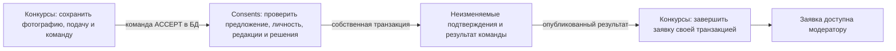

# Границы общего сервиса согласий

`Consents` остаётся одним доменным сервисом. Отдельного приложения, очереди для конкурсов или экспортируемого `ContextualConsentService` нет. Внутренние функции обработки команд и общие проверки входят в этот же сервис.

## Владение данными

| Владелец | Данные и действия |
| --- | --- |
| `Consents` | Реестр редакций PDF и форм, предложения, проверка личности и решений, неизменяемые подтверждения, результаты команд |
| `Contests` | Условия конкурса и их PDF, сроки конкурса, параметры публикации, фотографии, незавершённые подачи, заявки и модерация |
| `Users` | Подтверждённая почта и состояние аккаунта через опубликованный `customer_auth_directory_v1` и контракт блокировки личности |

Конкурсы не читают внутренние таблицы согласий и не вызывают их обработчик. Они записывают команды через `consents/contracts/consent-operations.contract.ts` и читают опубликованные результаты. Срок 15 лет передаётся конкурсом как `validity: { years: 15 }`; внутри общего обработчика этого значения нет.

## Сохранение документов

Конкурс своей транзакцией сохраняет PDF условий и команды регистрации документов. Регистрацию выполняет существующий `ConsentDecisionCommandHandler` через существующую очередь `apply_consent_decision_commands`.

Сохранение конкурса не ждёт работающего обработчика согласий. Форма подачи перед подготовкой предложения дожидается подтверждённой регистрации. PDF и оригинальные байты формы сохраняются без изменения при передаче через JSONB.

## Подача фотографии

Подтверждение согласий и завершение заявки не объединяются общей транзакцией. Сначала сохраняется `contest_entry_submissions` с неизменяемым содержимым и командой. Успешный результат `Consents` позволяет конкурсному модулю создать редакцию заявки и связать её с идентификаторами подтверждений.

До получения результата HTTP-запрос ожидает ограниченное время. При обрыве запроса или перезапуске приложения подача остаётся в БД; фоновое восстановление использует тот же результат. Повторный обработчик не создаёт вторую редакцию. Подача, принятая до закрытия конкурса, может завершиться после закрытия. Выбор победителей ждёт незавершённые подачи; модератор не может принять решение по заменяемой редакции, пока подача не завершена.

Отказ в согласиях сохраняется как терминальный результат. Заявка не создаётся; новые файлы не остаются публичными и удаляются. Временный сбой БД оставляет команду для повторной обработки.

## Опубликованные контракты

- `consent_revision_catalog_v1`: идентификаторы и метаданные редакций без байтов документов.
- `consent_operation_results_v1`: состояние команды, подтверждённый результат либо код отказа.
- `consent_object_offers_v1`: предложение для конкретной личности и объекта.
- `consent_object_acceptances_v1`: сведения о подтверждениях для разрешённых внутренних потребителей, включая модерацию.

Общие проверки решений, действующих редакций, подтверждённой личности и сроков находятся в `Consents`. Auth, согласия для объектов и настройки рекламных согласий переиспользуют применимые проверки. Доказательства Auth и конкретной работы сохраняют собственное основание: операции входа ради конкурсных подтверждений не создаются, прежние записи не переписываются.

## Вынос в отдельный проект

Текущий транспорт — команды и опубликованные контракты в общей PostgreSQL. `Consents` можно выносить вместе с обработчиком, реестром и доказательствами, сохраняя этот транспорт и доступ к опубликованному контракту Users. Потребителям не нужен его NestJS provider или общая бизнес-транзакция. Для перехода на физически разные БД потребуется транспортный адаптер; отдельные сервисы для каждого вида согласия не нужны.
