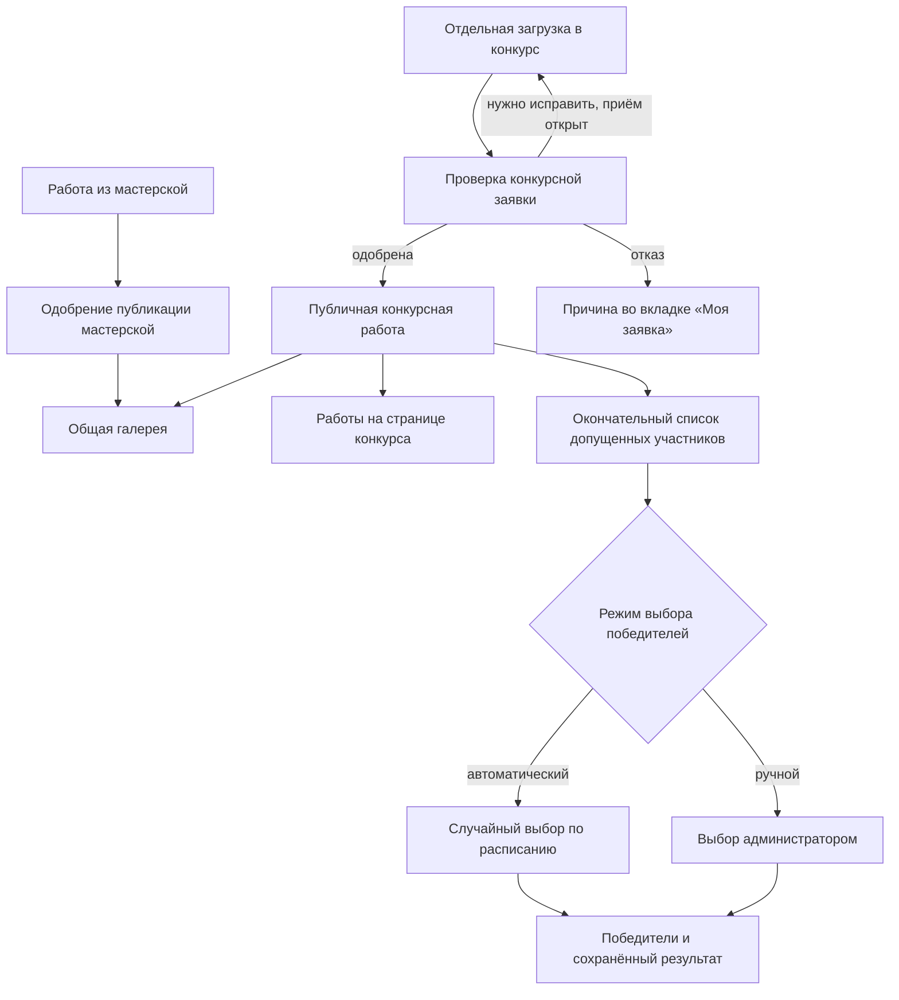

# План реализации конкурсов Artmate

**Призовые места подключены к API, 2026-11-23:** отдельные награды по местам, одинаковые призы, альбомы и маркеры, промокоды победителям и за участие сохраняются в базе и выдаются существующими доменами заказов и промокодов. Ручной выбор учитывает порядок мест, автоматический — сохранённый порядок жеребьёвки. Условия формируются из этих настроек; опубликованные призы зафиксированы. План: [Призовые места и награда за участие](contest-prize-places.md).

Пользователь загружает конкурсную фотографию отдельно от мастерской. После одобрения она появляется на странице конкурса и в общей галерее. Победителей выбирают в одном из двух режимов: автоматически случайным образом по расписанию или вручную в админке.

Создание и редактирование конкурсов подключены к API и PostgreSQL. Список и страницы сайта читают опубликованные конкурсы из базы. Загрузка конкурсных заявок, модерация и публикация в общей галерее подключены к серверу. Выбор победителей подключён к серверу и интерфейсам. Альбомные призы и персональные призовые промокоды подключены к выдаче победителям и личному кабинету.

**Уточнение остатка от 2026-11-21.** Приоритет — правовые документы и необходимые изменения по результатам [исследования законодательства РФ](contest-legal-research.md). Резервное копирование рассматривается отдельно для всего сайта. Призовой заказ на Ozon организатор оформляет вручную; автоматизация внешней покупки не нужна. Выпуск выполняется в конце, отдельную проверку production сейчас не проводим.

**Документы подключены 2026-11-22.** Общие правила, два согласия и условия отдельного конкурса доступны через `/legal/...` в общем просмотрщике PDF. Условия формируются на сервере из задания, сроков, способа выбора и призов в админке; опубликованная редакция фиксируется. В форме два коротких чекбокса, правила и условия принимаются отправкой работы. Имя и контакты берутся из профиля. Единый сервис Consents сохраняет четыре подтверждения, редакции документов, снимок профиля и способ принятия. Срок согласий задаётся параметром: 15 лет. Исходники: `docs/legal/contests/2026-11-21`, действующие PDF — `apps/site/public/documents/legal`, серверный пакет — `apps/api/assets/contest-legal`.

**Редакция документов 2.0.** По уточнению пользователя срок обоих конкурсных согласий и фото-лицензии — 15 лет. Полные тексты заменили редакторские шаблоны; условия события формируются из существующих полей конкурса и сохранённого `prizePromoTerms`, без повторного ручного документа. Офлайн-генератор проверен на локальном «Зимнем настроении» и сохраняется рядом с источниками. Функция генерации ещё не подключена к админке/API. Отчёт участнику о каждом посте и повторное авторское согласование не требуются; персональные данные обрабатываются в подтверждённом объёме и на законных основаниях. Принятый перечень ресурсов и срок не должны незаметно расширяться при изменении URL. Недостающие настройки, доказательства, учёт и правовые вопросы перечислены в `review.json` и PDF готовности. Условия старых заявок не заменяются новой редакцией задним числом.

Срок оформления и передачи альбомного приза в доставку согласован: не позднее 30 календарных дней после получения полного выбора и необходимых данных победителя. Это общее условие; время перевозки Ozon и хранение в ПВЗ учитываются отдельно. Вариант нового срока сгорания права не вводится.

## Объём: выбор и получение призов

**Уточнение от 2026-11-21 после проверки загрузки и модерации.** Нужны выбор победителей (автоматический и ручной), выбор и получение призов. Из объёма исключены отдельный кабинет заявок, снятие заявки участником, уведомления, отмена конкурса с причиной, отдельные публичные страницы работ и жалобы на конкурсные фотографии. Это не отложенные задачи. Состояние заявки и причина решения остаются во вкладке «Моя заявка» на странице конкурса; просмотр фотографий — в конкурсе и общей галерее. Подготовка правил, проверки и выпуск сохраняются в плане.

- Серверная загрузка работ и модерация реализованы: отдельная форма, обязательный вход, одна заявка с одной фотографией от участника, очередь и решения в админке. Одобрение публикует работу в конкурсе и общей галерее. Работы мастерской не меняются.
- Реализованы два режима определения победителей у конкурса: автоматический случайный выбор по расписанию и ручной выбор администратором из допущенных заявок. Это заменяет прежнее ограничение «только случайный выбор автоматически».
- Подключены альбом или несколько альбомов, а также персональные промокоды. Альбомы и их доставку оплачивает Artmate. Призы хранятся в разделе «Мои призы» личного кабинета. Остальные виды призов отложены. Состав альбомного приза и образец условий промокода задаются отдельно от публичного описания.
- Перед реализацией соответствующих экранов и моделей уточнить сценарий выбора и получения приза. Не добавлять заранее поля и API под ещё не согласованную механику призов.

## Первый проход: интерфейс сайта

- [x] Собрать `/contests`: текущий конкурс, список с датами и призами, фильтры стадий.
- [x] Собрать `/contests/[slug]`: задание, сроки, призы, условия и работы участников.
- [x] Проверить отдельную подачу: выбор фото, альбома, необязательных номера и подписи; ошибки формы и вид заявки после отправки.
- [x] Проверить состояния анонса, приёма, итогов и пустого конкурса на отдельных примерах.
- [x] Проверить полный кадр, CTA альбома, Dialog/Drawer на границе 768 px, клавиатуру и мобильную компоновку.
- [x] Зафиксировать поля конкурса по результатам UI и подключить создание и редактирование к API.

Статичные конкурсы и фотографии-примеры удалены из активного кода. `/contests` и `/contests/[slug]` используют public API; черновик по публичному адресу возвращает 404. В форме выбора альбома используется каталог товаров. Форма сохраняет фотографию и заявку через API; вкладка «Моя заявка» читает актуальный статус из базы. Страницы остаются закрытыми от индексации.

Внешние референсы: [Johanna Basford](https://www.johannabasford.com/inklings-colouring-competition/) — конкретное задание, срок и случайные победители; [Lavinia](https://www.laviniastamps.com/lavinia-stamps-monthly-creative-challenge/) — условия и примеры работ на странице конкурса. Для Artmate используем крупный блок текущего конкурса и компактный список остальных, существующие шрифты, обложки, фотографии и оформление карточек.

Для блока текущего конкурса выбран концепт № 5 без фотографии: крупная дата окончания приёма слева, название, краткое задание и дата итогов по центру, приз и кнопки участия и условий справа. На телефоне блоки идут друг под другом. Случайные фотографии из галереи в этот блок не добавляем.

По уточнению пользователя основной CTA плашки — «Принять участие»: он ведёт на страницу конкурса с открытой формой подачи (`participate=1`). «Условия и работы» — отдельный вторичный переход без открытия формы. На десктопе блок призов расположен справа от заголовка и задания, начиная с верхнего края общего блока; лишняя пустота под сроками убрана. На странице конкурса основной CTA в блоке призов — «Принять участие», он открывает ту же форму; кнопка выбора альбома и дублирующая кнопка под заданием убраны. Цель этих страниц — публикация работ, переходы к альбомам вторичны. CTA подачи показываем только при открытом приёме, после отправки заявки он меняется на «Моя заявка». Закрытие формы убирает параметр и возвращает фокус на кнопку подачи на странице конкурса.

Цветовое оформление сдержанное: общий фон `bg-background`, как в каталоге, блоге и контактах; светлая подложка карточки `from-rose-50 via-white to-orange-50`, как в блоке условий оптовой страницы. Отдельные HEX-цвета фона для конкурсов не вводим. Розовый выделяет число даты; яркий градиент оставлен на основном CTA. Заголовок, приз, фильтры и таблица нейтральные. Насыщенная розово-фиолетовая область даты и розовые рамки отклонены пользователем как чрезмерные. Компактная компоновка сохраняется.

### Оформления конкурсов

Оформление выбирается вручную, независимо от названия и дат. Согласованный набор: без оформления; Новый год; 14 февраля; 8 Марта; Пасха; День знаний; Хэллоуин; День матери; день рождения Artmate; весна, лето, осень, зима. День защиты детей исключён. Дата дня рождения Artmate пока не определена; оформление не назначает дату события.

Палитры для UI собраны в `packages/ui/src/contest-design/appearance.ts`. Плашка на `/contests` и верхний блок страницы `/contests/[slug]` используют общий `ContestSurface` и одно поле `contest.appearance`. На странице конкурса оформление охватывает заголовок, задание, сроки и призы; работы и форма сохраняют своё оформление. Для «Работы ноября» в примерах выбрана осенняя тема. Тему задаёт администратор в самом конкурсе; на сайте нет независимого сохранения темы и вычисления по датам. Кнопка и временное переключение оформлений удалены после просмотра. На сайте показывается только оформление из данных конкурса; отдельного экрана, модалки или панели просмотра нет. Оформление сохраняется в `Contest.appearance` через админку и передаётся через API. Предпросмотр в админке и сайт используют общий декор из `@repo/ui/contest-design`. Для новогодней темы реализована гирлянда вдоль верхнего края: тонкий провод, небольшие тёплые и розовые лампочки, без мигания. Гирлянда слегка заходит на содержимое; отдельной полосы и дополнительного отступа под неё нет. Украшения не перехватывают нажатия и скрыты от скринридера.

Для Нового года пользователь выбрал палитру зимнего оформления: светлую небесно-голубую подложку, голубую область даты и тёмно-синее число. Зелёный для этой темы не используем. Провод и цоколи гирлянды нейтральные, лампочки тёплые и розовые.

В новогоднюю композицию добавлены две небольшие заснеженные голубые ёлочки со звёздами. На широкой плашке они стоят у нижнего края в разных частях композиции, на телефоне разнесены по высоте. Текст и кнопки остаются поверх них.

У тем разные композиции по всей плашке. Пасхальные яйца разбросаны между датой, заголовком и призом; ко Дню знаний лежат раскрытые и закрытые книги, лист и карандаш. К Хэллоуину тыква стоит у нижнего края, сверху висят привидения и летучие мыши, есть паутина. 14 февраля — сердца и открытый конверт; 8 Марта — ветки мимозы, тюльпан и отдельные цветы; День матери — цветы и сердце; день рождения Artmate — флажки, воздушные шарики и конфетти. Весна — цветы, листья и бабочки; лето — солнце, ракушки, кораблик и волны; осень — несколько падающих листьев; зима — снежинки разных размеров. Новый год сохраняет гирлянду и зимнюю палитру.

Украшения находятся в одном слое над подложками (`z-20`), а дата, текст и кнопки — над украшениями (`z-30`). По последнему уточнению пользователя пересечения сохраняются, но буквы и действия остаются на переднем плане. Декоративный слой имеет `pointer-events: none` и `aria-hidden`; у самой карточки изолированный stacking context. Мотивы расположены и масштабированы отдельно для мобильной и широкой плашки. Декоративные слоты `date`, `title`, `prize` удалены. «Без оформления» остаётся без украшений. Сохраняются мягкие цвета, общий фон страницы, тексты, действия и высота плашки.

### Форма участия и вход

Форма подачи теперь использует светлую розово-персиковую шапку, крупную область выбора/перетаскивания фото и основную градиентную кнопку. На десктопе фотография и поля расположены рядом; до 768 px — нижний шит с закреплённой шапкой и прокруткой. Превью сохраняет фотографию целиком. Ошибки типа/размера появляются сразу после выбора файла; закрытие и повторное открытие сохраняют ввод.

Референсы загрузки: [FilePond](https://pqina.nl/filepond/) — одна заметная область выбора и превью; [Uppy Dashboard](https://uppy.io/docs/dashboard/) — фото и его метаданные в одном сценарии. Для Artmate эти приёмы реализованы существующими компонентами, без подключения новых библиотек загрузки.

Гость по кнопке «Принять участие» и по `?participate=1` сначала проходит существующий вход Artmate. Форма доступна только после разрешения сессии; успешный вход возвращает к загрузке, отмена убирает запрос участия. При потере сессии форма закрывается, её ввод остаётся в RHF, отправка блокируется до повторного входа. Авторизация, лимит одной заявки и сохранение файлов проверяются сервером. До одобрения заявку видят только автор и модератор.

### Данные, выявленные в первом UI

- Для конкурса нужны отдельные даты открытия, окончания приёма и выбора победителей. UI форматирует их в московском времени; текстовые подписи дат не храним вместо самих дат.
- Короткое описание в списке и полное задание на странице выполняют разные задачи. Призы содержат название и пояснение распределения между победителями.
- У конкурсной фотографии собственные ID, автор, альбом, необязательный номер, файл и ссылка на товар. Палитра и мастерская автора для просмотра не нужны.
- Для выбора альбома нужна связь с товаром; список номеров должен зависеть от выбранного альбома. В макете номер проверяется только на формат — проверку реального состава альбома подключим с данными.
- Собственная заявка требует отдельного состояния проверки, причины решения и прав на исправление. В первом макете реализованы пустое состояние и локальная заявка «На проверке»; состояния после решения модератора — следующий проход UI.
- Результаты ссылаются на конкретные конкурсные работы. Один ID публикации должен использоваться на странице конкурса, в галерее и для лайков.

## Реализовано: управление конкурсами (2026-11-20)

- В админке `/contests`, `/contests/new`, `/contests/[contestId]`: список, создание, редактирование, черновик и публикация. Поля: название, адрес, короткое описание, задание, условия по пунктам, приз, описание приза, число победителей, три даты, оформление.
- PostgreSQL: таблица `contests`, уникальный slug, ограничения порядка дат, числа победителей и 13 идентификаторов оформления. После первой публикации адрес не меняется. `version` блокирует перезапись устаревшей формы; ошибки не сбрасывают ввод.
- API: `GET/POST /admin/contests`, `GET/PATCH /admin/contests/:id` доступны только администратору; mutations защищены общим CSRF middleware. Public `GET /contests` и `GET /contests/:slug` исключают черновики. Стадии — черновик, анонс, приём, приём завершён; дата выбора пока не означает, что результат уже получен.
- В админке даты вводятся по Москве, запросы и БД используют UTC. RHF + Zod, payload в feature lib, отдельные mutation hooks. Предпросмотр оформления встроен в редактор; отдельного экрана оформления нет.
- Проверены DTO, сохранение темы и дат после перезагрузки, отсутствие черновика на сайте, публикация, совпадение темы в плашке списка и на странице, права и CSRF, конфликт двух правок и DB constraints. Все 13 оформлений проверены на ширине 390 px без горизонтальной прокрутки.
- Проверки завершены: `check-types` и `lint` для API, admin, site и `@repo/ui`; `build` для API, admin и site; API DTO tests, HTTP/PostgreSQL tests, тесты формы админки и доступа к подаче. Миграция применена только к изолированной локальной UI-базе и тестовой БД. Временный dev-сервер админки остановлен после проверки.
- Осталось: выбор и получение приза, редакции правовых правил и подготовка к выпуску. Сейчас хранятся текстовое описание приза и число победителей; модель выбора и распределения призов нужно спроектировать.

### Точное соответствие предпросмотра баннеру

Предпросмотр оформления в админке и плашка на `/contests` используют общий `ContestBanner` из `@repo/ui/contest-design`, включая дату, текст, призы, статус и компоновку кнопок. В админке подключены те же Comfortaa и Nunito; полотно шириной 1288 px масштабируется по размеру блока через ResizeObserver. Украшения и раскладка используют container queries, поэтому ширина окна админки не меняет расположение элементов внутри миниатюры. Самостоятельная упрощённая композиция предпросмотра удалена.

В браузере сравнены фон, шрифты и геометрия даты, заголовка, описания и кнопки при ширине баннера 1288 px: расхождение меньше 1 px после учёта масштаба. Все 13 тем проверены при мобильной ширине без переполнения. Выбранное оформление в открытой форме сохранено при обновлении компонента; проверка не меняла данные конкурса.

## Загрузка и модерация: реализовано 2026-11-21

- Самостоятельные `ContestEntry`, неизменяемые версии фотографии и история решений. Одна заявка на пользователя и конкурс закреплена уникальным ограничением БД. Исправление возвращает ту же заявку на проверку.
- Сервер проверяет действующую авторизацию, профиль и обязательное согласие, сроки, опубликованный альбом и принадлежность номера альбому. Покупка и публичная мастерская не нужны. Статус и причина решения доступны во вкладке «Моя заявка» на странице конкурса; отсутствие заявки возвращается явным `{ entry: null }`, без пустого HTTP body.
- Обработка фото и безопасное файловое хранилище вынесены в общую инфраструктуру `user-photos`, которую используют мастерская и конкурсы. Полный кадр, WebP без EXIF, проверки содержимого и размера; до одобрения файлы доступны только автору и администратору. Альбомы выбираются из тематических категорий каталога; маркеры исключены, наличие цифровой версии не обязательно. Конкурсные файлы хранятся отдельно в `private/contests`; в compose добавлен постоянный том.
- В админке `/contests/[contestId]/entries` — очередь с фильтром статусов и пагинацией; `/contest-entries/[entryId]` — фото, альбом, автор, задание, условия, причина и история. Решения: одобрение, исправление, отказ, скрытие. Скрытую публикацию можно восстановить без новой фотографии и публичного ID.
- Одобрение одной транзакцией делает работу доступной в конкурсе и общей галерее; у конкурсной работы один публичный ID и один набор лайков. Смешанная галерея возвращает разные модели `source: workshop | contest`, без поддельных цифровых картинок и палитр. Фотография без номера участвует в фильтре альбома и не попадает в фильтр конкретной картинки.
- Исправления ограничены сроком и состоянием заявки, одобренная версия фиксирована. После закрытия модератор принимает окончательное решение по уже загруженной версии, включая заявки на исправлении. `version` защищает от одновременных решений и подмены проверяемой версии. Условия, задание, сроки и призы блокируются после первой заявки; сохраняется снимок условий.
- Скрытие закрывает прямые URL фото и убирает работу из обеих публичных выдач. Публичные фото передаются с `no-store` и без Next Image cache. Работы мастерской не заменяются, их публичные ссылки и лайки сохраняются.
- Альбомные и промокодные призы реализованы последующими этапами; редакции юридических документов конкурса ещё не согласованы. Публичная ссылка на работу ведёт на конкурс с якорем работы. Автоматический отказ неисправленным заявкам не запускается: окончательное решение принимает модератор.

Первый проверочный проход: HTTP/PostgreSQL tests загрузки, прав, CSRF, пустой заявки, гонок, исправлений, публикации, скрытия, восстановления и пагинации; проверки фото и регрессия мастерской. Ограничения того прохода (file chooser и мобильный viewport) сохранены в `outputs/contest-upload-moderation-20261121/browser-verification.json`.

**Повторный E2E от 2026-11-21:** 22 проверки через внутренний браузер с реальным выбором файла, загрузкой формы, отдельными сессиями участника и администратора. Проверены вход гостя, сохранение фото и полей после серверной ошибки, подача и перезагрузка, приватность до одобрения, причина исправлений, повторная проверка той же заявки, одобрение и публикация в конкурсе и галерее, общий лайк и запрет своего лайка, CTA нужного альбома, запрет замены одобренной работы, скрытие с HTTP 404 по прямому URL, восстановление и отказ с причиной. Участнику недоступна карточка модерации. Форма проверена как Dialog на 1280 px и Drawer на 714 px без горизонтального переполнения; точная граница 767/768 отдельно не прогонялась. Ошибок консоли не обнаружено. Отчёт и снимки: `outputs/contest-e2e-20261121`.

Для независимых локальных сессий в `allowedDevOrigins` сайта добавлен `127.0.0.1`, только в development. Lint и импорт конфигурации в development/production прошли. По просьбе пользователя сайт, API и админка оставлены запущенными; во внутреннем браузере открыты форма и карточка новой заявки «На проверке». Для просмотра в изолированной UI-базе оставлены тестовый альбом, одобренная работа участника и новая заявка администратора. Отдельная отклонённая E2E-заявка очищена как тестовая фикстура, без изменения продуктового запрета повторной подачи после отказа. Production не менялся.

## Выбор победителей: реализовано 2026-11-21

**Уточнение пользователя:** мест и ранжирования нет. В обоих режимах выбирается набор равноправных победителей; порядок выбора в админке не влияет на результат. Места удалены из модели, API, интерфейсов и плана призов. Миграция `20261121160000_contest_winners_without_ranks` сохраняет выбранных победителей.

- `Contest.selectionMode`: `AUTOMATIC` или `MANUAL`, выбор в редакторе конкурса. После первой заявки или сохранения результата менять режим, сроки, число мест и условия нельзя. Новая миграция: `20261121150000_contest_draws`.
- `ContestDraw` хранит единственный результат, снимок допуска с версиями заявок, контрольную сумму, способ и фактическое время выбора. `ContestDrawWinner` хранит победителей и версии работ без мест; при ручном выборе сохраняется администратор. Публичный ответ не содержит контактов и внутренних идентификаторов участников.
- Автоматическое задание запускается раз в минуту, обрабатывает просроченные конкурсы после простоя и ждёт окончательных решений по `PENDING` и `CHANGES_REQUESTED`. Используется `crypto.randomInt` и Fisher–Yates; полный случайный порядок, включая резерв, сохраняется в той же транзакции. Повторный запуск не меняет результат.
- В админке `/contests/[contestId]/results`: список допущенных фотографий, выбор победителей без мест, подтверждение публикации или просмотр уже опубликованного результата. Сервер проверяет режим, сроки, допуск, число победителей и актуальность списка. Пока список изменился, старое подтверждение не принимается. При недостатке работ выигрывают все допущенные; без допущенных работ конкурс завершается без победителей.
- Выбор и модерация используют одну блокировку конкурса. Скрытие работы после выбора отзывает фотографию из результатов, не переписывая победителя. На сайте — результаты с фактическим способом выбора, ожидание итогов или задержка на проверку. Работы открываются в существующем просмотре с CTA «Посмотреть альбом».
- Проверки: 23 API/HTTP/PostgreSQL tests конкурсов, включая оба режима, CSRF и права, конкурентные запросы, гонки модерации, пустой результат, недостаток участников, запрет повторного выбора, скрытие и восстановление победителя. Ещё 8 frontend tests форм и доступа к подаче. Typecheck, lint и production build API/site/admin, а также проверки `@repo/ui` прошли.
- Во внутреннем браузере проверены ручной выбор и отмена подтверждения без потери выбора, фокус, публикация результата и просмотр работы. Отдельный автоматический конкурс обработан настоящим планировщиком. Страница результатов без переполнения на 390, 767, 768 и 1280 px; на 767 px фото открывается в Drawer, на 768 px — в Dialog. В шапке админки исправлен перенос действий на 390 px. Снимки и отчёт: `outputs/contest-draw-20261121`.
- Миграция применена только в изолированных локальных test/UI-базах. Исходная база и production не менялись. Два отдельных конкурса с синтетическими фотографиями оставлены для просмотра; «Работа ноября» и её заявки не изменялись. Выбор и получение приза реализованы отдельными этапами ниже.

## Согласованные решения

- Администратор вручную создаёт каждый конкурс. Название, задание, условия, сроки и призы задаются в админке. Темы и месяцы не зашиваются в код; автоматического создания ежемесячных конкурсов нет.
- Конкурсная заявка самостоятельна: не создаёт работу в мастерской и не меняет существующие работы.
- Одна заявка от участника на конкурс. Исправления относятся к этой же заявке, а не создают дополнительные шансы.
- Подача предполагает публичную публикацию. Отдельного согласия или переключателя для общей галереи нет.
- До одобрения фотографию видят только автор и модераторы. Одобрение публикует её сразу на странице конкурса и в общей галерее.
- Неодобренная конкурсная заявка не попадает в общую галерею.
- После завершения конкурса опубликованные фотографии остаются доступны. Завершение конкурса само по себе не скрывает их.
- Режим выбора победителей задаётся у конкурса: автоматический случайный выбор по серверному расписанию или ручной выбор в админке. Лайки не определяют победителей. Режим должен быть указан в условиях конкурса; прежнее требование случайного выбора для всех конкурсов заменено этим решением.
- Фотографии сохраняются целиком, с исходными пропорциями. При просмотре работы основной CTA — «Посмотреть альбом».

## Рабочие решения для первой версии

Эти детали предложены для реализации; их можно уточнить до начала соответствующего этапа.

- Участие доступно авторизованному пользователю. Публичная мастерская и покупка через сайт не требуются.
- Заявка содержит одну фотографию, обязательный альбом Artmate, необязательные номер картинки и подпись. При выборе картинки проверяется её принадлежность альбому. В кадре может быть композиция; конкретная картинка не обязательна.
- Для фотографии с несколькими альбомами участник выбирает основной. Привязка нескольких альбомов — последующее расширение.
- Проверки ограничивают одну заявку на аккаунт. Это не доказывает, что разными аккаунтами пользуются разные люди; модерация должна позволять разбирать связанные заявки до выбора победителей.
- Исправления можно отправлять до одобрения заявки и окончания приёма. После одобрения фотография и подпись фиксируются; после закрытия приёма модератор принимает окончательное решение по уже отправленной версии.
- Перед запуском объявляются правила недостаточного числа участников и замены победителя. Предложение: если участников меньше заданного числа победителей, выигрывают все допущенные участники; один человек может выиграть только один раз.
- Автоматический выбор сохраняет полный случайный порядок допущенных заявок, включая резерв. Интерфейс замены победителя пока не создаём; для него потребуются отдельно согласованные правила. Повторного розыгрыша нет.

## Пользовательский сценарий

1. Пользователь открывает `/contests`, выбирает конкурс и читает задание, сроки и условия.
2. На странице `/contests/[slug]` видит призы, работы участников и основное действие «Принять участие».
3. Входит в аккаунт, если требуется. После входа возвращается в тот же конкурс. Фотографию не заставляем выбирать до обязательного входа.
4. Загружает фотографию, выбирает альбом, при желании — картинку и подпись. Видит полный кадр и проверяет данные перед отправкой.
5. Отправляет заявку. Во вкладке «Моя заявка» на странице конкурса видит её состояние и причину решения модератора.
6. После одобрения фотография доступна на странице конкурса и в галерее. Это одна публикация с одной публичной ссылкой и одним набором лайков.
7. После выбора победителей на странице конкурса появляются результаты. Победителю доступна информация о получении приза.

Публичность и проверка объясняются коротко: «Одобренные работы публикуем в конкурсе и галерее». Ссылка на правила находится рядом с отправкой.

Две загрузки ведут в общую галерею через свои проверки. Конкурс не изменяет работу мастерской; выбор победителей использует только допущенные конкурсные заявки.

## Что уже есть в проекте

| Часть          | Текущая реализация                                                                                     | Что требуется                                                                                 |
| -------------- | ------------------------------------------------------------------------------------------------------ | --------------------------------------------------------------------------------------------- |
| Модерация      | `apps/api/src/workshops/workshop-moderation.service.ts`, `apps/admin/src/features/workshop-moderation` | Переиспользовать приёмы очереди, просмотра и истории; добавить отдельную конкурсную модерацию |
| Обработка фото | `apps/api/src/workshops/workshop-media.service.ts`                                                     | Вынести общую обработку пользовательских фото в нейтральный инфраструктурный модуль           |
| Хранение       | `workshop-storage.service.ts`, `colorings/immutable-file-storage.ts`                                   | Собственное хранилище конкурса; общие низкоуровневые функции записи и проверки файлов         |
| Галерея        | `public-workshop.service.ts`, `apps/site/src/entities/community-work`                                  | Добавить второй источник публикаций и общий контракт чтения                                   |
| Просмотр фото  | `apps/site/src/features/community-gallery/ui/image-preview.tsx`                                        | Поддержать конкурсную фотографию без обязательных палитры, номера и ссылки на мастерскую      |
| Лайки          | `apps/api/src/likes/subject-registry.ts`, доменные DB views                                            | Зарегистрировать конкурсную публикацию по тому же контракту доступности                       |
| Расписание     | `apps/api/src/cron/cron.module.ts`, `cron/jobs/*`                                                      | Добавить задание автоматического выбора и восстановления после сбоя                           |
| Уведомления    | `apps/api/src/notifications`                                                                           | Уведомления о конкурсах исключены из объёма пользователем          |

Нынешняя галерея получает только `WorkshopWork`: обязательны официальная картинка, палитра и публичная мастерская автора. Конкурсную заявку нельзя выдавать за такую работу или создавать для неё фиктивную мастерскую.

## Этап 1. Данные, состояния и контракты

**Основные файлы:** `apps/api/prisma/schema/contests.prisma`, новая миграция, `apps/api/src/contests`, публичные контракты чтения конкурса и галереи.

- [x] Добавить `Contest`: стабильный slug, название, описание, задание, условия, призы, сроки и состояние публикации.
- [ ] Подключить редакцию правовых правил.
- [x] Хранить `appearance` у конкурса, валидировать значение по согласованному набору и передавать его в публичных read-моделях списка и отдельного конкурса. Сохранение в админке меняет это поле, а не отдельные настройки каждой страницы.
- [ ] Спроектировать выбор приза и получение призов. Уточнить необходимые данные до изменения модели; не считать нынешнее текстовое описание механизмом выбора.
- [x] Добавить `ContestEntry`, неизменяемые версии отправки, файлы фото и историю решений. Уникальное ограничение `(contestId, userId)` обеспечивает одну заявку даже при одновременных запросах.
- [x] Добавить режим выбора победителей у конкурса, `ContestDraw`, снимок допущенных заявок и список победителей без мест. Сохранять, получен результат автоматически или вручную; для ручного выбора — автора решения. Уникальное ограничение допускает только один зафиксированный результат конкурса.
- [x] Разделить состояние проверки заявки и её участие в итогах. Скрытие одобренной работы записывается в историю и не переписывает сохранённый результат выбора.
- [x] Состояния заявки: `PENDING`, `CHANGES_REQUESTED`, `APPROVED`, `REJECTED`, `HIDDEN`. Повторная отправка создаёт новую версию и возвращает заявку в `PENDING`.
- [x] Стадии публичного конкурса вычислять из публикации, дат и результата: анонс, приём работ, проверка, ожидание итогов, итоги. Не хранить независимо изменяемые статусы, противоречащие датам.
- [x] Установить порядок блокировок конкурса и заявки для конкурентных изменений. После фиксации списка изменения допуска не могут незаметно менять результат.

**Проверка:** миграции на PostgreSQL, уникальность заявки и результата, допустимые переходы, согласованность дат, неизменяемость версий и истории.

## Этап 2. Создание конкурса в админке

**Основные файлы:** `apps/api/src/contests/*`, `apps/admin/app/contests/*`, новые `entities/contest`, `features/contest-editor`, `features/contest-list`, `_pages/contests`, маршруты и навигация админки.

- [x] Сделать список конкурсов с датами, стадией и оформлением.
- [x] Добавить количество заявок и ожидающих проверки работ после подключения заявок.
- [x] Добавить форму создания и редактирования: название, slug, описание, задание, условия, приз, число победителей и даты.
- [ ] Подключить ссылку на согласованную редакцию правил через `/legal/...`.
- [x] Добавить поле «Оформление» с согласованным набором и предпросмотром плашки. Сохранять выбранный идентификатор оформления; не вычислять его по датам или названию. Общий фон сайта не меняется.
- [x] Проверять `opensAt < closesAt < drawAt` в форме, API и БД. В админке указывать московское время, в БД хранить UTC.
- [x] Добавить предпросмотр оформления и публикацию заполненного конкурса.
- [ ] Проверять доступность отдельного правового документа перед публичным запуском.
- [x] После первой заявки зафиксировать задание, условия, сроки и описание призов; сохранить снимок условий заявки.
- [x] Зафиксировать режим выбора до первой заявки или сохранения результата. Распределение конкретных призов остаётся в следующей задаче.
- [x] Формы реализовать через RHF + Zod, сборку payload держать в feature `lib`, mutations — отдельными hooks.

**Готово, когда:** администратор может создать и опубликовать любой конкурс без изменения кода, а опубликованные условия и даты согласованы на всех экранах.

## Этап 3. Отдельная загрузка и просмотр своей заявки

**Основные файлы:** `apps/api/src/contests` — entry/media/storage services и DTO; `apps/site/app/contests/[slug]/*`, `entities/contest`, `features/contests` и server actions.

- [x] Добавить загрузку фото, выбор альбома и необязательных картинки и подписи. Хранить ссылку на реальный товар для CTA.
- [x] Использовать общую проверку фото: MIME и декодирование, предел размера и пикселей, EXIF-ориентация, удаление метаданных, WebP-копии без кадрирования.
- [x] Хранить файлы в закрытом хранилище. Доступ к исходным служебным копиям — только автору и модератору; публичные копии доступны лишь при действующей публикации.
- [x] Проверять доступность конкурса, сроки и ограничения на сервере. За время подачи считать успешную фиксацию заявки с файлами в БД до `closesAt`, а не начало загрузки и не решение модератора.
- [ ] Повторная отправка формы и восстановление ответа после сетевого сбоя не создают вторую заявку, новую версию без причины или файлы-сироты.
- [x] Сохранять выбранное фото и поля при ошибках формы. Ошибка загрузки не должна показываться как успешная отправка.
- [x] На странице конкурса показать собственную заявку: фотографию, состояние, причину и доступное действие. Закрытая мастерская не влияет на заявку.
- [x] До `closesAt` разрешить исправление ещё не одобренной заявки и повторную проверку. После одобрения зафиксировать фотографию и подпись: новую загрузку нельзя использовать для подмены опубликованной работы. Исправления до одобрения не создают отдельных публикаций в галерее.
- [x] После `closesAt` запретить изменение фото и подписи. По `CHANGES_REQUESTED` и `PENDING`, отправленным вовремя, модератор принимает окончательное решение по уже загруженной версии. Автоматического отказа нет.

**Готово, когда:** можно отправить заявку без мастерской, увидеть решение, исправить её в срок; существующие работы мастерской не меняются.

## Этап 4. Модерация и публикация

**Основные файлы:** конкурсный moderation service; `apps/admin/app/contests/[contestId]/entries/*`, `entities/contest-entry`, `features/contest-moderation`.

- [x] Добавить очередь с фильтрами по конкурсу и состоянию. На карточке проверки показать полный снимок, альбом, данные автора и условия конкурса.
- [x] Действия: одобрить, запросить исправления, отказать, скрыть опубликованную работу. Причина обязательна для всех решений, кроме одобрения.
- [x] Запрашивать исправления только пока открыт приём. После закрытия принять окончательное решение по отправленной версии.
- [x] Проверять допустимость публикации, связь с указанным альбомом и выполнение задания. Не оценивать художественное мастерство для допуска к случайному выбору.
- [x] Одобрение одной транзакцией фиксирует решение, публичную версию и `publishedAt`.
- [x] Разрешить решение только по точной актуальной версии. Повторный запрос или одновременная работа двух модераторов не дублируют публикацию и историю.
- [x] Скрытие отзывает публичный доступ в конкурсе, галерее, лайках и по прямому URL фото. Передавать фото с `no-store` без Next Image cache.

**Готово, когда:** одобрение добавляет одну публикацию в конкурс и галерею, а отзыв публикации убирает её из обоих мест и закрывает прямой доступ к файлам.

## Этап 5. Общая галерея с двумя источниками

**Основные файлы:** опубликованные DB views мастерской и конкурса; новый read-модуль галереи в API; `apps/site/src/entities/community-work`, `features/community-gallery`, `features/public-work`, `shared/actions`, `CommunityDataBuilder`.

- [ ] Каждый домен публикует свой контракт доступных работ через DB view/read model. Галерея читает эти контракты и не управляет состоянием мастерской или конкурса.
- [ ] Общий контракт содержит `source`, стабильный идентификатор, автора, фото с размерами, альбом, товар и дату публикации. Данные источника различаются явно: у мастерской есть картинка и материалы, у конкурса — конкурс и необязательная картинка.
- [x] Сделать одну общую сортировку и keyset-пагинацию по `(publishedAt, id, source)`. Не склеивать две уже ограниченные страницы на клиенте: это приводит к пропускам и дублям.
- [x] Сохранить текущие фильтры альбома и номера. При выбранном номере конкурсные фотографии без номера не включаются; при выборе только альбома включаются все его фотографии.
- [x] В просмотре конкурсного фото показать автора, альбом и ссылку на конкурс. Палитра, материалы и переход к мастерской отображаются только при наличии соответствующих данных; фиктивных значений нет.
- [x] Приватность мастерской не определяет видимость конкурсной публикации. Если у автора нет публичного профиля, его имя отображается без неработающей ссылки.
- [x] Одна конкурсная публикация используется в галерее и на странице конкурса: одинаковые URL фотографий и лайки. Для неё добавлены `subjectType: contest-work` и DB view в существующий registry лайков.
- [ ] Основной CTA в просмотре — «Посмотреть альбом». Фото целиком, Dialog от 768 px и Drawer до 767 px, одинаковые действия в обоих вариантах.
- [ ] Проверить схемы, selectors, hydration и SEO общей галереи. Существующие URL работ мастерской сохраняются; конкурсные работы используют ссылку на конкурс с якорем `#work-{publicId}` и существующий просмотр фотографий. Отдельный публичный маршрут работы не создаётся.
- [x] Конкурсные публикации не создают `WorkshopPublicationFact`, баллы и ачивки мастерской. Такие награды не входят в первую версию.

**Готово, когда:** смешанная галерея корректно фильтруется и листается, конкурсная работа открывается без мастерской, старые работы и лайки сохраняются.

## Этап 6. Автоматический и ручной выбор победителей

**Статус:** выбор победителей реализован 2026-11-21. Выбор и получение приза — отдельная следующая задача.

**Основные файлы:** `apps/api/src/contests/contest-draw.service.ts`, `apps/api/src/cron/jobs/contest-draw.job.ts`, `cron.module.ts`, модели результата и интерфейс результатов в админке.

### Общее для обоих режимов

- [x] Добавить выбор режима в настройках конкурса и отображать его в публичных условиях. Объяснение случайного выбора показывать только в автоматическом режиме.
- [x] Допускать только одобренные, не скрытые заявки активных участников. Вовремя поданные, но ещё не проверенные заявки нельзя молча исключать из итогов: сначала завершить модерацию.
- [x] Сохранять снимок допущенных заявок и их версий, режим, время выбора, победителей без распределения мест. Для ручного режима сохранять администратора, подтвердившего результат. Контакты участников не включать в публичный протокол.
- [x] Зафиксировать результат один раз под транзакционной блокировкой конкурса. Повтор запроса или конкуренция не создают второй результат. После публикации нельзя незаметно заменить победителей.
- [x] Обработать отсутствие участников и недостаточное число допущенных заявок по заранее объявленным условиям. Один участник не получает несколько заданного числа победителей.
- [x] Опубликовать результаты на странице конкурса с фактическим временем и способом выбора. Действие по призу добавляется в следующей задаче.
Замена победителя требует отдельного согласования. Сейчас скрытие фотографии не меняет сохранённый результат и не назначает другого победителя.

### Автоматический режим

- [x] Планировщик обрабатывает только конкурсы с автоматическим режимом, `drawAt <= now`, закрытым приёмом и отсутствием результата. После простоя подбирает пропущенные задания.
- [x] При незавершённой модерации отложить выбор и показать задержку итогов. После последнего решения следующий запуск выполняет выбор автоматически.
- [x] Одна допущенная заявка даёт один шанс. Использовать серверный криптографический источник, например `crypto.randomInt`, без повторений; не использовать клиентский выбор или `Math.random`.
- [x] Одновременно сохранить случайный порядок участников и резерв, контрольную сумму входного списка и версию алгоритма. Повторный запуск возвращает сохранённый результат вместо нового розыгрыша.

Сохранённый протокол позволяет проверить список допуска и единственность результата; независимую проверку источника случайности можно спроектировать отдельно.

### Ручной режим

- [x] В админке дать выбрать победителей из окончательного списка допущенных заявок без распределения мест. Порядок выбора не имеет значения; перед публикацией открывается подтверждение с выбранными участниками.
- [x] Перед фиксацией показывать выбранных победителей. Проверять допуск, отсутствие повторов и число победителей на сервере, сохранять администратора и время решения.
- [x] Планировщик не определяет победителей ручного конкурса. Достижение `drawAt` само по себе не создаёт результат. На сайте показывается ожидание результатов Artmate.

**Готово, когда:** оба режима работают по опубликованным условиям, используют только допущенные заявки и сохраняют один проверяемый результат. Механика выбора и получения приза согласована отдельно до реализации связанных моделей и экранов.

### Выбор и получение приза

**Согласовано пользователем:** только альбомы (один или несколько) и промокоды. Выигранные альбомы и их доставку оплачивает Artmate: победитель оформляет получение бесплатно. Призы должны храниться в личном кабинете. Раздел «Мои призы» не возвращает исключённый ранее кабинет конкурсных заявок. Мест и ранжирования победителей нет. Маркеры, цифровые альбомы, сертификаты и прочие виды призов отложены.

**Предлагаемый сценарий, до реализации:**

1. После фиксации победителей каждому однократно выдаётся личное право на приз, связанное с конкурсом и результатом. Право сохраняется на сервере независимо от посещения сайта. Повтор обработки результата не выдаёт второй приз.
2. В «Моих призах» видны конкурс, содержание приза, доступное действие и состояние получения. Для альбомов — «Выбрать альбомы», для промокода — код, размер скидки, ограничения и срок действия. Получение приза доступно в личном кабинете; в блоке победителей личной кнопки нет.
3. Для альбомов администратор задаёт доступный список и количество. Победитель выбирает нужное количество и переходит в оформление заказа: контакты и пункт выдачи Ozon на общей с корзиной карте, проверка состава, подтверждение. Известные данные подставляются. Предложение для первой версии — отдельный призовой заказ через общую форму checkout; обычная корзина сохраняется, покупки не обязательны.
4. В призовом заказе альбомы и доставка для победителя стоят 0 ₽, итог — 0 ₽. Заказ создаётся с подтверждённым основанием «приз конкурса», без перехода в банк и без имитации банковской оплаты. Расходы Artmate на доставку учитываются отдельно от суммы к оплате покупателем. Бесплатные позиции не создают оплаченный оборот, партнёрское вознаграждение или кешбэк с потраченных денег.
5. Право на приз резервируется за одним оформлением и связывается с созданным заказом. Повторный клик, сетевой сбой или открытие другой вкладки не создают второй заказ и не лишают приза. До подтверждения можно менять выбор. Предложение: при подтверждённой отмене до передачи в доставку право восстанавливается; основанием служит состояние заказа, а не нажатие кнопки в браузере. После оформления показывается ссылка на заказ; отправка и получение читаются из существующего заказа.
6. Промокод выдаётся персонально победителю, с одним использованием и сохранёнными условиями конкурса. Существующие механизмы процента/фиксированной скидки, резервирования и использования переиспользуются; привязка к получателю проверяется сервером. В личном кабинете промокод можно скопировать; применение доступно в ленте личных промокодов корзины и checkout, без ручного ввода. Бесплатная доставка согласована для выигранных альбомов; для покупок с призовым промокодом отдельное обещание бесплатной доставки не согласовывалось.

**Реализовано для альбомов, 2026-11-21:** администратор задаёт количество разных альбомов каждому победителю и доступный список. После первой заявки или итогов настройка блокируется. Старому конкурсу без настройки можно однократно добавить состав альбомного приза, сохранив опубликованные условия и точные сроки.

Домен заказов читает опубликованный контракт итогов конкурса и создаёт `OrderPrizeGrant`, уникальный по победителю. Выдача выполняется по расписанию и при загрузке личных призов. Право сохраняется независимо от посещения сайта. В личном кабинете доступны только свои призы; получение открывается из раздела «Мои призы», без личной кнопки на странице конкурса.

Выбор и оформление подключены к настоящему каталогу и API. Сервер проверяет состав, точное количество разных альбомов, публикацию, наличие и возможность доставки Ozon. Адрес и тариф проверяет существующий адаптер Ozon. Ошибка или отсутствие товара не расходуют приз. Бесплатный заказ и связь с правом сохраняются одной транзакцией под блокировкой. Повторный запрос возвращает тот же заказ, включая случай потерянного ответа. Обычная корзина не используется.

Для такого заказа введены `CONTEST_PRIZE`, `NOT_REQUIRED`, `FULFILLMENT_READY`. Покупатель платит 0 ₽ за альбомы и доставку; покрытый тариф сохраняется в `sponsoredDeliveryPrice` отдельно. Банковский платёж, платёжные события, кешбэк и партнёрское вознаграждение не создаются. Нулевые позиции через обычный платный checkout по-прежнему запрещены. Заказ виден в личном кабинете и админке; отправления Ozon привязываются и отслеживаются существующим процессом. Завершение доставки не превращает приз в оплаченную покупку.

Временные примеры и development-only маршруты удалены. После получения приз переходит в историю со ссылкой на заказ. Формы остаются на React Hook Form и Zod; черновик выбора и контактов сохраняется в текущей вкладке. ПВЗ выбирается через общий `widgets/pickup-point-picker`, Dialog от 768 px / Drawer до 767 px. Ссылки согласий открывают существующие правовые страницы в новой вкладке.

- [x] Настройка альбомного приза в админке, сохранение условий.
- [x] Однократная выдача победителям, персональный доступ и связь с результатом.
- [x] Выбор, бесплатное оформление и защита от повторного получения.
- [x] История получения и просмотр заказа на сайте и в админке.
- [x] Обработка доставки без банковской оплаты и финансовых начислений.
- [x] Персональные призовые промокоды: образец условий в админке, сохранённые условия, личный код победителю на одно использование, копирование в ЛК и применение в корзине/checkout; детали — `plans/contest-promo-prizes.md`.
- [ ] Автоматический возврат права после отмены требует отдельного решения. Сейчас повтор возвращает исходный заказ; повторного получения не создаёт.

Срок получения автоматически не ограничивается. Повтор одинакового альбома в одном призе не поддерживается: используется согласованный интерфейс выбора разных альбомов. Детали реализации и проверок: `plans/contest-prize-orders.md`, `outputs/contest-prize-orders-20261121`.

## Этап 7. Публичные страницы и правила

- [ ] `/contests`: открытые, предстоящие и завершённые конкурсы; даты, призы и стадии. На телефоне данные доступны без горизонтальной прокрутки таблицы.
- [ ] `/contests/[slug]`: задание, альбомы, сроки, призы, правила, собственная заявка, работы участников и результаты. Кнопка отправки соответствует текущей стадии.
- [ ] Проверить загрузку, ошибки с повтором, пустой конкурс, отсутствие заявок, закрытый приём, ожидание модерации, скрытую работу, задержку итогов и отсутствие допущенных участников.
- [ ] Подключить согласованные правила через `/legal/...`, `LegalPage`, `PdfDocumentViewer`, PDF в `public/documents/legal` и `source-documents.ts`. Условия конкретного события задаются в админке; версия правил фиксируется в заявке. Участие публичное, отдельного необязательного выбора публикации в галерее нет. Это не отменяет разрешения на использование фотографии и отдельного согласия на распространение персональных данных, когда оно является необходимым основанием; состав документов и подтверждений уточняется по правовой проверке. Публикация в галерее не означает согласия на рассылки или любое рекламное использование.
- [x] События `contest_view`, `contest_entry_start`, `contest_entry_submit_success` подключены через feature-local adapter и общий typed transport с существующим cookie consent. Просмотр — после успешной загрузки; начало — при открытии формы новой заявки после входа и проверки существующей заявки; успех — после ответа сервера о первой отправке. Повторные effects/callbacks дедуплицируются, редактирование не считается новой подачей. Payload содержит только публичный `contest_slug`, без данных автора и работы. В Метрике — `artmate_action` и `artmate_action_context`.
- [ ] Обеспечить управление клавиатурой, видимый фокус, доступные имена полей и сохранение ввода при ошибках. Уточнить тексты в реальном интерфейсе по `AGENTS.md`.

## Этап 8. Проверки и выпуск

- [ ] API: HTTP-проверки авторизации и CSRF, чужой заявки, сроков, повторной отправки, просмотра файлов до и после одобрения, отзыва доступа и поддельного MIME.
- [ ] PostgreSQL: одна заявка и один результат при конкурентных запросах; одобрение одновременно с выбором, скрытие одновременно с выбором, повтор планировщика, откат незавершённой транзакции и восстановление после простоя.
- [ ] Проверка обоих режимов: выбор только из зафиксированного допуска, без повторов, корректное число победителей при недостатке участников. Для автоматического режима — источник случайности и отсутствие управляемого seed в production; для ручного — права администратора, история и невозможность запуска планировщиком.
- [ ] Галерея: смешанная пагинация без пропусков, одинаковые временные метки, фильтры альбома/номера, старые публичные URL, лайки и немедленное скрытие.
- [ ] Браузер: полный путь от создания конкурса до публикации заявки и результатов; desktop/mobile, длинные названия, горизонтальные фотографии и композиции. Отдельно проверить CTA альбома.
- [ ] Архитектура: routes и `_pages` собирают страницы; сценарии и RHF-формы находятся в features; entity hooks и query options раздельны; mutations не вызываются прямо из UI; домены обмениваются DB-контрактами.
- [ ] Выполнить `yarn workspace api check-types`, `lint`, `build` и профильные tests; для `site` и `admin` — `check-types`, `lint`, `build` и профильные tests.
- [x] Постоянный volume для файлов конкурса и права каталогов настроены в `docker-compose.prod.yml` и `apps/api/Dockerfile`. Backup/restore файлов — отдельная общесайтовая инфраструктурная задача, не остаток реализации конкурсов.
- [ ] Если потребуются новые env, провести их через workflow deploy, compose, примеры env, `required-prod-env.txt` при обязательности и `turbo.json`; выполнить проверки из `AGENTS.md`.
- [ ] Проверить миграции на копии схемы и данных, сохранность текущей галереи и ранее загруженных фото. Для production использовать согласованное окно миграции и выпуска API/site/admin; сломанные промежуточные контракты не обслуживать.
- [ ] Публичный запуск — после готовности загрузки, модерации, галереи и согласованных режимов выбора победителей. Первый конкурс создать через админку. SSH и deployment этим планом не разрешаются.

## Порядок выполнения

Загрузка, модерация и общая галерея реализованы и проверены. Выбор победителей реализован. Альбомные призы и бесплатное оформление реализованы. Призовые промокоды реализованы. Восстановление права на альбомный приз после отмены остаётся отдельной задачей.

1. UI сайта на примерах → проверка сценариев → уточнение данных и связей.
2. Контракты и данные → админка → подключение загрузки и своей заявки к API.
3. Модерация и публикация → смешанная галерея.
4. Автоматический и ручной выбор победителей → публичные результаты → выбор и получение приза по уточнённому сценарию.
5. Сквозные проверки, согласованные правила и выпуск.

Правила UX, использованные в плане: `rule/name-object-scope-consequence`, `rule/irreversible-action-safeguard`, `rule/preserve-user-input`, `rule/cover-reachable-states`, `rule/error-states-recovery`, `rule/one-primary-action`, `rule/keyboard-complete-flow` из навыка `product-design`. Конкретные действия, состояния и проверки перечислены в соответствующих этапах.

## Подключение правовых документов — 22 ноября 2026

- Общие правила, согласие на обработку данных и согласие на распространение доступны на `/legal/...` через общий `LegalPage` и `PdfDocumentViewer`. Используется согласованная редакция 3.1 от 22.11.2026.
- Условия события формируются из данных админки и сохраняются отдельным PDF со снимком задания, сроков, механики, альбомов и условий промокода. Черновой PDF виден администратору; опубликованный доступен по постоянному адресу. После публикации существенные условия зафиксированы, оформление можно менять.
- Редакции и подтверждения принадлежат общему модулю `Consents`. Он использует существующий `ConsentRevision` для PDF и формы. Для подтверждения конкретной работы добавлены контекстные предложения и неизменяемые записи принятия; операции входа Auth для этого не создаются. Заявка хранит идентификаторы этих записей.
- В форме два коротких согласия: на обработку данных и публикацию работы. Правила и условия принимаются нажатием «Отправить работу»; сервер фиксирует способ принятия. Участие — с 18 лет по правилам конкурса. Предустановленных согласий нет. Ссылки открываются отдельно и не сбрасывают фотографию.
- Имя и контакты для согласий сервер берёт из профиля при отправке заявки. В форме — два коротких чекбокса: «Даю согласие на обработку персональных данных» и «Даю согласие на публикацию работы». Правила с условиями принимаются отправкой; текст со ссылками стоит перед кнопкой. Отдельного ввода ФИО, публичного имени и настроек публикации нет ни в форме, ни в API. Состав публикации задан документом; каждая редакция фотографии связывается с подтверждениями и контрольной суммой. Модератор видит сохранённые подтверждения в карточке заявки.
- Срок конкурсных согласий — 15 лет. По окончании срока работа исключается из публичных выдач, прямого просмотра и доступных для лайка работ. Новые согласия не приписываются историческим заявкам.
- Проверки: типы и scoped lint всех трёх приложений; 37 PostgreSQL/HTTP сценариев конкурсов и призов; 24 проверки согласий/миграций; существующие проверки формы админки и просмотрщика; PDF и мобильная страница условий проверены визуально. Миграция применена локально, production не меняли.

### Границы согласий — уточнение 22 ноября 2026

`ContextualConsentService` удалён. Конкурсы используют только контракт `Consents` для записи команд и чтения опубликованных результатов. Регистрация документов, подготовка предложения и принятие подтверждений выполняются существующим общим обработчиком через общую очередь. Общие проверки переиспользуются с Auth и настройками согласий; срок 15 лет передаётся конкурсом параметром.

Подача сохраняется до завершения обработки согласий и восстанавливается по сохранённому результату при обрыве запроса или перезапуске. Выбор победителей ждёт незавершённые подачи. Подробности владения данными и выноса сервиса: `docs/tasks/2026-11-22-consents-boundary/design.md`.
