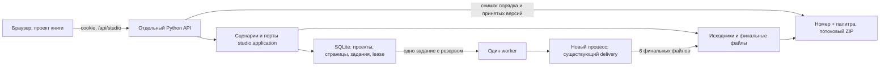

# Архитектура проектов раскрасок

Основной объект — книга, содержащая упорядоченные страницы. У страницы один исходник,
переопределения настроек и ссылка на принятую версию. Конкретные вычисления записаны в jobs.
Проект имеет постоянный UUID и не зависит от текущего номера страницы.

## Границы

Frontend: `app` связывает routes, `_pages` компонует, `features/studio` координирует действия,
формы и загрузку, `entities/project` читает модели; shared содержит транспорт и shadcn primitives.
Ссылка `/projects/[projectId]` восстанавливает проект после перезагрузки. API и cookie студии
отдельные; существующие бизнес-модули Artmate не импортируются.

`studio.domain` содержит валидацию настроек, площадь, лимиты и ошибки. `studio.application`
содержит сценарии загрузки/удаления и Protocol-порты. Внутренние слои не импортируют SQLite,
HTTP, Pillow и файловые адаптеры. Репозиторий выполняет атомарные изменения вместе с проверкой
инвариантов, которые требуют транзакции: квота, очередь, удаление, принятие и lease.
`api.py` — HTTP/composition root, `worker.py` — жизненный цикл дочернего процесса, `studio/compute.py`
собирает delivery-конвейер. Печатный шаблон и ArialMT сохраняются.

## SQLite v2

- `projects`: name, settings, start_page, version, timestamps, state; TTL отсутствует.
- `pages`: project_id, position, name, source metadata/bytes, overrides, selected_job_id;
  состояния uploading/ready/deleting, готовые исходники бессрочны.
- `jobs`: page_id, неизменяемые параметры запуска, stage, status, attempts, reserved/output bytes,
  report, error, timestamps, expires_at. Канонический вывод новых заданий использует номер 1.
- `downloads`: lease проекта/страницы/задания с TTL 300 секунд; архив продлевает lease.
- `worker_status`: heartbeat. Схема имеет PRAGMA user_version=2.

`schema.py` транзакционно переносит прежние одиночные проекты в книги с одной страницей.
UUID страниц равны прежним UUID исходников, файлы не копируются. На диске сохраняется стабильный
адрес `projects/<page-id>/source` и `projects/<page-id>/jobs/<job-id>/*`; это каталог ресурса,
а не отражение состава книги. Перемещение страницы в порядке не меняет путь к исходнику.
Миграция односторонняя, старые HTTP-контракты одиночных проектов удалены.

Настройки страницы = общие настройки проекта + её overrides. Очередь хранит снимок настроек
на момент запуска, поэтому правки во время расчёта не изменяют уже выполняющийся алгоритм.
Поле outdated сравнивает текущие параметры с готовыми версиями, игнорируя номер страницы.
Порядок и общие настройки используют version для обнаружения конкурентного редактирования.

## Очередь и принятие

Проект можно поставить целиком (до 100 страниц). Очередь до 500 заданий содержит ссылки,
а не копии исходников и не резервы всех максимальных результатов. Claim в BEGIN IMMEDIATE
разрешает только один running и резервирует 100 МиБ. При нехватке диска задания остаются
queued; статус usage сообщает storage_blocked. Освобождение места позволяет продолжить.
Завершение заменяет резерв фактическим размером. Пакет из 25 обычных страниц помещается
в квоту исходя из реального объёма, а не 25 максимальных резервов.

Первый успех страницы становится принятой бессрочной версией автоматически. Новые результаты
имеют TTL и требуют принятия; старый выбранный результат сохраняется до замены. Принять можно
одну страницу или последние готовые версии всей книги. Повторный обычный запуск пропускает
уже актуальные/активные страницы; force создаёт новые версии. Ошибка не блокирует другие страницы.

Worker удерживает flock, создаёт отдельный процесс на страницу, ограничивает время и завершает
группу процесса при отмене. Child watchdog завершает процесс после потери parent. После аварии
running возвращается в очередь один раз, частичные файлы удаляются до повторного запуска.
После второй аварии задание становится failed, очередь продолжается. SIGTERM останавливает
текущую задачу; queued сохраняются в SQLite. Секреты не передаются вычислительному процессу.

GC очищает временные результаты, просроченные незавершённые загрузки и tombstones между
заданиями. Готовые проекты/страницы/выбранные результаты по возрасту не удаляются. Удаление
защищено проверкой активных заданий, загрузок и lease. Квоты не включают БД/WAL и логи;
лимиты контейнеров и вращение журналов описаны в README.

## Экспорт и оформление

`BookExporter` читает принятую версию, сохраняет artwork и заменяет только palette/page-number
с помощью исходных layout-адаптеров и шрифта. Если номер совпадает, SVG/PNG отдаются побайтово
как сохранены. Для нового номера PNG растеризуется из обновлённого SVG; повторной сегментации,
построения границ и размещения обозначений нет. Изменённые печатные файлы не кэшируются на диске.

Архив получает атомарный снимок порядка и принятых job_id и lease на весь проект. Требуется
результат каждой страницы: частичная книга не маскируется под полный экспорт. Каждый файл
обрабатывается отдельно, ZIP передаётся по 64 КиБ, целая книга в RAM/на диске не собирается.
Индивидуальный SVG может быть временной версией, общий экспорт использует принятые.

## HTTP

Все ресурсы требуют cookie студии. Публичны только /health и вход/проверка сессии.
Origin, лимиты тела/времени, PBKDF2/HMAC cookie и правила no-store сохранены.

| Endpoint | Действие |
| --- | --- |
| GET/POST /api/studio/projects | Список / новая книга с name, settings, start_page |
| GET/PATCH/DELETE /api/studio/projects/{id} | Книга с pages / параметры / удаление |
| POST /api/studio/projects/{id}/pages | Raw image, query name |
| PUT /api/studio/projects/{id}/order | page_ids и version |
| POST /api/studio/projects/{id}/generate | Все нужные страницы; force для пересчёта |
| POST /api/studio/projects/{id}/cancel | Остановить очередь книги |
| POST /api/studio/projects/{id}/accept | Принять готовые версии |
| GET /api/studio/projects/{id}/archive | variant=outline/colored, file_type=svg/png |
| PATCH/DELETE /api/studio/pages/{id} | name/overrides / удаление |
| GET /api/studio/pages/{id}/source | Исходник |
| POST /api/studio/pages/{id}/generate | Пересчёт страницы |
| POST /api/studio/pages/{id}/accept | Принять последнюю готовую версию |
| GET /api/studio/pages/{id}/files/{name} | SVG/PNG, job_id для временной версии |
| GET /api/studio/jobs/{id} | Статус |
| POST /api/studio/jobs/{id}/cancel | Отмена задания |
| GET /api/studio/usage | Диск, очередь, heartbeat, лимиты |
| GET/POST/DELETE /api/studio/session | Сессия, вход, выход |

Один приватный workspace и один хост. Раздельные пользователи, PDF-книги, редактирование кривых
и billing находятся за пределами этого этапа. Настройки studio.artmate.ru подготовлены в
репозитории; локальные изменения сами по себе не меняют DNS и не выполняют deploy.

## Защищённые детали

`details.domain` описывает физические ограничения и карту отобранных деталей. Численные
операции находятся в `details.adapters.detector`; экземпляр внедряется в delivery processor
через composition root. Detector читает исходный RGB до bilateral/k-means. `DetailMap` передаёт
маску отдельных штрихов, их устойчивый цвет и редкие акценты в адаптер упрощения.

`SimplifiedImage.prefilled_mask` → `RegionInput.prefilled_mask` → `Region.prefilled` →
`GeometryResult.prefilled_ids` → `Cell.prefilled`. Флаг проходит через raster → cubic mesh →
subdivision → numbering. Слияния исключают защищённые вершины графа. Изолированные крошечные
промежутки внутри готовых деталей печатаются без символа. Все проверки покрытия/площади/топологии
остаются общими, пользовательский минимум применяется только к незакрашенным граням.

Сглаживание общей границы с готовой деталью ограничено более строгим допуском. Разбиение и
нумерация используют ту же сетку с отверстиями; защищённую грань нельзя использовать как
соседа для исправления тесной области. NumberingResult проверяет сохранение её происхождения
и цвета. SVG хранит готовые грани в `g#prefilled-details` внутри `g#artwork`; печатный контроль
сверяет точные paths и заливки. BookExporter сохраняет этот слой при перенумерации.

`numbering.contours.visible_contour_edges` задаёт общую политику для SVG и печатной
проверки: все границы белых областей сохраняются, в том числе у готовых бликов внутри
цветных деталей. Швы между соприкасающимися белыми фрагментами одинакового цвета
не печатаются; естественные границы разных светлых оттенков сохраняются. Цветные
готовые штрихи обходятся без собственной серой обводки.
Группа заливок идёт до контуров, поэтому белая заливка не перекрывает свою границу.
Это правило отображения: сетка, число областей, запрет дробить белое и номера не меняются.

Версия алгоритма объявлена во внутреннем delivery.domain. Репозиторий сравнивает её с
report завершённого задания, чтобы новый обычный запуск не пропускал результат старого
алгоритма. Accepted job не заменяется до пользовательского принятия новой версии.

## Локальное распознавание черт лица

`details.adapters.strokes.stroke_candidates` дополняет контрастный детектор до
сокращения палитры. Двусторонний поперечный контраст выделяет тонкие тёмные линии на
разноцветном фоне; ограничения длины, площади, толщины и соседства с широкими тёмными
пятнами отсекают неподходящие компоненты. Диагональные пиксели соединяются только при
наличии исходного контрастного свидетельства, остатки после перекрытия проходят
`printable_pixels`. Отдельных масок, файлов или raster-overlay в delivery не добавляется.

Сначала отбираются прежние компактные/модельные кандидаты, затем штрихи в пределах
того же бюджета. Резерв акцентных цветов вычисляется до добавления штрихов, чтобы они
не меняли палитру соседних предметов. Принятый длинный штрих может уточнить цвет обычного тёмного фрагмента,
если перекрывает не менее двух третей его пикселей; белые и модельные детали исключены.
Остальная обработка использует прежний `DetailMap` → `prefilled` → общую геометрию.
Цвет ядра дополнительного штриха проверяется в CIELAB: насыщенные ядра с L > 20 и
chroma > 30 остаются обычными цветовыми областями. Это снижает риск ошибочной защиты
цветных контуров, замыкающих узкие области без места для номера.
Версии `thin-strokes-v5` и `coloring-delivery-v8-strokes` отличают эти результаты от старых.

```mermaid
flowchart LR
  Original["Подготовленный RGB до сокращения палитры"] --> Locator["FaceLocator: порт определения зон"]
  Locator -->|"RGB через stdin, без файлов и секретов"| Child["Короткий CPU-процесс: готовые YOLOv3 + HRNetV2"]
  Child -->|"До 8 лиц, координаты и оценки через stdout"| Validate["Проверка отдельных глаз, носа и рта"]
  Validate -->|"Только принятые зоны"| Details["Контраст + приоритет деталей лица"]
  Details -->|"DetailMap: общие лимиты, готовые грани"| Mesh["Прежняя векторизация и печатные проверки"]
```

`details.application.FaceLocator` описывает порт, `details.domain` содержит `FaceAnalysis`
и `FeatureHint` без библиотек обработки. Адаптер `LocalFaceLocator` управляет процессом;
`details.infer` — его composition root. Готовые веса проверяются по манифесту и SHA-256,
сеть при инференсе не нужна. Секреты не наследуются, модель завершает работу при исчезновении
родителя. Векторизация начинается после её выхода и освобождения памяти.

`FaceAwareDetailDetector` передаёт подсказки обычному `ContrastDetailDetector`. Пустые
или отклонённые подсказки не меняют маску и палитру. Уверенность оценивается для каждой
черты отдельно: прямоугольник лица с сомнительными ориентирами не защищает произвольную
часть картинки. Готовыми становятся только найденные в исходнике штрихи в пределах
общих лимитов площади и количества; координаты модели сами не превращаются в контур.

`ComputedPage` несёт компактные данные для `face_protection` в финальном отчёте. Новый
алгоритм создаёт обычные временные версии, прежний принятый результат не заменяется.
Модель и runtime закреплены в requirements/манифесте; смена модели или политики требует
новой версии алгоритма. Обучение и накопление тренировочных картинок не выполняются.

## Профили, пропущенные в исходном ракурсе

`details.adapters.views.predict_faces` оставляет исходное распознавание неизменным,
если оно нашло лицо. В остальных случаях YOLO проверяет повороты ±30°, ±45° и ±60°.
Пустое поле вокруг повёрнутого изображения не отражает исходник. Кандидаты за пределами
исходника отбрасываются; лицо требует согласия разных поворотов (IoU ≥ 0.55), оценки
лучшего обнаружения ≥ 0.95 и прошедшего обычную проверку ориентира носа. Для такого
профиля усреднение зеркальных ориентиров отключено: оно смешивает видимые и скрытые
черты. Результат ограничен восемью лицами и прежним таймаутом CPU-процесса.

В IPC передаются исходные координаты четырёхугольника и свидетельства подтверждения.
`analyze_faces` проверяет их и создаёт `ProfileRegion` внутри `FaceAnalysis`.
`details.adapters.profile_colors` группирует Lab-цвета локального участка с собственным
RNG, проверяет контраст и физическую толщину отдельных компонентов. Компоненты,
обрезанные границей зоны, и фрагменты меньше 0.35 мм² отбрасываются. После пересечения
с уже выбранными масками отдельно удаляются непечатные несвязные остатки. Их цвета берутся
из исходного RGB, а не из предсказаний модели. Кандидаты проходят общий отбор detector
по лимитам 80 деталей / 0.8% изображения и обычную векторную сетку.

Базовые подсказки ориентиров не расширяются до всего прямоугольника лица. Неподтверждённый
прямоугольник не создаёт `ProfileRegion`. Печатные проверки контролируют геометрию и
обозначения; наличие узнаваемых глаза и рта дополнительно проверяется визуально.

## Сглаживание при геометрическом конфликте

Первое приближение общих границ сохраняется. Если оно нарушает допуск или топологию,
промежуточные попытки ограничивают суммарное смещение каждой точки относительно
исходника (до 0.4 пикселя и половины допуска), сохраняя повторные проходы сглаживания.
Ограничение длины скругления также не даёт срезать острые концы длинных сегментов.
Так одиночный выступ не вынуждает возвращать всю границу к пиксельным ступенькам.
Последняя консервативная попытка и проверки пересечений, покрытия, числа граней и
аналитических площадей сохранены. Очень тесные границы всё ещё могут потребовать
минимального сглаживания.
